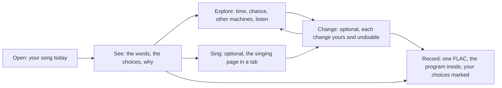
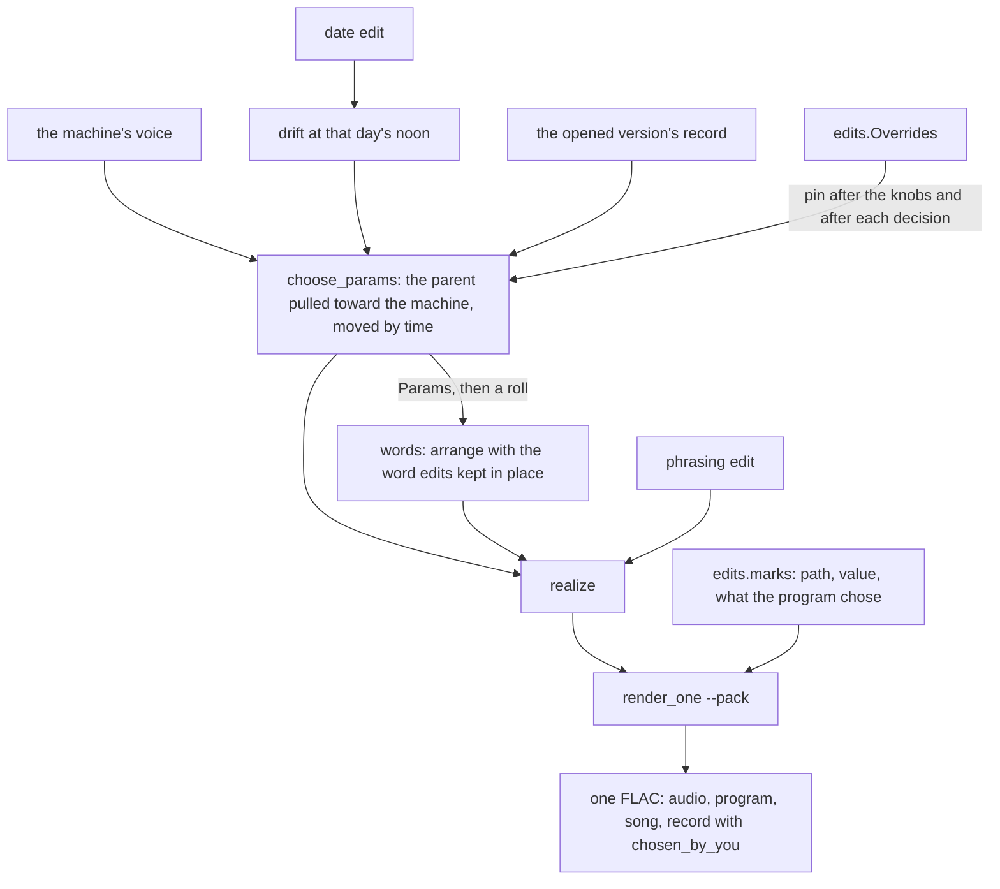

# The studio (2026-09-27)

The artist: "…for the final deliverable tool to allow the user to explore the
procedural generation and optionally edit the song before recording."

`songbird studio` opens a page on this computer that shows *your song today*:
the version this machine would sing now, from the rendition it was opened on
(or from the song as it began). The page shows every choice the program made
and why, lets you move through time, roll chance again and hear other
machines, lets you change what you like (each change marked as yours and
undoable), sends you to sing it if the program has its singing page, and
records the finished rendition: one FLAC carrying the program, the song and
its record, your choices marked as yours.

It is a local web page served by the standard library's `http.server` on
127.0.0.1, with plain HTML, CSS and JavaScript (songbird/studio/)
and nothing fetched from anywhere else: system fonts, no libraries, no build
step, only the program's own runtime dependencies. So it runs from a seed
packet's own program, offline. Nobody editing anything changes nothing about
how a song is made: the studio's version of today is `songbird render
--date <today>`'s, byte for byte.

## Running it

From a checkout:

    uv run songbird studio                                   # the lead song, from the song as it began
    uv run songbird studio renders/some-version.flac         # a child of that rendition (a packet, or a FLAC with its record)
    uv run songbird studio --machine fictional:ada --port 8766 --out renders/ --no-open

From a rendition (docs/PACKET.md):

    python3 now-its-by-you.flac studio

The file's bootstrap unpacks its program and runs `songbird studio --packet
FILE` with it, so the studio opens on the rendition the packet came from and
records its child. `--packet` (or the positional parent) takes any packet;
the studio reads its record with `pack.read_record` and its song from the
`genome.json` inside it. With no parent at all it looks for an unpacked
packet beside the program, else (in a checkout) the lead song. `--machine`
is the command line's (here, none, fictional:NAME, a voice file or a
record), default here; `--out` where recordings go (default `renders/` in a
checkout, the current folder from a packet); `--port` 8766 or the next free
one. It prints the address and opens it in the default browser.

The page opens someone's version too (2026-09-29): a rendition's .flac
dropped anywhere on it, or chosen under Other versions, "Open someone's
version". The studio reads it as data (never running the program it carries,
in a process of its own), keeps its record and song, and the page moves to
`/v/<id>`, the studio on that version as the parent, as if it had been
given on the command line. docs/WEB-STUDIO.md, "Opening someone's version",
has the design, the threat model and the limits.

## How it looks: a page from a copied tune book

The artist: "how can an app feel more like a folk song or something passed
down? I don't want to go overboard with this."

**Direction.** The studio is a page from a tune book that has been copied by
hand, person to person: the song set in a book face on warm paper, written in
one ink by the hand that copied it, with *your* changes in a second ink, as a
later hand annotates a copy it was given. Nothing is drawn to look old; it
borrows the conventions that make such a page readable, not its wear.

- **Paper and ink.** Warm off-white paper and a brown-black ink, instead of a
  green app palette. In the dark, the same page by lamplight: dark paper,
  cream ink. Every colour is a token; nothing else changes between the two.
- **A second hand.** Everything a person chose is in a blue-black ink (it was
  already its own colour; now it has a reason): the words they picked, the
  cards they changed, the notes they moved.
- **Rubrics.** Section names (Verse 1, Refrain 2) in small capitals, in the
  red a copyist used for headings, as hymnals and tune books still do. The
  same red marks the playhead.
- **Set like a songbook.** The words are the page: book face, generous
  leading, a copybook's single margin rule down their left. Controls stay in
  the system's sans at a readable size; only reading text is serif.
- **Broadside rules.** The header ends in a thin-and-thick double rule, as a
  ballad sheet's title does; the player sits under one. Buttons are small
  squared blocks (a letterpress's), not pills; cards are index cards with a
  ruled heading, as a field recordist's.
- **The line it came down.** Beside the version's name, a small row of
  marks, one for each version before this one and a filled one for this, so
  "passed down" is something seen.

**Not done, on purpose:** no textures, images, downloaded fonts, blackletter,
torn edges or stains (kitsch, weight, and worse to read); no change to what is
where. System fonts and CSS only (the program aims at 8 MiB). Contrast stays at
least 4.5:1 for text in both schemes, and phones keep the same layout rules.

## The flow



Every step but the first is optional: opening the studio and pressing Record
records what `songbird render --parent THE_PACKET --machine here --date
<today> --pack` would.

## The musical workbench

Since 2026-09-30 the studio's page is **the score** (docs/STUDIO-REDESIGN.md, and its "Built" section): one
transport, three views (Page, Arrange, Mix), one inspector for whatever is selected, *Tools* for taking it out
and bringing it in, and *Time* as a drawer. What follows describes the page it replaced, kept at `/classic`
until the artist signs the score off; both pages share studio.js, so the edits, history, drafts, listening
and recording below are the score's too.

The first screen holds only what matters most: **Hear the song**, a few simple
changes (key, scale, tempo, a new performance), undo and redo, **Record it**
(or **Sing or record**, where the singing page exists), and **Help**. Everything
else is a step deeper, in four areas under them, opening on the words: **Words**,
**Tune** (the arrangement and melody editor, called Arrange in the code and in
links), **Sound** and **Other versions** (time and other computers). The bottom
player always plays and records. **Sing, record & pass it on**, at the foot,
holds singing, recording and saving the changes as a draft file.

Help is there when asked for and quiet otherwise (the artist: "Labeling
everything makes it busy and confusing"):

- a **?** beside each area (and beside the line saying which version this
  is) opens two or three sentences on what it is; the longer notes that used
  to sit under the controls (how the sketch differs from the sung preview,
  the keyboard for notes, what mute and solo do, how a style moves) live
  there, or in each card's *How this choice works*;
- the **Help** button (or the ? key) opens the whole studio in plain words,
  with **Show me around**;
- a first visit is walked through four steps, each pointing at one thing:
  hear it, change something simple, go deeper, record it. It is shown once
  per browser (and never on a link into a particular view), and Skip or Esc
  ends it. songbird/studio/help.js has both.

### Tune (Arrange)

A full-song overview shows every section, in proportion to its musical length.
Select one to open it; the scrollable detail strip underneath shows its miniature
melody and bar position. Drag sections to rearrange them, or use Earlier/Later.
The backend checks the arrangement before accepting it. Repeated verses and
refrains retain their story order: their chronological and canonical lyric rules
still matter. They can move around other kinds of section. This is a musical
arrangement, not arbitrary audio clips.

Every section opens a phrase strip and a scale-based piano roll. Each note carries
its sung syllable. Drag up/down for pitch, left/right for timing, or drag the right
edge for length. Select a note for precise pitch, start and duration controls.
Arrow keys nudge notes; Shift+Left/Right changes duration. Snap and zoom adjust the
editing grid. The harmony lane shows the chords beneath the tune. A shared phrase
edit updates every appearance, including instrumental echoes; the interface shows
how many places share it.

Notes retain their syllable count and order (a syllable may be sung over up to
four notes, a melisma), stay within the song's range (three steps past its own),
keep space before the following phrase's pickup, and keep the ending's scale-degree
class unless the person frees it ("Looser harmony and melody", below). Validation rejects overlaps, non-finite values, excessive leaps and notes
outside the phrase. **Step**, **Soften leaps**, and **Even rhythm** offer small,
undoable compositional transformations. **Restore phrase/order** removes the local
override and returns to the version inherited by this studio: a released order gives
the form back to the machine, which chooses it from the parent's as it would with no
order (with no machine, the parent's form stays; never the seed's in its place).

**Play sketch** auditions a phrase, section or whole song immediately through a
few Web Audio oscillators: the tune, and under it its chords (a soft strum on
each beat, the triad between G3 and F♯4) and a bass (each chord's bass note on
its first beat, its fifth halfway through a four-beat chord), with **Chords**
and **Bass** to leave either out. It reads the page's own score (each tune line's
`harmony`, from `composition.view`: every chord where the band lays it, its
name and pitch classes, bass first), so a key, mode, tempo or chord change is
heard as soon as the page has it, with no render. Loop and click provide
practice tools; the playhead follows the score. It is a sketch: no swing, no
style, no singer. Its players, and the band's parts, can go to a musician's own
instruments over MIDI ("Learning it at the piano, and the sketch's players" below). **Hear sung section** and **Hear the
song** use the real singer, phrasing, arrangement and mix, rendering locally when
needed. The two players stop each other. Existing audio is marked when it belongs
to earlier edits.

### Words

Each section shows the lyrics as sung. Native dropdowns sit directly in the lines
where a singable word can change; the verse, couplet or head has a dropdown beside
its section. Coupled words and refrain trades still follow the bank's rules. The
rules, unavailable alternatives and valid placements are folded underneath each
section. Options are loaded automatically and stale replies never replace newer
choices.

**Write your own lines** opens an original-lyrics editor in each sung section.
Each line displays its syllable target and a live count. Words with more than one
syllable are written with syllable hyphens (`car-ry`). **Use these lines** checks the
count and the singer's pronunciation before changing the song, as one undoable
transaction. Unsupported words and mismatched counts receive an explanation;
unapplied typing stays in place while choices refresh. The writer is responsible
for the meaning and rhyme. **Use the song's line** releases authored text, including
text inherited from a parent recording.

Authored text belongs to the words it replaces rather than to every use of its
tune or to a place in the form: a verse's lines to that verse (`verse:wire`, or
`verse:seed2` in a song without a bank), a refrain's, bridge's or tag's to its time
round (`refrain:0`, `bridge2:0`; the last refrain is `refrain:last`, which the
bank always sings the same way). It follows that section through arrangement
moves. The bank continues evolving underneath it: a later version that still
sings the verse sings the line in it, wherever it now comes; one that no longer
sings it doesn't sing the line. Restoring a bank line reveals the current
procedural words. Original lines travel in compact composition data (`lines`),
and the exported lyric sheet is taken from the actual sung score. A recording
made before lines were kept this way kept them by place (`lyrics`); it still sings
them there, and its next version takes them by the verses it sang.

### Sound

Cards expose the style, form, players, room, vocal presence and other choices.
Reasons and provenance are folded away. Every band player has a gain control
(0–200%), a mute that remembers its previous level, and a solo control that restores
the previous band mix when released. Solo leaves the singer audible. A solo or a
batch of mix changes is one undoable edit. A new style brings its own instruments,
pace, feel and arrangement options.

### Other versions (Explore)

The existing six-year timeline, day/month/year controls, and other-machine
comparison live here. Your explicit edits remain in place while the machine and
time change the rest of the song. The same fictional machine name always produces
the same machine.

### Drafts, history and recording

Edits save in browser storage on this device, under the song genome's fingerprint as
a draft is, so a changed song file doesn't bring back tune or lyric edits made for the
old one (edits saved before the fingerprint was part of the key keep only the choices
any genome takes: key, tempo, shape, band, mix, style). Date and chance are deliberately not
retained across reloads, so tomorrow opens on tomorrow. Undo/redo covers note drags,
word changes, arrangements and mixer actions (100 steps during the current visit).
Cmd/Ctrl+Z works outside text fields; text fields keep their own editing history.

**Save your changes as a file** (a draft, under Sing, record & pass it on) downloads a small `.songbird.json` file with the song's fingerprint
and edit map. **Open a saved file** validates the file and its edits before replacing the
current draft; opening is itself undoable. Drafts contain no audio or software,
and belong to the exact song genome they were written for. They are useful for
saving alternatives while the finished FLAC remains the complete portable artifact.

**Record it** uses the normal renderer and marks every chosen value. The finished
FLAC carries the program, song, composition, lyrics and record. Opening it in the
studio makes the next generation from those choices. No browser libraries, sample
packs, build tools or external services are required by the editor.

## How edits flow

An edit is one entry in a flat map from a path to a value: what the person
chose, on top of what the program chose. The page holds the map (and its
browser storage keeps it across a reload, all but the day and chance drawn
again, so tomorrow opens on tomorrow) and sends it with every request; the
server keeps nothing else but caches, so any request can be replayed.

| Path | Value | Acts on |
|---|---|---|
| `form.order` | section occurrence IDs (`verse:0`, `refrain:0`, …) | validated arrangement order, inherited in children |
| `tune.<phrase>` | `{degree, onset, duration}` for each note, in beats | pitch/rhythm of every appearance of that phrase |
| `chords.<phrase>` | a list of chords a bar (`[["vi"], ["IV/3", "Vsus4"]]`), or null for the song's own | the harmony of every appearance of that phrase: the band, the choir, the backing voices ("Changing the chords") |
| `part.<player>.<section>:<n>.<line>` | `[[onset, length, pitch, velocity], ...]`, whole numbers (96ths of a beat, semitones from the key's note), `[]` to rest, or null for the program's own | one player's notes in one line of one place in the form, played in or brought back from a MIDI file ("Notes in") |
| `lyrics.<section>:<verse-or-round>.<line-index>` | syllable-hyphenated text, or null to release inherited text | one original lyric line (`lyrics.verse:wire.0`, `lyrics.refrain:last.2`), checked against its tune; kept only where this version sings that verse or round |
| `date` | "YYYY-MM-DD" | the moment time is read at: noon UTC that day, as `--date` |
| `roll` | 1, 2, 3... | chance drawn again: the day's own seed drawn again that many times (`edits.rolled`), so chance still follows the day |
| `tonic`, `mode`, `tempo` | a MIDI note, a mode, beats a minute | `Params` |
| `form.verses`, `form.pairs`, `form.intro`, `form.turn`, `form.break`, `form.tag`, `form.outro`, `form.bridge2` | a count; on or off | `Params.form`: the program's shape with just these parts changed |
| `band.pattern`, `band.lead`, `band.density`, `band.brightness`, `band.<instrument>` | as `Band`; an instrument's gain (0 sits it out) | `Params.band` |
| `mix.space`, `mix.width`, `mix.forward`, `mix.intimacy`, `mix.rt60`, `mix.predelay` | as `MixParams` (the room: how long it rings, 0.3 to 2.5 s; how soon it answers, 5 to 80 ms) | `Params.mix` |
| `variants.<name>` | as the variant takes | `Params.variants`, once it exists (said refused until then) |
| `words.verse.<i>` | `{"id": verse, "slots": {slot: words}}` | the i-th verse section's verse (from 0) |
| `words.refrain.<i>` | `{"id": couplet, "head": head, "slots": {slot: words}}`, any of the three, or just a couplet | the i-th refrain's own words: its couplet (never the last's), its head (between the first and last), its words (the question too, between them) |
| `words.refrain` | `{slot: words}` | words for every refrain whose head sings them ("while"), unless one chooses its own; the question and "then" are each refrain's own |
| `words.bridge` | `{slot: words}` | the bridge's once-a-song words |
| `words.bridge2`, `words.tag` | a stanza, a syllable | the second bridge, every tag |
| `phrasing` | a phrasing's name on this computer | whose way it is sung |
| `arrange.<section>:<n>.<player>.level`, `.pattern`, `.from`, `.fill`; `arrange.<section>:<n>.bars`, `.sung`, `.build` | out, soft, plays, hard; a pattern; a line; a fill; 2 to 16 bars; played; a build | the arrangement taken over, by place ("Arrangement control", below; docs/ARRANGE.md) |
| `style.intro`, `style.stops`, `style.alone`, `style.alone_with`, `style.bridge` (and `style.entrances`, `style.breakdown`, `style.lift`, `style.ending`, `style.backing`) | as `Style` | the style's options, chosen whole |
| `sound.<player>.patch`, `.cutoff`, `.resonance`, `.envelope` | a patch's name; Hz, 0-1, octaves | a synth's sound and its filter ("Sound design", below) |
| `sound.<player>.kit`, `.kick`, `.snare`, `.hat` | `808`, `909`, `lofi`, `acoustic`; `{tune, decay, snappy}` | a drum player's kit and its pieces' character |
| `mix.<player>.pan`, `.send`, `.sidechain` | -1 to 1; 0 to 3 times; a preset or `{depth, release, key, sections}` | the player's channel: its place, its send to the room, its pump on the kick or the beat |
| `transition.<section-id>` | `{riser, roll, sweep, stop, impact, down}` | what happens at the boundary into that section |

Each part of the shape is its own edit, so "no intro" holds while the day
moves the rest of the shape. The edits go in inside the program's table, not
after it, so a decision that reads one reads the person's: a chosen minor
mode leans the words darker, as the machine's own minor would (and the words
card says so). That is the only such knock-on so far; `songbird/edits.py`
lists them.



In code, all additive (a call without edits is the call as it was, and the
seed render and the word draw are unchanged, byte for byte):

- `songbird/edits.py` (new) is the override interface: `check()` holds each
  value to its bounds or says why not; `Overrides` puts them in place inside
  the table and draws chance again; `resolve()` makes the whole rendition with
  a person's edits (parameters, then the words, each chosen word kept only if
  the rules can keep it beside the ones before it), with `applied`,
  `problems` and `marks`; `pins()` turns word edits into arrange's choices;
  `shape()`, `build()`, `reshape()` and `shapes()` read a form as its parts,
  build it back and say which part changes can be sung; `marks()` makes the
  record's block, `from_record()` turns it back into edits; `keep_words()`.
- `realize.choose_params(..., overrides=None)`, and `variation.choose(...,
  pin=None, trace=None)`: the pin is called after the knobs and after each
  decision; the trace receives each knob's arithmetic.
- `arrange.arrange(..., chosen=None)`, `arrange.keep()` (a person's words kept
  in place, the rest drawn around them), `arrange.problem(genome, form,
  chosen=None)` (why a form or a choice can't be sung), `arrange.options()`
  (every choice for one section, allowed or refused with why, and where else a
  refused verse could go); `_VerseRules.why()` and `pinned()` say which rule.
- `cli.render_one(..., chosen_by_you=None, progress=None)`; `songbird render
  --edits FILE` (today's version with those choices: an edits file, or a
  record whose marks are made again) and `--replay RECORD` (a rendition again
  exactly as its record says: its parameters and the words it recorded, from a
  packet or a record; a person's phrasing given again with `--phrasing`).
- `synth.render(..., progress=None)`: told which part it is making, for the
  progress bar.
- `songbird/explain.py` (new) says each choice in plain words, with its
  reasons, draws the timeline and compares machines; `songbird/studio.py`
  (new) is the server; `songbird/studio/` the page.

### Why a choice was made

- **A number** the table works out (tempo, the key's note, the band's density
  and brightness, the mix, the words' era and appetite for rare verses, the
  singer's day) is traced as it is made: what it was in the parent, how far
  the machine pulled it and how far time moved it (the child hears 0.6 of
  each). Each is said, with its direction, only when it is big enough to hear
  (a beat a minute, half a semitone, 4% of a range); when they pull opposite
  ways and cancel, the card says "so in the end it is about as it was"; when
  neither is heard, "kept from the version before".
- **A choice among a few** (the mode, the shape, the band's pattern and lead,
  the room) is asked again without time (every dimension of the drift at
  zero, and no past to read) and without the machine (one with no signals, at
  the same moment): what changes when the machine is taken away is its doing,
  what changes when time stands still is time's. The words' mood is said from
  what leans it: the screen's brightness and warmth, a minor key, these weeks.
- The words and every small detail of the sound are **chance**; anything
  changed is **yours**, with what the program chose; a value the version
  before kept from a person says "kept from the version before, where a person
  chose it".

The page never says genome, drift, harvest, knob, params or seed
(tests/test_studio.py checks every text it shows). It says the song, the song
as it began, the version before, your machine, time (today, these weeks, this
season, this year), chance and you.

## Listening

A preview is a section (or the whole song) made when asked. A section is cut
from the whole rendition's score by what is sounding: the notes from a breath
before its first pickup (a beat of the band before it at least) to where the
next section's pickup begins, an instrument's note already ringing brought in
a second early so it has settled, and no sung syllable from before it (none is
begun halfway). It is made,
brought up by the gain mastering gives a whole rendition (5.3 dB, measured on
H: 5.1 to 5.4) under the same ceiling, so a quiet verse stays quiet and a turn
isn't pushed to the loudness of a refrain, and faded in and out. A section of
H takes a second or two, the whole song about fifteen seconds on this Mac (the band, the choir and the vocoder now run on threads; docs/PERFORMANCE.md). The page calls it a
preview: a part heard alone is not the record's exact samples, and the mix's
balance is judged on the whole song.

One renderer works at a time: recordings first, then the newest preview (a
preview still waiting is dropped when another is asked for). Every render is
cached by what it depends on (the parameters, the words, the phrasing, the
section, the program's version) under `~/.songbird/studio/` (or
$SONGBIRD_HOME), kept under 300 MB, least recently heard going first. The
whole song's preview is the recording itself, so Record after Hear it all
only copies it.

## Singing

In a checkout, *Sing it* starts the singing page (`tools/karaoke.py`, reused,
not copied) on 127.0.0.1:8765 for the same song, if it isn't running there
already (it checks the song's title), opens it in a new tab, and stops it when
the studio stops. Back in the studio, the singer's card offers the phrasings
made on this computer: each person who kept takes of this song, and everyone's
together; never the reference voices. The singing page's own "hear the
machine" sings the song as it began, not the studio's version: the studio's
preview is where to hear your version sung your way. A packet's program has
no singing page yet (songbird.quadule.com will take takes online), and the
card says so.

Started with `--web-singing` (a checkout, with the singing kit), the studio
takes singing on its own page instead, for the web studio: the visitor sings
to the guide in the browser, the take is measured on the server and its audio
deleted there, and the singer's card offers *your way*. docs/WEB-SINGING.md.

## Recording

*Record it* renders the whole rendition as `songbird render --pack` does
(`cli.render_one`, as the child of the version opened) and writes one file:
`<song>.<day>.<first six of its id>.flac`, into `renders/` from a checkout or
the current folder from a packet. It plays anywhere, and carries the program,
the song, the words and its record, whose `params` are what was sung (a
person's choices among them) and whose `chosen_by_you` marks, for each edit
that took effect, the value chosen and what the program had chosen:

```json
"chosen_by_you": {
  "date": {"value": "2027-09-26", "was": "the day it was made"},
  "mode": {"value": "aeolian", "was": "ionian"},
  "words.verse.1": {"value": {"id": "ink", "slots": {...}}, "was": {"id": "mind", "slots": {...}}}
}
```

A phrasing is marked by what it is, never whose: `{"value": "a person's way",
"detail": "2 sung take(s)", "digest": ...}`. `songbird render --replay
FILE` renders it again byte for byte (tests/test_studio.py does). Run with
Python, the file makes the next version: its children inherit what was sung,
a person's choices among them.

## Taking it into your own tools (2026-09-29)

For a musician who wants to keep going somewhere else: **Take it into your own
tools**, under *Sing, record & pass it on* (and linked from the Tune area), makes
two files of the version on the page, with every change in it:

- **Download MIDI**, at once: a format 1 file (songbird/midi.py, standard library
  only, some 360 lines) made from the very score the render sings
  (realize, `variation.lay`, a style's lift), so it is what is heard. The singer's
  notes with the words as lyric events (`num-` `bers`), each lineage voice, every
  band part on its own track with the nearest General MIDI program (percussion on
  channel 10, its strokes on GM drum keys), and a **Chords** track: each chord
  voiced plainly (its bass below middle C, the triad above), named (`Bm`, `G/B`,
  `Dsus4`) as a text event, a person's own harmony included. The first track has
  the time signature, the key (a mode by its relative major; a style's lift as a
  key change), the sections as markers and the tempo map.
- **Download the parts (stems)**, a render (about as long as the whole song):
  each part rendered alone and dry by `synth.render_stems`, as `songbird render
  --stems` makes them, as 24-bit FLAC, with the MIDI file and a README, zipped.
  One gain for all of them if any would clip, so they keep their balance.

**Time.** The notes keep their performed timing (a phrasing's pushes, swing, the
band's small human timing); the tempo map follows the rendition's clock
(`realize.timeline`) beat by beat, so the final ritardando is tempo changes and a
song re-barred in three (a waltz feel) is written in 3/4 (6/8 for a slow six),
a foot to a bar. Bar 1 is the bar the first pickup sits in, which begins a
little before the audio's first sample (1.6 s for H); the stems are padded by
exactly that, so the stems and the MIDI file dropped at the start of a project
line up. `songbird render --midi` writes the same file beside a render and says
where bar 1 falls against its FLAC.

In a public studio (docs/WEB-STUDIO.md) the MIDI file is made at once, as
here; the stems wait their turn in the one queue, one at a time for each
visitor, and count as a whole song against the visitor's and the address's
hourly limits. Both are served from the previews' cache, streamed, so the
stems' zip (75 MB for H) goes first when the cache is full.

Left as they are: stems are dry (the room, the mix's balance and mastering are
in the recording, so the parts don't sum to it exactly); the MIDI is not
quantized (a musician's sequencer quantizes if wanted, and what is heard is
kept); lyrics are syllables with a trailing hyphen inside words, the karaoke
convention most sequencers read. Changed in a sequencer, the file comes back
in: "Notes in", below.

## Changing the chords (2026-09-29)

A musician's first move with a folk tune is often to reharmonize it. Until now
the harmony lane only showed the chords. This is how a person changes them.

**Where the chords live.** Each tune line (a phrase of the genome) carries its
chords as roman-numeral functions, a bar at a time, the bar's chords sharing it
out on its beats (`I | V I`: a bar of I, then V and I two beats each). Their
quality comes from the mode (vi is minor in major and becomes a major VI in
minor: `theory.chord_tones`); an accidental borrows a major chord (bVII).
`realize` hands the phrases to the band (`band.Context`: every player's chords,
the bass's roots, the guitar's shapes, the harp's spread), the lineage choir's
harmony (`theory.choir_voicing`: each voice takes a tone of the chord under the
note) and the backing voices, so one place feeds everything that sounds.

**What a person may change.** A tune line's chords, bar by bar, with the same
shape the genome has: `chords.<line>` = one list of chords a bar, as many bars
as the line has, and a bar shared evenly on its beats: 1, 2 or 4 chords in 4/4,
1 or 2 in 6/8, 1 or 3 in 3/4 (three in 4/4 would be 1 + 2 + 1 beats as the
band lays them, and the singer's chord under a note is found by an even
split: the two would disagree). A change on a weak beat is written with
repeats (`I I I V`), which the band plays as a new strike of the same chord.
A pickup sings over its line's first chord, as it always has. Each chord is:

- a **root**, as a function of the key: I, bII, II, bIII, III, IV, #IV, V, bVI,
  VI, bVII, VII (so the chords move with a key change, as the song's own do);
- a **quality**: as the key has it (the default, which follows a mode change,
  as the song's own chords do), or major, minor, diminished, augmented, sus2,
  sus4 (kept whatever the mode: a V major in a minor song stays a dominant);
- a **bass**: the root, the third or the fifth (G/B, C/G).

Written as the genome writes chords, extended (`theory.parse_symbol`): `V`,
`Vmaj`, `ivm`, `viidim`, `IVsus4`, `I/3` (first inversion), `V/5`. The
numeral's case never carries a quality (the genome's `v` and `V` are one
function, as before); the quality is a lower-case suffix, so `IM` is refused
rather than read as minor. A plain numeral means exactly what it meant, the
same tones computed the same way, so every song and record reads as before.
Adding a passing chord is splitting a bar (`I` becomes `I I`, then change the
second); taking one away is joining it.

**How it is stored and replayed.** As the tune is: `params.composition["chords"]`
maps a line to its bars, carried in the record's parameters and handed down to
children (a person's chords pass on, like a person's melody). `realize` sings
from the song with those lines' chords in place (`composition.harmonized`: the
very same genome, untouched, when nobody changed one; goldens hold). The record
marks `chords.<line>` with the chords chosen and what the program had
(`edits.marks`); `from_record` makes them edits again; `--replay` renders from
the record's parameters, so byte for byte. A null releases the line's chords,
inherited ones included, to the song's own (as Restore phrase does for a tune).

**Who follows.** Everything that sounds from the chords: every band part, the
lineage choir's harmony and the backing voices (they take its tones), the
sketch, the MIDI file's Chords track and its names. The singer's melody does
not move. An inversion's bass is taken by whatever plays the bass line and
nothing else (`band.Context.bass()`: the bass part's roots and walks, every
style's bass idiom, a pedal, the thumb's bass string, the harp's lowest
string); `pcs()` and `root()` stay the chord's own, root first, so every other
player's sense of root, third and fifth (colour tones, the guitar's "the third
must be there", the drone's fit) is unchanged, and the guitar keeps its open
root-position shape (and the song's capo): the bass carries the inversion.

**The melody against the new chord: allowed, and shown.** A sung note that
isn't a tone of its chord (a rub) is allowed: passing tones, suspensions and
modal rubs are how folk harmony works, and the band already keeps out of the
singer's way (a chord tone held over a passing note; the choir only ever sings
chord tones). The chord card names the sung notes under a chord that aren't
its tones, by the band's own test (pitch class not in the chord), and marks the
chord in the lane where one is a half step from a chord tone (a sharp rub);
selecting it outlines those notes in the roll. Refusing would forbid most
reharmonizations; changing the tune to fit would change what the person didn't
ask to change. What a chord chosen against the tune does to the band, said so
nobody is surprised: the comping holds its last chord tone through each note
that rubs (`held_through`), so a chord fighting the tune gives long holds; the
woven counter-line drops out where its notes stop being chord tones; the
choir's lowest voice seeks the chord's root, not an inversion's bass, and a
sus chord's fourth can sit a minor ninth over a sung third.

**Fenced, and why.**

- *Per tune line, not per place*: a line's chords change everywhere it is sung,
  as its melody does (the arrangement moves sections; a line is the unit the
  song is made of). Since 2026-09-29 a change can also be kept for one place
  (the last refrain's second line, `chords.refrain:last.1`): "Looser harmony
  and melody", below.
- *Triads (and sus) only, for now*: since 2026-09-29 sevenths, sixths and
  added ninths too (`V7`, `iim7`, `IVmaj7`, `Iadd9`...), taught to the guitar,
  the harp, the choir and a style's players: "Looser harmony and melody", below.
- *Changes on beats, a bar shared evenly*: the band lays a bar's chords on its
  beats; half-beat anticipations and a line's length are the tune's.
- *A bass from the chord*: root, third or fifth. A bass that isn't a chord tone
  (IV over a tonic pedal, the other classic folk move, or a walking line's
  passing bass) is out of scope for now.
- *The tune's own evolution reads the song's chords*: the lineage's melodic
  variants (songbird.variants, evolve) are chosen against the chords the song
  was written with (the person's chords never reach choose_params), so a
  reharmonized line can gain a variant note that rubs, shown like any rub.
  Which modes a machine may choose also stays the song's
  (`variation.allowed_modes`); a person's chord with a quality keeps it in any
  mode, one "as the key has it" follows the mode, and the card names each chord
  as the current mode makes it (a plain `vi` a dorian machine chose is shown as
  the diminished chord it has become).
- *No new tune lines, no chords under the quote or a style's amen*: those are
  the song's and the style's.

**The page.** The harmony lane's chords are buttons, named in the key (`Bm`,
`G/B`), laid where the band plays them; a person's (where the line differs
from the song's own) in the second ink, as their notes are. Selecting one
strums it and opens a chord card under the note inspector: the chords in the
key as one-press choices (with their names), then root (each numeral with its
note), quality, bass, the bar's number of chords (to add a passing chord), ♪ to
hear it, and Restore chords (the song's own, inherited ones included). Each
change is one undoable edit, heard at once in Play sketch (the page redraws
from the server in a few milliseconds) and sung with Hear sung section.

**Built as designed, after a Fable review** (read-only, before building),
whose points are in: an inversion's bass through a named `bass()`, not by
reordering the chord's tones (which would have made every player read a C/E as
E minor); the guitar and the capo keep root position; `realize` itself sings
the harmonized song, so the render, the MIDI and the sketch agree; the
harmonized song is made once per set of chords and kept (the per-song caches
key on the object, and a fresh one per request would have grown without end);
qualities lower case and case-sensitive; a bar shared evenly (1, 2 or 4, not
3); the rub test the band's own; the fences said plainly (pickups, a
non-chord bass, sevenths as the next step).

Checked by tests/test_chords.py (the grammar, nothing changed without an edit,
refusals, the band and choir following and the melody not, the bass on an
inversion's note, rubs, marks, replay from the record, a child inheriting, a
release), tests/studio_composer.test.cjs (the card: in the key, root, quality,
bass, split and join, restore, second ink, the rub outlined, the strum) and the
goldens (tests/test_determinism.py, unchanged).

## Learning it at the piano, and the sketch's players on your own instruments (2026-09-29)

Two ways to take the version on the page to a keyboard, neither of which renders anything.

**Learn it at the piano.** In the Tune area (beside *MIDI and the parts*) and under *Take it into your own
tools*. It opens the piano page (docs/PIANO.md: falling notes, the chord above, the words below; speed,
key, hands, loops, wait-for-me, Web MIDI in and out, fitting the song to the player's keyboard) teaching
*your* version: its key, tempo, chords (an inversion and a sus chord named as such), words, form and tune,
a style's band and lift. The page is the very one web/piano/ serves (its files live in
`songbird/studio/piano/`; web/piano/'s are links to them), fed a score the studio lays out at once
(`Studio.piano`, `/api/piano`: `songbird.piano`, the same export tools/piano_score.py writes the release's
score with) and keeps in its cache under the version's key, at `/piano/?score=score/KEY.json`, so the tab
can be reloaded. It opens in a tab of its own; after a change, pressing it again sends that same tab the new
version (where a browser won't open a tab, a link says so). The page's own settings (speed, keyboard,
hands) stay in the browser; a version in another key starts the page's key change again from 0 and refits
the hands. In a public studio it is made at once, like the MIDI file, and held to the requests limit.

**Players: here, on your own instruments (MIDI), or off.** Under the tune editor. Play sketch's players
(the tune, its chords, its bass) and every part of the band (the lineage voices among them) can each play
on this page, go to a channel of a MIDI output (a synth, a sequencer; a virtual port such as the IAC
driver for a DAW on the same computer), or sit out, in time with the sketch, looped with it, at its
tempo. The band's parts come from the studio at once (`Studio.players`, `/api/players`: the score the render
sings, laid out as the MIDI file lays it, `midi.layout`), so the channels and General MIDI programs are the
MIDI file's: a musician whose instruments are set up for the file hears the sketch on the same ones.
Program changes are sent unless unticked; drums go to channel 10. Each note is in beats of the song's grid
(`midi.in_beats` reads the rendition's clock backwards, so the final slowing, a swing and a re-barring come
back to the grid, while the band's small human timing stays), the grid the composition view and the sketch
count, and a note a moment early still starts a playback. "Everyone to MIDI, as the file" sends every
player to its file channel (the sketch's bass to the band's bass channel), "Everyone here", "As at
first" (the sketch's own players here, the band off). The choices are this browser's.

How it keeps time and keeps quiet (songbird/studio/players.js): notes go out 0.2 s ahead, stamped on the MIDI
clock with the page's audio output latency added, so the synth and the page's sound meet; a key sounding
again ends its last note just before; every note-on's note-off is kept until it's sent. Stop sketch (and a
new version, the tab hidden, the page left) ends every note sent, each after its own note-on even if that
was still ahead, then sends all-notes-off and the sustain pedal up on each channel used; **Panic** tells all
16 channels to stop, note by note (for an instrument that ignores all-notes-off). Connect MIDI asks the
browser once; a browser that already allowed it connects by itself. Without Web MIDI (Safari), with it
refused, with no output chosen, or with the output unplugged mid-song, a player set to MIDI plays on the
page instead and nothing breaks. The Chords and Bass ticks still leave those out wherever they'd go.

composer.js only asks players.js where its own players go (the page's chords and bass come from
`backingNotes`, the same notes that go to MIDI) and hands it the rest; without players.js it plays as before.

**Left as they are.** The tune the sketch sends is the grid's (as the sketch plays it), not the singer's
phrased timing: the MIDI file has that. The page plays the band's parts plainly (a pluck, a drum's tap):
MIDI is where they sound as instruments. Web MIDI needs a secure page (https, or this computer), so a studio
shared over plain http on a network plays everything on the page. Sending MIDI *in* (playing along, a
performance) is another piece of work.

Checked by tests/studio_players.test.cjs (when notes go out, across a loop's turns; note-offs at the end,
at a stop with a note-on still ahead, when a key sounds again; program changes; the fallbacks without
Web MIDI, refused, or with the output gone; Panic; the remembered choices), tests/studio_composer.test.cjs
(the sketch hands its players over and doesn't also play one sent away), tests/test_studio_piano.py (the
parts on the MIDI file's channels and programs, on the view's grid; the piano page served and fed; the
public limits) and tests/test_piano_score.py; and in the built-in browser with a stand-in output: the tune,
lute, bass and harp sent in step (the lute's first note 0 ms from the tune's, the bass's 1 ms), every
note-on ended.
## Notes in: playing a part, and bringing a MIDI file back (2026-09-29)

The export sends a version out to a musician's own tools. This is the way back
in: a musician plays a part on their own keyboard along with the sketch, or
brings the MIDI file back from their sequencer after changing it. What comes in
is notes as numbers (when, how long, which, how hard), never a sound; each
change is an edit in the second ink, undoable, recorded and replayed like any
other.

### A part's notes: the new edit

`part.<player>.<section>:<n>.<line>`: the notes one player plays in one line of
one section of the form (`part.fiddle.verse:1.0`: the fiddle in the first line
of the second verse). The value is a list of notes, each four whole numbers:

    [onset, length, pitch, velocity]

onset and length in 96ths of a beat (the composition's beat, the one the tune
editor and the sketch count in), onset from the line's first bar line (back to
its pickup, as the tune's notes may start); pitch in
semitones from the key's note (`params.tonic`), so the part moves with a key
change as the song's own chords do; velocity 1 to 127, as played. `[]` is the
player resting through the line; null gives the line back to the program.
About 16 bytes a note in JSON.

- **By place, a line at a time.** A section is its lines, the whole song every
  line, taken in one undoable step. Unlike a tune line (changed everywhere it
  is sung), a performance belongs to one place: the fiddle's second verse
  isn't its first. The place is the arrangement's own id (`verse:1`, the
  second verse in story order, as `form.order` names it: not a lyric key, whose
  `verse:wire` names the verse's words), which follows the section when the
  order changes. The bars before the song (a count-in, a quoted older song),
  a style's ending bars (an amen, the last line sung again) have no place, and
  can't be played in.
- **What it replaces.** That player's own notes in the line, found where the
  band writes them, in grid units before they are placed in time (so no
  timing wobble moves one across a line's edge): every note it was given from
  the line's pickup to the next line's (a line's notes belong to it as the
  tune's do), left out; and one it began before and still sounding into the
  person's run of lines (a held pad, a ringing harp string, the drone) stops
  where the run begins. `composition.make_room`, called last by
  `band.arrange` and `idioms.arrange_style`. The other players' notes, the
  choir and the mix are as they were (each note's timing is drawn from where
  it is, so nothing else moves).
- **Where it acts.** The person's notes join in `realize`, after the band and
  before the last chord's ring, so the render, a section's preview, the stems,
  the MIDI file and a replay all hear the same notes. A note is placed on the
  rendition's clock beat by beat (the tempo,
  the final ritardando), straight within a beat, as the MIDI file's tempo map
  is: a style's swing is not laid over a person's own timing. It lasts as
  held, but not past the end of the run of lines the person played (where the
  program's part comes back), and the last line's notes ring out with the
  rest. A style's key lift for the last refrain lifts them too. The MIDI
  file's ticks are linear in grid units (`midi.tick_grid`), so a tick read
  back is a grid position exactly, and a part exported and brought back lands
  where it was.
- **What the instrument keeps.** Its sound and its own way of playing a plain
  note: the synth plays the person's notes as it plays the band's unmarked
  ones (no strum direction, slur or cut is invented). An instrument that
  plays one note at a time (the synth's `poly` is false: the fiddle, whistle,
  lute, bass, and some of the styles' players) has each note end where the
  next begins, done once when the edit is checked, so the numbers kept are
  the numbers played.
- **Who can be played.** Every pitched player in this version's band: the
  eight, and a style's (the piano, the organ, a synth bass...). Not the drums
  (their strokes aren't pitches; later), not the lineage voices (they are
  harmony made from the tune and the chords), and not the singer, whose notes
  are the tune (below). A performance for a player this version's band hasn't
  got (a style changed, the player sat out) or for a section this form
  doesn't sing is kept, silent, and said, as a line written for a verse this
  version doesn't sing is.
- **What it doesn't follow.** The chords and the mode: a part played is played
  as it was; a chord changed under it rubs. The key and the tempo it follows.

**Checked** (`composition.check_part`, through `edits.check`), whole, a line
at a time: the player known and pitched; the section in the song, its
occurrence under 48, the line one it has; whole numbers only; each onset
inside the line or its pickup, each length from a 96th to 32 beats; each pitch in the
instrument's range at the song's key, with five semitones either side for the
key moving; velocity 1 to 127; at most 512 notes a line, 32 starting in any
one beat, 10 sounding at once (a one-note player: two starting together is
refused, overlaps trimmed); sorted, exact duplicates dropped. At most 4,096
notes across all of a version's performances (about 70 KB of edits, sent with
every request under the server's 1 MiB; the record carries them once, in its
parameters). A refusal says which note and why.

**Recorded** as the tune is: `params.composition["parts"][player]["verse:1.0"]`,
in the record's parameters, so `--replay` renders from them byte for byte and
children inherit them (a person's part passes on, as their melody does); the
record's `chosen_by_you` marks each by its count (`{"value": {"notes": 8},
"was": "the program's own part"}`: the notes are already in the parameters),
and `from_record` makes the edits again from the parameters. A person's notes
for a place this version doesn't play, or a player its band hasn't got, are
said and put back as the version before had them; ones inherited wait,
silent, for a version that plays them. With no part edits every function
returns what it was given: the goldens hold.

### The tune, played

A take on the singer's line becomes tune edits (`tune.<line>`), never a part:
each note a syllable, so the tune's fences hold. Its pitches are read as
degrees of the key's scale (a note outside the scale is refused: the tune
editor's notes are degrees), its times as beats, and the line goes through
`check_phrase`: the count of syllables, the range, the leaps, the home note,
room before the next pickup. A line that doesn't pass is refused with the
reason ("this line needs 11 notes, one for each syllable"). A note held into
the next ends where it begins (one singer), and one too short for its
syllable is given its quarter beat where there's room. A line is sung
everywhere it comes, so the first place it was played is taken, and a later
place played differently is said.

### Playing a part in (the page)

In the Tune area, under the editor, **Play a part in**: pick a player (or the
tune), how much (this line, this section, the whole song), whether to keep the
timing as played or tidy it to the nearest eighth, sixteenth or eighth-note
triplet, and press Record. A bar of clicks counts in, then the sketch plays the
tune and its chords (not the player being replaced), with a click if wanted,
and the keyboard is listened to through Web MIDI (the browser asks first).
Nothing is recorded but the notes: the key, the moment it went down and up
(the event's own timestamp, moved by the audio's output latency so the note is
where it was heard), and how hard. It stops at the end of the last line (or
at Stop); **Hear it back** plays it over the sketch; **Keep it** sends it to
the server, which checks each line and says what it takes (lines covered where
nothing was played: the player rests there) and what it can't; **Apply** puts
them in as one undoable step, in the second ink, and **Hear sung section**
plays them with the real instrument. *Played in by you* lists each player's
lines, with **give it back**. `songbird/studio/perform.js`, a module of its
own (its one hook in studio.js: the page's render hands it the score): its
capture, timing and quantizing are pure functions, tested with synthetic
events (tests/studio_perform.test.cjs).

### Bringing a MIDI file back

Under *Take it into your own tools*, **Bring a MIDI file back**: a Standard
MIDI File (the one exported, changed in a sequencer). The server:

1. **Reads it defensively** (`midi.parse`, standard library, beside the
   writer): at most 256 KiB (the export of H is 21 KB; sent as base64 in a
   request of at most 1 MiB), 64 tracks, 100,000 events; header, chunk and
   event lengths checked against what is there; a variable-length number at
   most four bytes; running status only after a status; a note-off paired
   with the earliest unended note-on of its channel and key (kept in order,
   never searched: a key struck 40,000 times is read as fast as once); format
   0 (split by channel) or 1 at any division by ticks (SMPTE refused);
   everything in one pass, linear in the file. A file it can't read is
   refused with why, and nothing changes.
2. **Knows the version it came from.** It makes the MIDI file of the version
   on the page again and compares: the section markers (one for each section
   of the form, where it begins), the time signature and the key must match
   (else "it was made from another version of the song: download the MIDI
   again from this version, change that, and bring it back", since the numbers
   would land in the wrong places). A file without markers is read against
   this version's bars, and said.
3. **Matches tracks** by the names the export writes (Voice, Chords, Fiddle,
   Lineage voice 1...); a track it can't name is listed and the page asks
   which part it is (or to leave it). Two tracks of one name: the first.
4. **Compares line by line** against the export, both sides' notes turned into
   the numbers an edit keeps: a line whose notes are the same (pitch exact,
   onset within a 48th of a beat, length within a 24th, velocity within 2) is
   no change, so a file brought back unchanged is no edits at all, even saved
   again at another division with its note-offs as note-ons. A changed line
   becomes:
   - a band track's: a part edit, its notes as they are in the file;
   - the Voice's: a tune edit, each note moved as the file moved it (pitch to
     a degree, onset and length by as much as they moved in beats) from the
     line's written notes, not from the performed timing, then through the
     fences; a note added or taken away is refused with the count;
   - the Chords': chord edits in the grammar (`chords.<line>`): the chord
     sounding at each beat, the bar shared as evenly as the changes allow (1,
     2 or 4 in 4/4), each named from its notes (the lowest the bass; the
     tones a triad or sus chord on one of the twelve roots: the key's own
     quality if it is that, else named: A major in D minor is `Vmaj`, not
     `bVI`; the bass the root, third or fifth, which also tells a sus2 from
     the sus4 with the same notes; four different notes a seventh, a sixth or
     an added ninth, the seventh possibly in the bass, `/7`). Five notes or
     more, a bass outside the chord or a change off the beat is refused with
     the bar; a chord voiced differently but the same is no change.
   A line changed alike in every place it comes is changed everywhere; one
   changed in some of its places only, there (place edits). Lineage voices,
   the drums, the words, the tempo and the key in the file are not taken, and
   said.
5. **Shows a preview**: what will change, place by place, and what couldn't
   be taken and why. **Apply** puts them in as one undoable step; nothing
   changes before.

The endpoint is `/api/notes-in` (JSON: the edits, and the file as base64 or a
take's notes), the same for a take and a file; in a public studio it is
throttled with every other request and makes no render.

### Built after a Fable review

A read-only review of this design before it was built; its points are in:
the band makes room in grid units, inside both of its arrangers, not by
seconds after the fact (a fiddle's early lean and its timing wobble could
have left the band's own first note doubling the person's); a note of the
player's own that rings into the run is cut, not left under it (a pad would
have played under the whole performance); a line's notes run from its pickup
to the next line's, both ways, so a played pickup belongs to the line it
leads into; one clock both ways (ticks linear in grid units); both sides
compared as the numbers an edit keeps; the marks by count, not the notes
twice; the file at 256 KiB, under the 1 MiB request with the edits; the
section id named apart from a lyric key; the unaddressable bars said. Its
suggestion to write each chord's numeral into the MIDI file beside its name
(so a file brought back names chords the way the song does, verbatim) is left
for later: the export stays as it is, and the chord is named from its notes.

### How it was checked

- tests/test_notes_in.py: no part played in changes nothing; refusals say
  why; a one-note player's overlaps trimmed; the player makes room and nobody
  else moves; a held note rings to the end of the run and no further; the
  notes follow the key and the tempo; marked by count, made again from the
  record, the same score from it, handed down, released; silent and said where
  this version can't play them; a style's player (country, gospel) played in.
- tests/test_midi_in.py: the export brought back unchanged is no change, saved
  again at 960 and 96 ticks a beat with note-offs as note-ons; two chords and
  a bass line come back as `chords.v1` and `part.bass.verse:1.0`, and the
  version with them exports a file that comes back unchanged; the tune
  through its fences (a note moved a step; one added, one chromatic,
  refused); a seventh and an off-beat change refused; another version's file
  or key refused whole; an unnamed track asked about, then taken or left; the
  chord namer; a take as a part (a pickup; lines covered with nothing played
  rest) and as the tune.
- tests/test_midi.py: the reader reads the export as written, pairs notes as
  sequencers do, refuses twelve kinds of broken file with why, holds its caps
  (size, events, length, a key struck 40,000 times in linear time), and 2,000
  exports damaged at random are read or refused as unreadable, nothing else.
- tests/test_studio.py: `/api/notes-in` previews a file (unchanged: nothing;
  harder bass notes: part edits in the page's words) and a take, changes
  nothing until applied, and refuses what isn't a file with why.
- tests/studio_perform.test.cjs: a key's moment through the audio clock and
  its latency, notes paired from synthetic MIDI messages, quantizing from a bar
  line, the lines a take covers, the backing and its count-in, a preview
  applied as one undoable step.
- In the built-in browser (a studio on this Mac): the export changed in code as
  a sequencer would (two chords of the first verse's first line, and its bass
  line) and brought back: the preview said "Bm | D G/B" and "the bass: 8
  notes"; applied as one step ("Bring the MIDI file back"), heard in *Hear
  sung section*, undone in one; the version with them exported and brought
  back: "Nothing in it differs from this version". Web MIDI can't be played
  into there. `songbird render --edits` with two parts and a chord change,
  packed, then `--replay`: the same samples (id 5493b552c2d4 both times).
- The goldens (tests/test_determinism.py and the others) are unchanged.

### Open decisions for the artist

1. **Is a played part a composition or a way of playing?** It is kept as a
   composition, like a melody edit: the notes travel in the record and pass to
   children, timing and dynamics included. A singer's phrasing, by contrast,
   stays on the computer it was made on (decision 6). A player's unquantized
   timing is a little of how a person plays; quantizing is offered, not
   imposed.
2. **By place**, where tune and chords are by line everywhere: the fiddle's
   second verse isn't its first. A part for "every verse" would be the next
   step, if wanted.
3. **Drums aren't taken yet** (their strokes would need the kit's own names
   for them); nor lineage voices, words, tempo or key from a file.
4. **A played part doesn't follow a chord or mode change** made after it:
   what was played is kept as played, and rubs.
5. **Under a re-barred feel** (a waltz or six feel on a song in four) a
   played part is placed straight within each foot, as the MIDI file's tempo
   map is; it is played against the straight sketch.

## Looser harmony and melody: sevenths, one place or everywhere, melisma (2026-09-29)

The musician-like test (docs/STUDIO-EDM-TEST.md) found the chords "quick and
clear, but triads and sus only", that "a line's chords change everywhere it's
sung", and that "the melody can be moved but not rewritten": a phrase keeps its
syllable count and its ending, *Even rhythm* put notes off the grid (1.2727,
2.0455… beats), a phrase edit changes every place it appears (the instrumental
intro and break included), and after a drag the page announced the old note
name. It also found the words' `*asterisks*` unexplained and the stems' zip
carrying another id (8beb3d) than the recording (5beef0). This is the design
for loosening the first three without losing what the fences are for, and the
fixes for the rest. The engine and the API are built here; a redesign of the
page (one inspector for a selected chord, phrase or line of words, with a clear
"this place only / everywhere it's sung") is designed in parallel, so the page
gets only what's needed to use them.

### 1. Sevenths, sixths and added ninths

**The grammar** (`theory.parse_symbol`) keeps its shape, a numeral, a quality,
a bass, and learns the chords a lead sheet writes, each a fixed chord over its
root whatever the mode (as the named triads are): `7` (the dominant seventh),
`maj7`, `m7`, `m7b5` (half-diminished), `dim7`, `6`, `m6`, `add9`, `madd9`,
`7sus4` and `7sus2`. A bass can now be `/7`, the seventh (a V7/7 falling to
I/3), on a chord that has one. So `V7`, `iim7`, `IVmaj7`, `viim7b5`, `Iadd9`,
`V7sus4`, `V7/7`. A plain numeral and every triad mean exactly what they
meant (the same tones, computed the same way), so every song and record reads
as before and the goldens hold.

- *Why a fixed chord, not "the key's triad plus a seventh".* A musician reads
  `V7` as the dominant seventh in any key; a seventh that followed the mode
  would make `V7` in a minor song a minor seventh, and `maj7` would have to
  mean two things. The key's own sevenths are still one press away: the card
  offers them as a row (in D major Dmaj7, Em7, F♯m7, Gmaj7, A7, Bm7,
  C♯m7♭5), each written as the chord it is.
- *`I6` is a sixth chord*, not figured bass's first inversion: inversions are
  written `/3`, as before, and the card names every chord (`D6`, `D/F♯`).

**The chord's tones.** `theory.chord_tones` gives the root, the third (or the
sus chord's second or fourth), the fifth, and then the added tone: the
seventh, the sixth, or the ninth (as 14 semitones, a ninth above the root),
so four for an extended chord and three, as before, for any other. Every
reader that destructured three (the harp, the machine's mode choice, the
piano page) takes the triad and, where it voices the chord, the fourth tone.

**Who follows.** Everything that sounds from the chords, from the one place
(`realize` sings the song with the person's chords in it):

- *The band's sense of chord tone.* `band.Context.pcs()` gives all four
  pitch classes, root first, so every player's test "is this a tone of the
  chord" (a walking bass's passing and approach notes, a note held through a
  rub, fills, the woven counter-line, the drone's fit, the choir-avoiding
  voicings) counts the seventh as the chord's: a person asked for it.
- *The guitar's shapes.* `guitar_voicing` already searches open, capoed
  shapes whose strings sound only the chord's tones, the root on the lowest,
  the third required. A person's added tone is required too (as the third is:
  `guitar_voicing(pcs, capo, need=4)`), so it finds the shapes a guitarist
  plays (G7 320001, Cmaj7 x32000, Am7 x02010, D7 xx0212) and, where none fits,
  the plain triad on the middle strings with the added tone on top. A style's
  chance colour, which the styles' guitars already pass as a fourth tone, stays
  optional in the shape (need 3), so a triad's search and cost, and every
  style's coloured shapes, are unchanged. The bass still carries an
  inversion; the guitar keeps root position.
- *The harp's spread* (root, fifth, octave, tenth, twelfth) takes the added
  tone in place of the twelfth; the high voicing climbs through all four.
- *The bass*: roots, fifths and walks as now; a `/7` bass is the seventh.
- *A style's players* (songbird.idioms). A chord a person made a seventh is
  already coloured: the style's own chance colour (`COLOURS`: 7, maj7, 6,
  add9, drawn as often as its harmony knob says) is drawn only for a chord of
  three tones, so a person's `IVmaj7` never gains a 7 as well. Unlike a
  style's colour, which steps aside where it would rub against the tune, a
  person's added tone stays in the chord; the voicing (`fits()`: a chord tone
  always fits) keeps it off the sung note itself, as it does every tone. The
  keys' rootless voicing over a bass (four tones: the hands leave out the one
  the bass plays) leaves out the bass's own tone, so a `IVmaj7/3` keeps its
  root in the hands.
- *The lineage choir* (`theory.harmony`) picks its harmony notes from all the
  chord's tones, so a voice may sing the seventh; the lowest voice still seeks
  the root.
- *Rubs on the page* (`composition.harmony`): a sung note on the chord's
  seventh is no longer a rub, and a new sharp rub is marked, a chord's added
  tone a half step from a sung note (a maj7 under the tune's tonic), said on
  the card as "the chord's seventh is a half step from the tune here".
- *The sketch* plays the four pitch classes (the view's `pcs`, as now).
- *The MIDI file*: the Chords track voices four tones (the bass below middle
  C, the tones close above it) and names them `A7`, `Bm7`, `Gmaj7`,
  `F♯m7♭5`, `B°7`, `D6`, `Dadd9`, `A7sus4`, `A7/G`.
- *Notes in* (`notesin.name_chord`) names four different notes as the
  grammar's chord with those tones and that bass (the plainest spelling, as
  for triads; `/7` for a seventh in the bass), and refuses five or more
  ("a chord of five notes (a ninth chord) isn't taken yet") and a four-note
  set the grammar hasn't got, with why.

**Left as it is.** Ninth, eleventh and thirteenth chords (five tones and up:
the guitar's six strings and a harp's five would drop tones, and the choir has
three voices); `mmaj7`, `aug7`, altered dominants; a bass that isn't a chord
tone. The machine's own choices (its mode, the lineage's variants) still read
the song's chords, not a person's.

### 2. This place only, or everywhere

A chord or tune edit can name one appearance of a line, beside the
everywhere edit of today:

| Path | Acts on |
|---|---|
| `chords.<line>`, `tune.<line>` | the line everywhere it's sung or played (as now) |
| `chords.<section>:<n>.<i>`, `tune.<section>:<n>.<i>` | the i-th line (from 0) of the n-th time that section comes (the arrangement's id: `refrain:2`, the third refrain in story order, as `form.order` and a played part name it) |
| `chords.<section>:last.<i>`, `tune.<section>:last.<i>` | the i-th line of the last time that section comes |

So `chords.refrain:last.1` is the last refrain's second line and
`tune.intro:0.0` the instrumental intro's first line (a refrain's tune the
band plays), with the refrain itself untouched.

**Which wins**, line by line of the form: the place by its number, then by
`last` (if this is the last time), then the line everywhere, then the
lineage's variants, then the song's own. A place edit holds the whole line
(its chords, or its notes), so an everywhere edit made later doesn't reach a
place a person set on its own; restoring the place gives it back to the
everywhere edit.

**Why the arrangement's id and `last`.** The id follows the section when the
order changes, as a played part's does (`verse:1` is the second verse
wherever it now comes). `last` is there because the last refrain is where a
reharmonization most often goes, and a child can sing more or fewer refrains
than its parent: a change "for the last refrain" should go on meaning that.
But "the second of two refrains" and "the last refrain" are different wishes
once a child sings three, so the page never picks one for the person: at the
last of several times it offers both, *Only here (Refrain 2)* and *The last
refrain, however many there are*. Where a place has both a number and `last`
(one version's second of two), the number wins and the card says so.

**Stored** in the same maps, `composition["chords"]` and
`composition["tune"]`, keyed by place (`"refrain:last.1"`: a place has a
colon, a line's id never does), so the record carries both, `--replay`
renders them byte for byte, children inherit them, and a program from before
this, which looks up only line ids, reads such a record as it did (the place
keys wait unread).

**Where it acts.** `composition.form_phrases(genome, params)` makes the
phrase for each line of the form: the line itself (the very object, where
no place has its own), or a copy with the place's chords and its place in a
new field, `Phrase.place` (its `id` stays the line's, so a phrasing's
gestures, the lineage's variants and everything else keyed by the line still
find it); `played` reads a place's notes by it. `realize` lays these out, so
the band, the choir, the backing voices, the preview, the stems and a replay
hear them; `idioms.chord_times` (the MIDI file's Chords track, and the checks
against the band) and the piano page read the same list, and so does the
page's view. `composition.harmonized` stays what it is, the song with the
everywhere chords, under the places. A style that ends by singing the last
line again sings it as the last place has it (a `last` change covers the
repeat too). A turn that quotes a sung line (`band.quote`) quotes it as it
is everywhere: a turn is its own place.

**A place this version doesn't have** (a child with fewer verses, an intro
switched off): the edit stays in the parameters and waits, silent, for a
version that has it; made by a person there, it is said ("this version
doesn't play that section; your change waits for one that does") and put
back as it was, as a played part is.

**Marked** in the record like the everywhere edits: `{"value": bars or
notes, "was": what the program had at that place}`; `from_record` makes them
edits again.

**Notes in.** Each line of a file is compared with that place as the version
has it (its place's notes and chords, not the line's everywhere ones, or a
file from a version with a place of its own would show the place as a
change). A line changed the same way everywhere it comes gives the everywhere
edit, as now; one changed in only some of its places gives place edits there
(where today the first changed place was taken for every place, and the rest
said). A take played on a keyboard still gives an everywhere edit for the
singer's line.

**The page, minimally.** In the chord card and over the phrase tools, one
choice: *Everywhere it's sung (n places)*, *Only here (Refrain 3)*, and at
the last of several times *The last refrain, however many there are*. It
chooses the path an edit is written to, starts on the place's own scope
where it has one, and *Restore* restores the chosen scope. A line with a
place of its own is marked as the person's in the second ink.

### 3. A freer melody

**What the fences are for** (the composition module's docstring and "Tune"
above), and what that allows:

| Fence | Its reason | Here |
|---|---|---|
| a note for each syllable, in order | the words: the singer schedules one syllable a note, its consonants and vowel (`synth.voice.schedule`), and the lyric bank's lines are counted against the tune | kept for syllables; a syllable may now carry more notes (melisma) |
| the ending's scale-degree class | lines are recognized by their endings as the song evolves (the lineage's gate compares phrase-final targets), and the line's last chord is written under that note | the page keeps it unless the person frees it; the program takes any ending and says it as advice, not a refusal |
| the song's range, two steps past its lowest and highest notes | a voice the singer (and the learned throat) sings well | three steps past (in H, E3 to E5 at D; was F♯3 to D5) |
| leaps of an octave at most, no overlaps, room before the next line's pickup, inside the line | singable lines, one voice, the next pickup's breath | kept |

**Melisma.** A syllable may be sung over up to four notes: its own and up to
three more, each starting where the one before ends (legato: the vowel goes
on). In the edit a note continuing the syllable before is marked
`"slur": true`:

    tune.v1 = [{"degree": 5, "onset": -0.5, "duration": 0.5},
               {"degree": 1, "onset": 0, "duration": 0.5}, {"degree": 2, "onset": 0.5, "duration": 0.5, "slur": true},
               ...]

It stays singable because it doesn't change what the singer schedules: the
syllable is one note, held from its first note's start to its last's end,
and its pitch moves through the others inside it (`synth.voice.pitch_track`
moves the voice with a quick raised-cosine turn at each point, as it does
for the lineage's ornaments). So the consonants, the word's timing, the
breaths and a phrasing's gestures (kept by syllable) are as they were. The
turns are carried as times, not as fractions of the vowel: a new field,
`Note.melisma`, holds each turn's seconds after the syllable's written start
and its semitones, set by `realize` from the grid (so a coda consonant or a
phrasing's holding a note shorter doesn't move them; a phrasing that sings
the syllable early takes its turns with it, as a singer would). Where the
vowel is short the turns get quicker; unlike an ornament, a melisma is never
dropped for want of room. The band hears the melisma's notes as notes (the
tune it keeps clear of, and the lead playing the line where nobody sings, as
in an intro), the choir holds its harmony note under the syllable, and the
page's rubs count every note. Each note of a melisma is a degree of the
scale, at least a quarter beat long, and at most a fifth from the one before.
*Split* on a note makes it two (the second slurred, on the same degree, ready
to be moved); *Join* merges a slurred note back into the one before. Stored
beside the syllables' notes, so a line without one is stored and sung byte
for byte as before, and a program from before this sings the syllable plain:
`composition["tune"][key]` keeps each syllable's `[degree, onset, duration]`
(the duration through its melisma) and `composition["melisma"][key]` its
turns, `{syllable index: [[degree, onset], ...]}` in grid units from the
syllable's onset. `phrase_value` gives the notes back as the edit wrote them,
slurs and all, so the record's marks, undo, a replay and notes in agree; a
line restored loses its melisma with it.

**A freed ending.** The program no longer refuses an ending off the line's
home note: it keeps it and says so beside the line, as advice ("this line now
ends on 2, not on 1 as the song's does: it sounds open, like a question; the
chord under it, D, doesn't have it"). Asking is the page's part: a dragged
ending keeps its home note (moving by octaves) unless *Free the ending* is
ticked. Nothing is stored for it (the notes say it), so a MIDI file with a
moved ending, a replay and a child all take it the same way. Nothing else
follows it: the lineage's variants and the machine's choices read the song's
own line.

**The MIDI file** writes a melisma's notes as notes (the lyric on the
first), at their times from the grid, so a musician sees them; a file brought
back unchanged is no edit, and a melisma note moved in a sequencer comes back
as a tune edit. Notes added or taken away there are still refused with the
count (the lyric events could say which syllable a new note belongs to:
later).

**Even rhythm on the grid** (built: `composer.js`, `feelGrids` and
`evenRhythm`). It evens the notes on the phrase's own grid: thirds of a beat
where its notes sit on thirds (a six feel, a triplet lilt), halves where
they all sit on halves, quarters otherwise; each note the same number of
grid steps, counted in whole steps so a third stays exactly a third, the
last held to where the line ended, and a finer grid of the same kind only if
the notes can't fit. The verse's first line of H, which it put at 1.2727…,
becomes even eighths and a held ending.

### 4. The smaller things

- **The note name after a drag.** The dragged note's pitch was worked out from
  the note as it was, so the page announced the old name with the new degree;
  it is now worked out from the new degree.
- **The asterisks** in the words (`*sung*`) mark the word a line leans on
  (the singer sings it a little louder and lifts it: docs/DELIVERY.md). Kept,
  and said beside the lines: "A word between stars is the one the line leans
  on: the singer gives it a little more. Keep, move or drop the stars."
- **The stems' id.** The zip was named by the version's cache key, the
  recording by its sound's id (a hash of its samples, known only once it is
  made). The stems are now made after the recording of the same version,
  named after it (`<song>.<day>.<id6>.stems.zip`, the day the record's, a
  folder of the same name, the MIDI file too), and the README says which
  recording they belong to, by its file name and full id. Where the
  recording isn't made yet, the stems' job makes it first, in the same place
  in the queue (in a public studio, still one whole song against a visitor's
  limits), so the first stems of a version take about twice as long, and
  *Record it* afterwards only copies the file. It isn't saved into the
  recordings' folder until the person records it.

### How it was checked

- tests/test_chords.py: the grammar's new kinds, their tones and names, `/7`
  only on a chord with a seventh, the key's own sevenths offered; a person's
  seventh required in the guitar's shape (G7 320001, and every shape holding
  all four tones at capos 0 and 2) while a triad's and a style's colour are
  found as before; the guitar, harp and lute playing the seventh, sixth or
  ninth, the bass on a `V7/7`'s seventh, the choir singing a seventh's tones;
  a gospel band's keys voicing a person's maj7 with no colour on top; a maj7
  under the tune's tonic marked as a rub; the MIDI file voicing five notes
  and naming Dmaj7 and A7.
- tests/test_edits.py: places checked and kept one way (`refrain:02.1` is
  `refrain:2.1`); a place over the everywhere edit and a number over `last`;
  one place heard (the intro's tune and the last refrain's chords) and nothing
  between them moving; marked, made again from the record, handed down, still
  the last refrain in a version with four; released; a place a version doesn't
  sing said, and one inherited waiting silent.
- tests/test_composition.py: a melisma kept beside the syllables and given
  back as written, restored with its line; its fences (four notes, legato, a
  fifth, a quarter beat); sung as one note a syllable, its turns on the grid,
  the singer's schedule (every consonant and vowel) unchanged, the pitch
  turning at each note's moment and never swallowed; the band hearing its
  notes and the MIDI file writing them (a lyric a syllable), brought back as no
  change; an ending off its home note kept and said; the range.
- tests/test_midi_in.py: sevenths read back (a D7 over the first verse), five
  notes refused; a line changed in one verse only comes back as that place,
  changed in both verses as the line; a version with a place of its own comes
  back unchanged.
- tests/studio_composer.test.cjs: even rhythm on halves (the verse line the test
  put at 1.2727...) and on thirds; a dragged note announced by its new name; the
  sevenths row, a seventh strummed with four tones, `/7` offered only with a
  seventh; the scope choice (everywhere by default, both verses drawn at once;
  only here; the last verse, however many; restore here); split, a slurred
  note's boundary moved, a melisma's fifth, join, the ending freed. And
  tests/studio_author.test.cjs (the stars explained), tests/test_studio.py (the
  stems named after their recording, the README saying which).
- The goldens (tests/test_determinism.py and the others) unchanged; the
  program 5.91 MiB of 8 (`songbird budget`).
- In the built-in browser (a studio on this Mac, on 8801): the first verse's
  first line reharmonized from the card's *Sevenths* row, Dmaj7 | Bm7 A,
  everywhere it's sung (three places, the break among them); in the last
  refrain, *Only here (Refrain 3)* and A7 for the second line's A: the card
  said "These chords change only here, in Refrain 3", the other refrains kept
  A; "song?" in the refrain's first line split and its second half moved down
  a step (announced as G4: the stale name fixed), heard in *Hear sung section*
  for the verse and the last refrain. Sung dry, the learned voice holds A4 on
  "song?" and turns to G4 at 0.62 s of its 1.25, where the beat is. The MIDI
  file made from those edits names Dmaj7 and Bm7 three times each and A7
  once, has three more voice notes than syllables, and brought back to
  `/api/notes-in` is no change. `songbird render --edits` with the same edits,
  packed, and `--replay` of it: the same id (6150c25db8b4).

### After a Fable review

A read-only review before building; its points are in: a person's added tone
required in the guitar's shape but a style's colour left optional (the
styles' guitars already pass a colour as a fourth tone, and requiring it
would have changed every coloured shape); the melisma's turns as times from
the grid, not fractions of the vowel (a coda consonant or a phrasing's hold
would have moved them), never dropped for want of room, and heard by the band
and the lead as notes; `phrase_value` the exact inverse of what is stored,
and Restore clearing the melisma with the line; no stored flag for a freed
ending (the fence is advice for everyone; asking is the page's); the place as
its own field, the line's id kept, and `band.quote`'s choice said; notes in
compared place by place; `last` offered beside the number, never chosen for
the person, and its covering a style's repeated last line said; the style's
colour drawn only for three-tone chords and the rootless voicing leaving out
the bass's tone; the stems' cost and the record's day said. Its note that
`notesin.name_chord`'s table must prefer the root in the bass among chords
with the same notes (Am7 over C6/A) is kept in the ranking.

### Open decisions for the artist

1. **A seventh is a lead sheet's**, fixed whatever the mode: `V7` is the
   dominant seventh in a minor song too (the key's own sevenths are offered as
   a row). The alternative, a seventh that follows the mode, would make `V7`
   in minor a minor seventh.
2. **"Only here" or "the last refrain".** At the last of several times the page
   offers both; "only here" is kept by number (the third refrain), "the last"
   follows the last refrain in versions with more or fewer. Whether the
   redesign's two-way switch (*here only · everywhere*) should write the number
   or `last` for the last refrain is open; the engine takes either.
3. **The scope starts on everywhere** (the redesign's decision), except on a
   place that already has its own, where it starts on that place's scope, so a
   change there is heard there.
4. **A freed ending is taken from anyone**: a MIDI file or a keyboard take with
   another ending is kept and said, not refused, as a drag is once *Free the
   ending* is ticked. The page keeps the ending unless asked.
5. **A melisma's limits**: four notes a syllable, a fifth between them, a
   quarter beat each; the choir holds its harmony note under the syllable. A
   take played on a keyboard gives one note a syllable (a melisma is made on
   the page, or moved in a MIDI file), and the piano page shows a melisma's
   syllable on its first note only.
6. **The range is a step and a half wider** each way (three scale steps past
   the song's own lowest and highest notes, not two).
7. **The first stems of a version make its recording first** (about twice as
   long), so their name is the recording's.
8. **A place is its section's own line.** Where an arrangement lengthens a
   section (songbird.takeover), its added lines have no place of their own; where
   it lays a section to other lines, a place's change waits, silent, for a
   version that sings that line there (as a played part does).

## Arrangement control (2026-09-29)

The EDM test (docs/STUDIO-EDM-TEST.md) found the arrangement's dynamics drawn by chance and out of a
person's reach. The engine now lets a person take any of it over, section by section and player by
player, and says what the program chose and why beside it (docs/ARRANGE.md, "Taking over the
arrangement": the edits, what each does, how it is checked, stored, replayed and handed down). This is
the API the redesigned page draws its Arrange grid from (docs/STUDIO-REDESIGN.md); today's page uses only
the tempo's range.

**The edits** (`songbird/takeover.py`; by the form's section ids, `refrain:1` the second refrain):

| Path | Value |
|---|---|
| `arrange.<section>:<n>.<player>.level` | out, soft, plays, hard |
| `arrange.<section>:<n>.<player>.pattern` | one of the player's patterns (the grid lists them) |
| `arrange.<section>:<n>.<player>.from` | the line it comes in at, 0 from the start |
| `arrange.<section>:<n>.<player>.fill` | true or false: a kit's or a drum machine's fill into the next section |
| `arrange.<section>:<n>.bars` | 2, 4, 8 or 16 (the grid's `bar_options` for that section) |
| `arrange.<section>:<n>.sung` | false: played, not sung (a drop) |
| `arrange.<section>:<n>.build` | true: a build toward the next section |
| `style.intro`, `style.stops`, `style.alone`, `style.alone_with`, `style.bridge` | beside `style.entrances`, `style.breakdown`, `style.lift`, `style.ending`: the style's options, chosen whole |

null gives any of them back to the program. **A lock** is the same edit with the program's own value (the
cell's, section's or option's `program` below): the version doesn't change, a new performance can't move
it, and the record marks it `locked: true` in `chosen_by_you` (beside `value` and `was`); the grid says
`locked`. The tempo's range follows the style (`edits.tempo_range`: the style's own, a tenth wider each way,
never narrower than 0.75 to 1.3 of the song's, inside 0.4 to 1.6): the tempo card has it as `range`, and
the page's tempo input and slider use it.

**`POST /api/arrangement`** `{"edits": {...}}` (the page's token and JSON, as every request; made at once
from the score laid out, no audio, about half a second for H; a public studio's request limit holds):

```
{
  "key": "…",                                   the version's render key, as /api/listen's
  "sections": [{
     "index": 3, "id": "refrain:1", "name": "refrain", "label": "Refrain 2", "role": "refrain",
     "energy": 0.66,                            how full the band is there, 0..1 (the program's arc)
     "bars": 16, "own_bars": 8, "bar_options": [8, 16],
     "sung": false, "can_play": true, "build": false,
     "lines": [{"index": 0, "phrase": "r1", "sung": false, "start_beat": 96.0}, …],
     "start_beat": 96.0, "duration_beats": 64.0, "start_seconds": 46.9, "end_seconds": 76.9,
     "pair": [],                                the other section it is one with to the band (verses in pairs)
     "options": [{"field": "breakdown", "value": false, "path": "style.breakdown", "by": "chance",
                  "text": "the last refrain starts stripped down"}],
     "paths": {"bars": "arrange.refrain:1.bars", "sung": "…", "build": "…"},
     "program": {"bars": 8, "sung": true, "build": false},
     "by": {"bars": "you", "sung": "you", "build": "program"},
     "problems": []
  }, …],
  "players": [{"name": "drummachine", "label": "drum machine", "family": "drum machine", "plays": true,
               "patterns": [{"id": "four", "label": "four on the floor"}, …], "fills": true}, …],
  "cells": [{
     "section": "refrain:1", "player": "drummachine", "plays": true,
     "value":   {"level": "hard", "pattern": "four", "pattern_label": "four on the floor", "from": 0,
                 "fill": false, "enters_beat": 0.0},
     "program": {"level": "plays", "pattern": "four", "from": 0, "fill": false},
     "by": "you",                               program, you, or before (a person's, in the version before)
     "chance": false,                           a value chance drew (an entrance, a stripped start...): dashed
     "locked": false,                           a person's lock: the program's own, kept
     "why": [{"kind": "you", "text": "chosen by you; the program had the drum machine play four on the floor"},
             {"kind": "rule", "text": "synth folk: the drum machine plays four on the floor in a refrain"}, …],
     "paths": {"level": "arrange.refrain:1.drummachine.level", "pattern": "…", "from": "…", "fill": "…"},
     "problems": []
  }, …],                                        one for every section and player, in the sections' order
  "levels": [{"id": "out", "label": "out"}, {"id": "soft", …}, {"id": "plays", …}, {"id": "hard", …}],
  "tempo": {"value": 128.0, "min": 72.0, "max": 134.1, "song": 96, "style": "synth folk",
            "feel": "played straight", "by": "you"},
  "problems": [{"path": "arrange.verse:9.guitar.level", "why": "this version doesn't play that section; …"}]
}
```

A `why` has the explain layer's kinds (`you`, `rule`: the style's own way, `chance`: drawn for this
machine and season, `parent`/`lineage`: the version before, `song`), in the page's words, never the code's
(tests/test_studio.py checks every text). `enters_beat` is where the player comes in, in beats from the
section's start (a line chosen, a build's bar, or the entrance chance drew). A choice the version can't
play (a section it hasn't got, a player its band hasn't got, a pattern its player doesn't play, a build at
the song's end) is in `problems`, with why; one kept from the version before waits there, silent.

**For the page.** A cell's energy bar is `value.level`; the second ink where `by` is `you` (a padlock where
`locked`), a dashed outline where `chance`; its inspector shows `pattern_label`, the player's `patterns`,
`from` against the section's `lines`, `fill` where the player `fills`, the `program` value to go back to
(send null), and `why` folded. A region's edge offers `bar_options`; *Who sings* is `sung` where
`can_play`; *Moment* is `build` and the section's `options` (each a `style.*` path). Changing any of them is
one edit, undoable like every other; the grid is asked for again after each (it is made from the same edit
map as `/api/song`, so they always agree).

## Sound design (2026-09-29)

docs/STUDIO-EDM-TEST.md's first finding was that there was no electronic sound to reach for: no sidechain
pump, no patches or filter, no risers, sweeps or rolls, one drum kit. Each is now an edit, marked as the
person's, undoable, recorded, replayed byte for byte and handed down, as every other. The design, its Fable
review and how it was built are in docs/SOUND-DESIGN.md; this is what a person (and the page) gets. The
engine and its API are built; the page's controls come with the redesign (docs/STUDIO-REDESIGN.md: a mixer
strip's pump and patch, a player's inspector, a seam's transition), so for now the edits are made by a
draft file, `songbird render --edits`, or a page's own requests.

**What can be chosen.** Names are kept apart from the arrangement's: a player's *pattern* is what it plays,
its *patch* or *kit* what it sounds like.

- **A synth's patch** (`sound.<player>.patch`), each named for its sound, the program's own first: the synth
  bass *analog*, *sub*, *reese*, *pluck*; the synth lead *saw*, *square*, *supersaw*; the pad *warm*,
  *glass*, *wide*; the arpeggio *pluck*, *bell*; the chip *own*, *thin*, *reedy*, *hollow* (its pulse's
  width). Each sits within a decibel of the program's own (the sub 1.8 dB under, as K-weighting reads a sub),
  so choosing one changes the sound and not the balance; the balance is the player's gain (`band.<player>`).
- **Its filter** (`.cutoff` Hz, `.resonance` 0-1, `.envelope` octaves): the ladder's, in place of the
  patch's. A person's cutoff is theirs: the band's brightness no longer moves it (the maker's trim, the key
  tracking and the velocity still do).
- **A drum player's kit** (`sound.<player>.kit`, for the drum machine and the drum kit): *808* (the drum
  machine's own), *909*, *lofi* (the 808 soft and worn, its top rolled off, as a sampler keeps it),
  *acoustic* (the kit, a drummer). A pattern written for one is played by another with its strokes renamed
  (a hi-hat's foot is a machine's pedal hat, a brush sweep is left out). **Its pieces** (`.kick`, `.snare`,
  `.hat`) on a machine: tune (±12 semitones), decay (a quarter to four times), the snare's snappy.
- **A player's channel** (`mix.<player>.pan`, `.send`, `.sidechain`): its place (the stems carry it too);
  its send to the room (0 to 3 times its designed send); and a **sidechain pump**: the channel ducks `depth`
  dB on each kick the band's drum player really plays (or on every beat, `"key": "beat"`, for a pump with no
  kick), in 3 ms, and comes back over `release` beats on a raised cosine, its send to the room with it. Presets
  *subtle* (4 dB, 0.35 of a beat), *classic* (8 dB, 0.55), *heavy* (14 dB, 0.85); `sections` names where it
  pumps (`refrain`, or `refrain:2`). The voice's own ducking (the band making way for the singer) is as it was.
- **A transition** (`transition.<section-id>`, into that section of the form, `refrain:1` the second
  refrain, following it when the order changes): over the bars before, a *riser* (noise through a band-pass
  rising 250 Hz to 9 kHz, swelling 18 dB, a sine climbing under it, gone at the downbeat), a snare *roll*
  (on the band's drum player, quarters to thirty-seconds, velocity rising; its own snares under it left out),
  a *sweep* (the band through a high-pass rising to 1.5 kHz, or a low-pass falling to 350 Hz) and a *stop*
  (the band silent for its last 1, 2 or 4 beats); on the downbeat an *impact* (a falling boom and a burst,
  its low end left to a kick that lands with it); after it a *down*lifter. Bars 1, 2 or 4. Nothing builds
  into the song's first section (said); an impact there is fine.

A choice for a player this version's band hasn't got is refused with why (a style changed); one inherited
waits, silent, for a version that has it. A transition into a section this form doesn't sing is refused.
Every value is made canonical when checked (a preset spelled out, keys in one order, numbers held to their
ranges and rounded), so the record, a child's seed and a replay don't depend on how the page wrote it.

**The API.** `POST /api/sound {"edits": {...}}` (in its own section of studio.py; made at once, no render):
every player of the version's band with its `gain`, `patch` (value, options with a line each), `filter`
(cutoff, resonance, envelope, each with the patch's own), `kit` and `pieces` (where it has them), `pan`,
`send` and `sidechain` (with its presets, keys, ranges and whether the band has a kick to key on); every
boundary with its transition, its name ("Refrain 2") and whether anything may build into it; the problems.
Each value carries its `path` (the edit to set), `value` (as sung), `program` (as the program has it, a
parent's choice among it) and `yours`. Hearing and recording are the edits as ever (`/api/listen`,
`/api/record`); a section's preview carries the pump, the sweeps and a riser begun before it, as the whole
song has them.

**Heard, by measurement** (a real run: `songbird render --edits` with synth folk at 124, a sidechained pad
(*classic*) and bass (6 dB, 0.4 beat), the 909 with its kick 2 semitones down and 1.4 times as long, a reese
bass, the pad a little left, the arpeggio's send up, and into the second refrain a 2-bar riser and sweep, a
1-bar roll and an impact; 149 s, -14.0 LUFS, id 48e3e115a303, and `--replay` of the packet: the same id):

- the pad's channel against the same unpumped, around the refrains' kicks: -8.0 dB 10 ms after, -5.7 at
  100 ms, -1.3 at 200, level again by 300; its envelope's strongest modulation is at 2.07 Hz, the beat (53
  times the median, 3 unpumped). The bass: -6.0 dB, back by 200 ms.
- the riser (49.2 to 53.1 s), quarter by quarter: centroid 409, 878, 2,201, 5,541 Hz; level -44.7, -40.3,
  -34.0, -26.3 dB; the impact on the refrain's first kick, its boom's low end left to it.
- the kick: the 808's own 52 Hz, the 909's (tuned down 2) 48 Hz, brighter at its click (centroid 62 to 90 Hz).
- the roll: 15 strokes in the bar before the refrain, velocity 0.35 to 0.93.
- memory, the whole song on two threads (`MallocLargeCache=0`, tools/render_memory.py `--edits`): 1.13 GB,
  against 1.07 GB for the same synth folk without the sound design; 13.2 s against 12.1 s.

**Checked** by tests/test_sound.py (no sound design, no change: the parameters, the score and the preset
object itself; canonical values and eleven refusals; the patches levelled, and the program's own to the bit;
the filter the person's, the brightness no longer moving it; the chip's width; a kit's module, its level, the
lofi's darker top, a kick's decay, strokes renamed both ways; the pump's shape and only on its channel; the
key track the drum player's kicks in the sections asked, or every beat, its release following the tempo; the
transitions on the boundary on the rendition's clock, the roll's strokes and velocities; a riser rising, a
sweep only in its bars, the band swept and the transitions not, a stop; marks, `from_record`, the same score
from the record, a child inheriting, a release; a preview that begins mid-riser hearing the whole song's
riser; nothing new among the notes, the MIDI file or the band's parts but the `fx` stem; the studio's view,
whose each value is) and the goldens (tests/test_determinism.py, the seed scores, h-seed, the lean-render
tests: unchanged). No new compiled kernel: the transitions and the pump are numpy and scipy.

**Decisions for the artist**

1. **Patches are few and named by their sound**; the filter is the only raw knob. Envelopes and oscillator
   mixes could follow.
2. **A person's cutoff replaces the band's brightness** for that synth.
3. **The pump keys on the kick the drum player really plays**, its human timing included: a verse with no
   kick doesn't pump (choose `beat` for one that does).
4. **Transitions are sound, not arrangement**: they don't change who plays or a section's length (the
   arrangement's edits do); a roll takes the snare's place in its bars, a stop silences the band, not the
   singer.
5. **The kit is a sound**: a drum machine's pattern on the acoustic kit is played as a drummer would.
6. **The key track isn't in the MIDI file yet.** A producer keying their own sidechain would want it as a
   muted track; left for later.
7. **Any sound edit changes the seed a child draws from its parent**, as a person's chords or parts do.

## What stays on the machine

Nothing leaves it (unless it is shared for a preview: see below). The server
answers only 127.0.0.1 and only requests that
name it (so no web page can reach it under another name); it takes changes
only as JSON carrying the token its own page was given (a header no other
page can send without asking first, which it never answers); it serves only
its page, its answers and its renders by their hashes, under a content
policy that lets the page load nothing from anywhere else. The record keeps
what a command-line record keeps, plus the marks of what was chosen. The
browser's storage keeps the edits in progress on this browser only.

## Sharing the studio for a preview

The studio is made for one person on their own computer. It can also be
served from one computer to a few people, for a short preview, and only when
asked: `--host` (where it listens) or `--allow-host` (a name visitors reach it
by through a tunnel). Either one makes it *shared*:

- **A link with a key.** Every visitor needs the link it prints, ending
  `/?key=…`. The first visit keeps the key in a cookie for that browser; a
  visit without it gets a page saying to ask for the whole link. The key is
  new each time the studio starts unless `--key WORD` fixes it (so links
  survive a restart). It is the only lock: anyone holding the link can use
  the studio, and taking it back from one person means restarting with
  another key.
- **Its names.** It still refuses a request that names it by any name it
  wasn't given (the guard against a page elsewhere reaching it by
  rebinding a name), and a change from any page but its own. Bound to
  `0.0.0.0` it answers to this computer's addresses and its name; a
  tunnel's name is given with `--allow-host` (a leading dot allows every
  name under it, as a quick tunnel's names are random).
- **It says what it means**, in the terminal, when it starts: whom the
  link lets in, that the song is made on this computer's time, where
  recordings go, and whose machine shapes the song.

What changes for several people at once:

| | With a few people | What the studio does |
|---|---|---|
| Their changes | each browser keeps its own, as ever; the server keeps none | nothing to share or clash |
| Listening and recording | one renderer for everyone: a section takes seconds, a whole song about a minute | recordings first, then the newest preview; the page says how many are ahead; past 12 waiting it asks people to try again in a minute |
| Recordings | written on the serving computer, into `renders/` (a checkout) or the folder it ran from (a packet) | the page offers each visitor **Download it**; the file is theirs to run |
| The machine | "your machine" is the serving computer's (its languages, size, screen) for everyone | the page and the terminal say *the computer serving this studio*; `--machine fictional:NAME` or `none` if its facts shouldn't shape everyone's version |
| Singing | the singing page listens on the serving computer only | off while shared; the singer's card offers only *everyone who has sung it*, never one singer's own way or name |

Left as they are, for the artist:

- **A visitor's own computer doesn't shape their version.** Reading it
  would need the page to gather their browser's languages, screen and size
  and send them: a second harvest, with its own consent. Worth doing only if
  the studio goes on being shared.
- **Plain http on a home or office network.** Anyone on that network could
  read the link as it travels. A tunnel gives https.
- **No limit per person.** One visitor can keep the renderer busy for
  everyone; the queue's cap keeps it from growing without end, and
  recordings fill the disk at about 15 MB each. (A public studio,
  `--public`, has limits per person and keeps no recordings:
  docs/WEB-STUDIO.md.)
- **Previews are shared by what they are.** Two visitors with the same
  choices hear the same cached render; nobody can list anyone else's.

### The recommended way (the artist, from the other computer)

Through a Cloudflare quick tunnel, which needs no account: the studio stays
on 127.0.0.1, so nothing on the local network sees it, and visitors get
https. In one terminal, from the checkout:

    uv run songbird studio --port 8790 --allow-host .trycloudflare.com --key pick-a-long-word --no-open

(or beside a rendition: `python3 now-its-by-you.flac studio --port 8790
--allow-host .trycloudflare.com --key pick-a-long-word --no-open`). In a
second terminal, with `cloudflared` installed:

    cloudflared tunnel --url http://127.0.0.1:8790

It prints an address like `https://some-random-words.trycloudflare.com`.
Send people that address with `/?key=pick-a-long-word` on the end. Ctrl-C in
both terminals ends the preview; the address dies with the tunnel.

Other ways, described only (nothing here was set up):

- **Tailscale**, for people already on the artist's tailnet:
  `tailscale serve --bg 8790` publishes the local port inside the tailnet
  at `https://MACHINE.TAILNET.ts.net` (`tailscale funnel` instead opens it to
  anyone; the command's syntax has changed between versions, so check
  `tailscale serve --help`). Start the studio with
  `--allow-host MACHINE.TAILNET.ts.net`.
- **The same network** (a room, a house): `uv run songbird studio --host
  0.0.0.0 --port 8790 --no-open` prints `http://ADDRESS:8790/?key=…` links for
  this computer's addresses. Plain http: for people in the room. macOS asks
  once whether Python may accept incoming connections; say yes for this.

Before sending the link: render one section yourself so the first visitor
doesn't wait on the synthesis compiling (10 to 15 s), keep the computer awake
(`caffeinate -i` on macOS), and choose `--out` if the recordings should land
somewhere other than `renders/`.

## How it was checked

- tests/test_arrange_choices.py: the word draw without choices is byte for
  byte as before (a golden of 600 draws taken before the change); every refusal
  agrees with the rules (4,000 random sets); every verse offered is kept in its
  place with nothing else moving; choices hold, and the rules hold, as chance
  changes; couplets and heads trade, words for every refrain hold everywhere; each alternative
  offered can be sung.
- tests/test_edits.py: no edits change nothing; each edit takes its place in
  its bounds; a minor mode darkens the words; refusals say why; the shape
  changes part by part and holds as the day moves; words kept or refused; the
  marks replay; a phrasing is never marked with a name; keep these words holds
  through a roll.
- tests/test_studio.py: the server refuses other hosts, other origins, pages
  without its token and anything but JSON; the page gets the song, its choices
  and bounds; no card ever says the code's words (four machines, three days);
  today is the command line's today; a packet opens as the parent; a section is
  made on demand and served with byte ranges; a recording is a packet with the
  person's choices marked, and replays byte for byte.
- In a browser (the built-in one, laptop and phone sizes, and headless Chrome
  for the pictures): opening, choosing a verse and its words, the refusals and
  their alternatives, changing the key, mode, band and mix, moving through
  time, other machines, a section made and played (−14.4 LUFS, −1.2 dBTP, a
  verse's level), recording a packet, and opening that packet as the next
  version's parent. The song view answers in about 20 ms, six years of the
  timeline in about 2 s.
- A Fable review of the design (read-only) before it was built: its findings
  are in (the phrasing mark, roll for seed, edits inside the table, the knobs'
  trace, cutting by what sounds, the token, the refusals' alternatives,
  --replay). A second Fable review of the built studio found that a replay of
  a child lost its parent's choir voices, that "today:" ignored the person's
  own choices, that held words counted as changes, that a preview could begin
  the line before's last syllable, and some holes in the server (a refusal
  that left a kept-alive connection out of step, a short listen queue, a
  verse count unchecked): all fixed and tested, with its wording notes.

## Decisions for the artist

1. **A person's choices pass to children.** A rendition's parameters are what
   was sung, so a child pulls from the person's choices as from a machine's.
   The alternative hands children only what the program chose. (Found in
   review: an instrument sat out comes back in the child at half level at
   least, because the table's bounds catch it; clipping the machine's own
   value instead of the child's would let it ease back in.)
2. **Today is a day.** The studio's today is noon UTC of today's date, as
   `--date` has it: the same machine opens on the same version all day, and
   Roll chance again draws another. The command line without a date draws a
   new one every second.
3. **The singer is the machine's.** Only its phrasing changes, by singing.
4. **A person's ranges are the designed ones**, wider than a machine's own:
   tempo the style's own range a tenth wider (0.75 to 1.3 times for the ballad; since
   2026-09-29, docs/ARRANGE.md), every instrument can sit out (all of them for the
   voice alone), the mix's full ranges.
5. **A mode chosen by a person leans the words**, as the machine's own mode
   would; the rest of an edit changes only what it names.
6. **A singer's gestures don't travel.** Replaying a rendition sung a
   person's way needs that phrasing's file (the record keeps its fingerprint).
   Carrying the gestures in the record would make every rendition replayable
   anywhere, and would carry a little of a person's singing with it: whether
   the consent in docs/SINGERS.md covers that is the artist's call.
7. **Made-up machines have names** (Ada, Basil, Coral), because a name is what
   makes one; any name can be typed.
8. **Recordings are named** `<song>.<day>.<id6>.flac`, into `renders/` (a
   checkout) or the current folder (a packet).

## Verification

```sh
uv run pytest tests/test_composition.py tests/test_studio.py tests/test_edits.py tests/test_evolve.py tests/test_pack.py \
    tests/test_studio_piano.py tests/test_piano_score.py
uv run pytest tests/test_composition.py tests/test_studio.py tests/test_edits.py tests/test_evolve.py tests/test_pack.py
uv run pytest tests/test_notes_in.py tests/test_midi_in.py tests/test_midi.py
node --test tests/studio_*.test.cjs tests/test_studio_drafts.cjs   # the score's model and renderer among them
```

Composition regression tests cover validation, provenance, replay, inheritance,
actual packet reopening, compound meter, rendered note timing, and the editor's
compressed size. Browser interaction tests use dependency-free DOM/audio doubles
for history, races, selection, dragging, playback and original lyric drafts. Live
browser checks complement these for layout and native controls.
