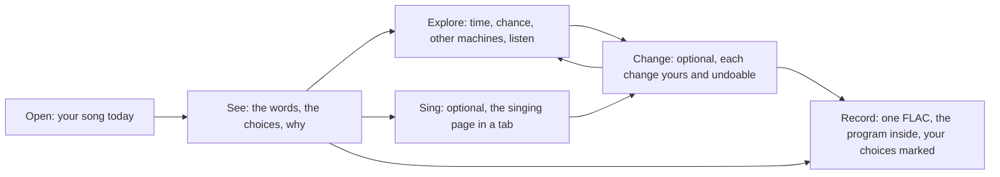
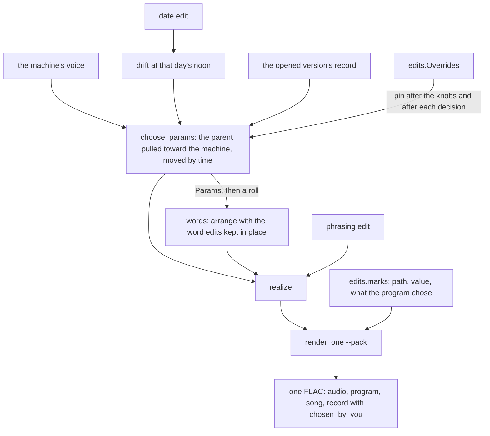

# The studio (2026-09-26)

The artist: "…for the final deliverable tool to allow the user to explore the
procedural generation and optionally edit the song before recording."

`songbird studio` opens a page on this computer that shows *your song today*:
the version this machine would sing now, from the rendition it was opened on
(or from the song as it began). The page shows every choice the program made
and why, lets you move through time, roll chance again and hear other
machines, lets you change what you like (each change marked as yours and
undoable), sends you to sing it if the program has its singing page, and
records the finished rendition: one FLAC carrying the program, the song and
its record, your choices marked as yours.

It is a local web page served by the standard library's `http.server` on
127.0.0.1, with plain HTML, CSS and JavaScript (songbird/studio/, about 70 KB)
and nothing fetched from anywhere else: system fonts, no libraries, no build
step, only the program's own runtime dependencies. So it runs from a seed
packet's own program, offline. Nobody editing anything changes nothing about
how a song is made: the studio's version of today is `songbird render
--date <today>`'s, byte for byte.

## Running it

From a checkout:

    uv run songbird studio                                   # the lead song, from the song as it began
    uv run songbird studio renders/some-version.flac         # a child of that rendition (a packet, or a FLAC with its record)
    uv run songbird studio --machine fictional:ada --port 8766 --out renders/ --no-open

From a rendition (docs/PACKET.md):

    python3 now-its-by-you.flac studio

The file's bootstrap unpacks its program and runs `songbird studio --packet
FILE` with it, so the studio opens on the rendition the packet came from and
records its child. `--packet` (or the positional parent) takes any packet;
the studio reads its record with `pack.read_record` and its song from the
`genome.json` inside it. With no parent at all it looks for an unpacked
packet beside the program, else (in a checkout) the lead song. `--machine`
is the command line's (here, none, fictional:NAME, a voice file or a
record), default here; `--out` where recordings go (default `renders/` in a
checkout, the current folder from a packet); `--port` 8766 or the next free
one. It prints the address and opens it in the default browser.

## The flow



Every step but the first is optional: opening the studio and pressing Record
records what `songbird render --parent THE_PACKET --machine here --date
<today> --pack` would.

## The screen

Pictures of each part are in `renders/production/studio/` (not in git), made
with a made-up machine called Ada so nothing of this computer is in them.

On a laptop, two columns under a header; on a small screen, one column in the
same order, the words first.

**Header.** The song's title; which version this is ("Your version today,
Saturday 26 September 2026, from the song as it began, sung by this
machine"); *Hear it all* and *Roll chance again* (and which draw it is).
Once anything is changed: "3 choices are yours · hear it as the program
would sing it · undo all". Edits that couldn't be kept say why here, with
"let it go".

**The words (the main column).** The song as it will be sung, section by
section: each sung section's lines large, in a serif, the line's focus word
underlined; a small heading with which verse or couplet it is, its tags
(plain, light, dark or tender; its year; rare; the question it asks), and how
it came to be there: "handed down" (as the version before held it), "new
this time" with the program's own reason under it ("verse 3 taken in: the
form sings three verses; your machine's verse this season", from
choose_params' log, docs/EVOLUTION.md), "chosen by you" or "kept by you". The
words are the lineage's own (Params.words), so rolling chance no longer
changes them. Instrumental
sections are one quiet line ("the whistle plays the tune in"). Every section
has a play button; a sung one has *change*, and *undo* once changed.

**The choices (the side column).** A card for each choice: its value in plain
words, a line of reasons each tagged by where it came from (your machine,
time, kept, the song, chance, the versions before, you), and *change*, folded
away until asked for. When a card has been changed, "chosen by you; the
program chose major" leads, and the program's own reasons follow under "Why
the program chose what it did". Moving through time adds "today: D major"
where a card differs from today.

| Card | Shown as | Reasons | Can change | Within |
|---|---|---|---|---|
| The style | "a string band, a waltz", what its band plays, and the arrangement's options that are on ("the last refrain a whole step up; a count-in to begin; backing voices in harmony") | kept from the version before; where your machine is at home among the styles, and that a version moves one style at a time; these weeks' lean; the styles the line was sung in | the style, its feel, how it ends, backing voices, the lift | the styles of songbird/style.py; a feel the style can't play the song in is said, not bent. A style edit goes in by name (choose_params(style=, arrange=)), so its players, pace and leans come with it |
| Key | "D major", "E mixolydian", "B minor" | where your machine's singer is comfortable; your machine's languages lean to folk (bright, darker) modes; this year | the note, and the mode | five semitones either side of the song's own key; the modes the song's chords keep their shape in (for H: major, mixolydian, minor) |
| Tempo | "95 beats a minute: a steady walk" | a brisk or unhurried machine (new or old files, quick or slow hands); today | a slider | 0.75 to 1.3 times the song's own |
| Shape | "three verses, with an intro, a turn after the refrains and the bridge twice", and the sections in order | a rich vocabulary tells a longer story; your machine's habit; this season | how many verses; verses in pairs; intro, turns, break, the bridge twice, the tag, outro | what the song's template and the words' rules allow; a refused part says why |
| The band | "a steady strum with the whistle leading; moderate and clear; all eight play", or under a style "the fiddle leading; busy and bright; bass, banjo, mandolin, guitar and fiddle play" | your machine's own band; the players are the style's own; a busy machine plays busier; your screen brightens it; these weeks; this year's lead | pattern and lead (the song's own band), how busy, how bright, who plays (a style's players by name) | the band's own ranges; every player can sit out, all of them for the voice alone ("the whistle sits out, so the fiddle takes the tune") |
| The room and the mix | "a room like a living room; the voice close and over the band; wide" | your machine's room; its own way of mixing; these weeks; today | how much of the room, how wide, the voice over the band, how close the singer is | the mix's designed ranges (MixParams RANGES) |
| The singer | "a high voice, clear, with a gentle vibrato; sung the song's own way" | your machine's own voice, the same in every song it sings; today | only whose way it is sung | the phrasings made on this computer (a checkout's singing page) |
| The words | "the version before's words, handed down, with two changes this time" | each change and why (taken in for a longer form, changed by the song's rule, swapped this season); the rest handed down; what your machine reaches for (its screen, the words you use, these weeks) | keep these words, and every section in the words column | the bank's rules; a word you choose changes only that word, the rest held as handed down |
| Voices before | "one voice from earlier versions joins the bridge" | one more for every version before this one, up to six | no: it is the lineage | |
| The melody | "one small change to the tune, handed down or found here", each in words | what the tune learned or forgot this time, and why | each can be dropped | as the lineage carries them (songbird.variants) |
| Your machine | its languages, size, files, screen, words, typing and room, a line each | | no | |

Any Params field no card speaks for yet gets a card of its own in plain
values, with reasons found the same way; a proper card, and an editor, can
follow.

**Through time.** Six years of this machine's song, from three years ago to
three on, a lane each for the style, the key (shaded by mode), the tempo, the
verses, who leads, and which way the words lean. A dashed line
is today; the cursor is the day shown. The slider, a tap on the lanes, or the
steps (a day, a month, a year either way; today) move it, and every card
follows.

**Other machines.** The same song, from the same version, on the same day, as
three made-up machines would sing it (Ada, Basil, Coral) beside yours: key,
tempo, shape, band, singer, room and first line, differences marked, each with
a play button for its whole song. Any name makes up another.

**Sing it.** What singing does, and a button that opens the singing page in a
new tab (in a checkout; elsewhere it says it isn't there yet).

**Record it.** One button; what it's making while it records; then where the
file is, how many choices are marked as yours, and the command that makes the
next version from it.

**The player.** Pinned to the bottom: what is playing, play and pause, where
it is (tap to seek), and while a preview is made, what the program is making
("the guitar", "the singer", "a voice from before", "mixing") with its
progress. *Record it* sits at its right, away from *Roll chance again*.

### Choosing words

A sung section's *change* opens its choices in place:

- **A verse**: every verse of the bank that can be sung in that place given
  the verses around it, by its first line and tags, the one sung marked. The
  ones that can't are folded below, each with the rule it breaks in one
  sentence (`arrange.problem()`): "a song sings at most one verse that rhymes
  another way or runs a line on, and the kids and lullaby verses both do";
  "the verses are sung in the order of their years, so the ink verse (1800)
  can't come after the wire verse (1990)"; "the first verse teaches the song's
  shape, so it is a plain one, and the trench verse rhymes ABAB (not AABB), is
  rare and runs a line on". Where it could go instead, it says so, one tap
  away: "it could be verse 3 instead", or "sing it as verse 1 instead" (the
  verses reordered as the rules ask, moving as few as can be). Below, the
  verse's swapped words ("girl", "boy", "nun", "monk").
- **A refrain**, with words of its own: its couplet, any the other refrains
  aren't singing (choosing one another refrain sings trades places with it);
  between the first and the last, how it begins (the song's own head, or
  another, "Who wrote this song? Nobody, so / it's yours if you sing it and
  then who knows?", which trades places too) and the question it asks
  (sang, heard, kept or wrote; one another refrain asks is asked afresh
  there); and its own "while" and "then". What the rules keep is said, not
  offered: the first and last refrains' head and question, the words a head
  sings as written, and the last refrain's "by everyone, no one, and now
  it's by you".
- **The bridge**: its canon stanza always first (said), its once-a-song words
  (water, mountain, border or desert...); a second bridge section chooses its
  stanza.
- **The tag**: la, loo or oo.

A choice puts that verse, couplet, word or syllable in its place among the
words the lineage holds; everything else stays as handed down (so a choice
offered in place changes nothing else), and the recording hands on what was
sung, the choice among it (`arrange.hold`, as `songbird render` does). Moving
through time can change the held words (a longer form takes a verse in, a
season swaps one); *Keep these words* (on the words card) holds every word as
it is, so moving through time changes only the music; the
words then say "kept by you", and the header counts only what was changed.

## How edits flow

An edit is one entry in a flat map from a path to a value: what the person
chose, on top of what the program chose. The page holds the map (and its
browser storage keeps it across a reload, all but the day and chance drawn
again, so tomorrow opens on tomorrow) and sends it with every request; the
server keeps nothing else but caches, so any request can be replayed.

| Path | Value | Acts on |
|---|---|---|
| `date` | "YYYY-MM-DD" | the moment time is read at: noon UTC that day, as `--date` |
| `roll` | 1, 2, 3... | chance drawn again: the day's own seed drawn again that many times (`edits.rolled`), so chance still follows the day |
| `tonic`, `mode`, `tempo` | a MIDI note, a mode, beats a minute | `Params` |
| `form.verses`, `form.pairs`, `form.intro`, `form.turn`, `form.break`, `form.tag`, `form.outro`, `form.bridge2` | a count; on or off | `Params.form`: the program's shape with just these parts changed |
| `band.pattern`, `band.lead`, `band.density`, `band.brightness`, `band.<instrument>` | as `Band`; an instrument's gain (0 sits it out) | `Params.band` |
| `mix.space`, `mix.width`, `mix.forward`, `mix.intimacy` | as `MixParams` | `Params.mix` |
| `variants.<name>` | as the variant takes | `Params.variants`, once it exists (said refused until then) |
| `words.verse.<i>` | `{"id": verse, "slots": {slot: words}}` | the i-th verse section's verse (from 0) |
| `words.refrain.<i>` | `{"id": couplet, "head": head, "slots": {slot: words}}`, any of the three, or just a couplet | the i-th refrain's own words: its couplet (never the last's), its head (between the first and last), its words (the question too, between them) |
| `words.refrain` | `{slot: words}` | words for every refrain whose head sings them, unless one chooses its own |
| `words.bridge` | `{slot: words}` | the bridge's once-a-song words |
| `words.bridge2`, `words.tag` | a stanza, a syllable | the second bridge, every tag |
| `phrasing` | a phrasing's name on this computer | whose way it is sung |

Each part of the shape is its own edit, so "no intro" holds while the day
moves the rest of the shape. The edits go in inside the program's table, not
after it, so a decision that reads one reads the person's: a chosen minor
mode leans the words darker, as the machine's own minor would (and the words
card says so). That is the only such knock-on so far; `songbird/edits.py`
lists them.



In code, all additive (a call without edits is the call as it was, and the
seed render and the word draw are unchanged, byte for byte):

- `songbird/edits.py` (new) is the override interface: `check()` holds each
  value to its bounds or says why not; `Overrides` puts them in place inside
  the table and draws chance again; `resolve()` makes the whole rendition with
  a person's edits (parameters, then the words, each chosen word kept only if
  the rules can keep it beside the ones before it), with `applied`,
  `problems` and `marks`; `pins()` turns word edits into arrange's choices;
  `shape()`, `build()`, `reshape()` and `shapes()` read a form as its parts,
  build it back and say which part changes can be sung; `marks()` makes the
  record's block, `from_record()` turns it back into edits; `keep_words()`.
- `realize.choose_params(..., overrides=None)`, and `variation.choose(...,
  pin=None, trace=None)`: the pin is called after the knobs and after each
  decision; the trace receives each knob's arithmetic.
- `arrange.arrange(..., chosen=None)`, `arrange.keep()` (a person's words kept
  in place, the rest drawn around them), `arrange.problem(genome, form,
  chosen=None)` (why a form or a choice can't be sung), `arrange.options()`
  (every choice for one section, allowed or refused with why, and where else a
  refused verse could go); `_VerseRules.why()` and `pinned()` say which rule.
- `cli.render_one(..., chosen_by_you=None, progress=None)`; `songbird render
  --edits FILE` (today's version with those choices: an edits file, or a
  record whose marks are made again) and `--replay RECORD` (a rendition again
  exactly as its record says: its parameters and the words it recorded, from a
  packet or a record; a person's phrasing given again with `--phrasing`).
- `synth.render(..., progress=None)`: told which part it is making, for the
  progress bar.
- `songbird/explain.py` (new) says each choice in plain words, with its
  reasons, draws the timeline and compares machines; `songbird/studio.py`
  (new) is the server; `songbird/studio/` the page.

### Why a choice was made

- **A number** the table works out (tempo, the key's note, the band's density
  and brightness, the mix, the words' era and appetite for rare verses, the
  singer's day) is traced as it is made: what it was in the parent, how far
  the machine pulled it and how far time moved it (the child hears 0.6 of
  each). Each is said, with its direction, only when it is big enough to hear
  (a beat a minute, half a semitone, 4% of a range); when they pull opposite
  ways and cancel, the card says "so in the end it is about as it was"; when
  neither is heard, "kept from the version before".
- **A choice among a few** (the mode, the shape, the band's pattern and lead,
  the room) is asked again without time (every dimension of the drift at
  zero, and no past to read) and without the machine (one with no signals, at
  the same moment): what changes when the machine is taken away is its doing,
  what changes when time stands still is time's. The words' mood is said from
  what leans it: the screen's brightness and warmth, a minor key, these weeks.
- The words and every small detail of the sound are **chance**; anything
  changed is **yours**, with what the program chose; a value the version
  before kept from a person says "kept from the version before, where a person
  chose it".

The page never says genome, drift, harvest, knob, params or seed
(tests/test_studio.py checks every text it shows). It says the song, the song
as it began, the version before, your machine, time (today, these weeks, this
season, this year), chance and you.

## Listening

A preview is a section (or the whole song) made when asked. A section is cut
from the whole rendition's score by what is sounding: the notes from a breath
before its first pickup (a beat of the band before it at least) to where the
next section's pickup begins, an instrument's note already ringing brought in
a second early so it has settled, and no sung syllable from before it (none is
begun halfway). It is made,
brought up by the gain mastering gives a whole rendition (5.3 dB, measured on
H: 5.1 to 5.4) under the same ceiling, so a quiet verse stays quiet and a turn
isn't pushed to the loudness of a refrain, and faded in and out. A section of
H takes about six seconds, the whole song about forty. The page calls it a
preview: a part heard alone is not the record's exact samples, and the mix's
balance is judged on the whole song.

One renderer works at a time: recordings first, then the newest preview (a
preview still waiting is dropped when another is asked for). Every render is
cached by what it depends on (the parameters, the words, the phrasing, the
section, the program's version) under `~/.songbird/studio/` (or
$SONGBIRD_HOME), kept under 300 MB, least recently heard going first. The
whole song's preview is the recording itself, so Record after Hear it all
only copies it.

## Singing

In a checkout, *Sing it* starts the singing page (`tools/karaoke.py`, reused,
not copied) on 127.0.0.1:8765 for the same song, if it isn't running there
already (it checks the song's title), opens it in a new tab, and stops it when
the studio stops. Back in the studio, the singer's card offers the phrasings
made on this computer: each person who kept takes of this song, and everyone's
together; never the reference voices. The singing page's own "hear the
machine" sings the song as it began, not the studio's version: the studio's
preview is where to hear your version sung your way. A packet's program has
no singing page yet (songbird.quadule.com will take takes online), and the
card says so.

## Recording

*Record it* renders the whole rendition as `songbird render --pack` does
(`cli.render_one`, as the child of the version opened) and writes one file:
`<song>.<day>.<first six of its id>.flac`, into `renders/` from a checkout or
the current folder from a packet. It plays anywhere, and carries the program,
the song, the words and its record, whose `params` are what was sung (a
person's choices among them) and whose `chosen_by_you` marks, for each edit
that took effect, the value chosen and what the program had chosen:

```json
"chosen_by_you": {
  "date": {"value": "2027-09-26", "was": "the day it was made"},
  "mode": {"value": "aeolian", "was": "ionian"},
  "words.verse.1": {"value": {"id": "ink", "slots": {...}}, "was": {"id": "mind", "slots": {...}}}
}
```

A phrasing is marked by what it is, never whose: `{"value": "a person's way",
"detail": "2 sung take(s)", "digest": ...}`. `songbird render --replay
FILE` renders it again byte for byte (tests/test_studio.py does). Run with
Python, the file makes the next version: its children inherit what was sung,
a person's choices among them.

## What stays on the machine

Nothing leaves it. The server answers only 127.0.0.1 and only requests that
name it (so no web page can reach it under another name); it takes changes
only as JSON carrying the token its own page was given (a header no other
page can send without asking first, which it never answers); it serves only
its page, its answers and its renders by their hashes, under a content
policy that lets the page load nothing from anywhere else. The record keeps
what a command-line record keeps, plus the marks of what was chosen. The
browser's storage keeps the edits in progress on this browser only.

## How it was checked

- tests/test_arrange_choices.py: the word draw without choices is byte for
  byte as before (a golden of 600 draws taken before the change); every refusal
  agrees with the rules (4,000 random sets); every verse offered is kept in its
  place with nothing else moving; choices hold, and the rules hold, as chance
  changes; couplets and heads trade, words for every refrain hold everywhere; each alternative
  offered can be sung.
- tests/test_edits.py: no edits change nothing; each edit takes its place in
  its bounds; a minor mode darkens the words; refusals say why; the shape
  changes part by part and holds as the day moves; words kept or refused; the
  marks replay; a phrasing is never marked with a name; keep these words holds
  through a roll.
- tests/test_studio.py: the server refuses other hosts, other origins, pages
  without its token and anything but JSON; the page gets the song, its choices
  and bounds; no card ever says the code's words (four machines, three days);
  today is the command line's today; a packet opens as the parent; a section is
  made on demand and served with byte ranges; a recording is a packet with the
  person's choices marked, and replays byte for byte.
- In a browser (the built-in one, laptop and phone sizes, and headless Chrome
  for the pictures): opening, choosing a verse and its words, the refusals and
  their alternatives, changing the key, mode, band and mix, moving through
  time, other machines, a section made and played (−14.4 LUFS, −1.2 dBTP, a
  verse's level), recording a packet, and opening that packet as the next
  version's parent. The song view answers in about 20 ms, six years of the
  timeline in about 2 s.
- A Fable review of the design (read-only) before it was built: its findings
  are in (the phrasing mark, roll for seed, edits inside the table, the knobs'
  trace, cutting by what sounds, the token, the refusals' alternatives,
  --replay). A second Fable review of the built studio found that a replay of
  a child lost its parent's choir voices, that "today:" ignored the person's
  own choices, that held words counted as changes, that a preview could begin
  the line before's last syllable, and some holes in the server (a refusal
  that left a kept-alive connection out of step, a short listen queue, a
  verse count unchecked): all fixed and tested, with its wording notes.

## Decisions for the artist

1. **A person's choices pass to children.** A rendition's parameters are what
   was sung, so a child pulls from the person's choices as from a machine's.
   The alternative hands children only what the program chose. (Found in
   review: an instrument sat out comes back in the child at half level at
   least, because the table's bounds catch it; clipping the machine's own
   value instead of the child's would let it ease back in.)
2. **Today is a day.** The studio's today is noon UTC of today's date, as
   `--date` has it: the same machine opens on the same version all day, and
   Roll chance again draws another. The command line without a date draws a
   new one every second.
3. **The singer is the machine's.** Only its phrasing changes, by singing.
4. **A person's ranges are the designed ones**, wider than a machine's own:
   tempo 0.75 to 1.3 times, every instrument can sit out (all of them for the
   voice alone), the mix's full ranges.
5. **A mode chosen by a person leans the words**, as the machine's own mode
   would; the rest of an edit changes only what it names.
6. **A singer's gestures don't travel.** Replaying a rendition sung a
   person's way needs that phrasing's file (the record keeps its fingerprint).
   Carrying the gestures in the record would make every rendition replayable
   anywhere, and would carry a little of a person's singing with it: whether
   the consent in docs/SINGERS.md covers that is the artist's call.
7. **Made-up machines have names** (Ada, Basil, Coral), because a name is what
   makes one; any name can be typed.
8. **Recordings are named** `<song>.<day>.<id6>.flac`, into `renders/` (a
   checkout) or the current folder (a packet).
