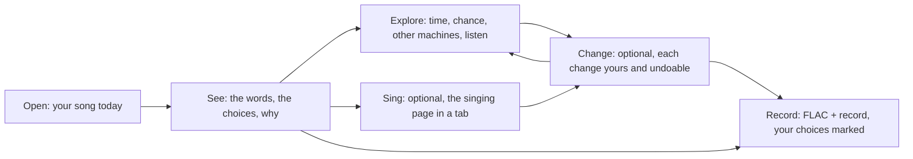
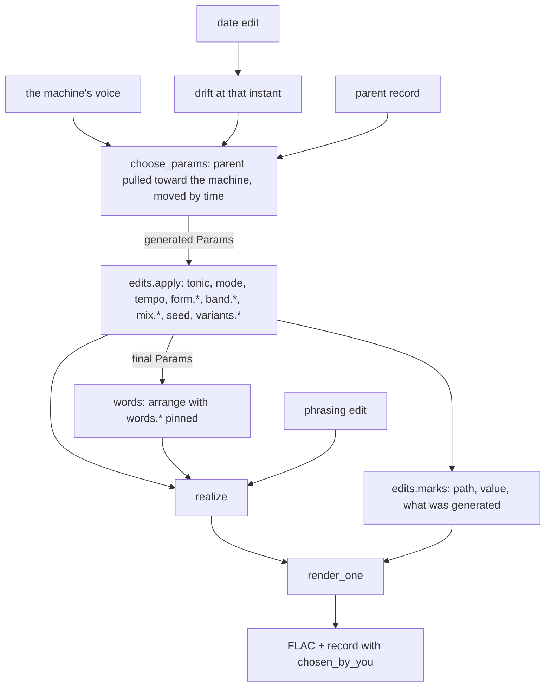

# The studio (design, 2026-09-26)

The artist: "…for the final deliverable tool to allow the user to explore the
procedural generation and optionally edit the song before recording."

`songbird studio [PARENT.flac|record.json]` opens a page on this computer that
shows *your song today*: the version this machine would sing now, from its
parent (or from the song as it began). The page shows every choice the
program made and why, lets you move through time, roll chance again and hear
other machines, lets you change what you want to (each change marked as
yours and undoable), sends you to sing it if you like, and records the
finished rendition: a FLAC and its record, your choices marked as yours.

It is a local web page served by the standard library's `http.server` on
127.0.0.1, with plain HTML, CSS and JavaScript. Nothing is fetched from
anywhere else: no fonts, no scripts, no network. It changes nothing about how
a song is made when nobody edits it: the studio's version of today is the
command line's, byte for byte.

## Running it

    uv run songbird studio                                   # the lead song, from the song as it began
    uv run songbird studio renders/h-now-its-by-you.flac     # a child of that rendition (its record beside it)
    uv run songbird studio parent.json --machine fictional:ada --port 8766 --out renders/

It prints the address (http://127.0.0.1:8766) and opens it in the default
browser (`--no-open` to not). `--song GENOME` picks the song when the parent
doesn't name one; `--machine` is the command line's (here, none,
fictional:NAME, a voice file or a record), default here.

## The flow

Every step but the first is optional: opening the studio and pressing Record
records exactly what `songbird render --machine here --date <today>` would.

## The screen

On a laptop, two columns under a header; on a phone, one column in the same
order.

**Header.** The song's title; one line saying which version this is ("your
version today, Saturday 26 September, from the song as it began, sung by this
machine"); three buttons: *Hear it all*, *Roll chance again*, *Record it*.
When anything has been changed: "3 choices are yours · undo all".

**The words (the main column).** The song as it will be sung, section by
section, in the order of its shape. A sung section shows its lines large and
readable, with a small heading: which verse or couplet it is, a few plain
tags (plain, light, dark or tender; its year; rare), and how it came to be
here ("drawn by chance" or "chosen by you"). An instrumental section is one
quiet line ("the whistle plays the tune"). Every section has a play button,
and a *change* link on the sung ones opens its choices in place (below).

**The choices (the side column).** Readable cards, one per choice, each with
its value in plain words, a line of reasons, and a *change* control folded
away until asked for:

| Card | Shown as | Reasons it can give | Can change | Within |
|---|---|---|---|---|
| Key | "D major", "E folk major (mixolydian)", "B minor" | where your machine's singer is comfortable; your machine's languages lean to folk (bright, darker) modes; this year's drift; kept from the version before | the note, and the mode among those the song's chords allow | 5 semitones either side of the song's own key; for H: major, folk major, minor |
| Tempo | "95 beats a minute: an easy walk" | your machine is brisk or unhurried (new or old files, quick or slow hands); today's drift; kept | a slider | 0.75 to 1.3 times the song's own tempo |
| Shape | "three verses; an intro; the strings turn after the refrains; the bridge twice; no tag" | your machine likes an intro (a tag, the turns...); a rich vocabulary tells a longer story; this season's drift; kept | verse count, verses in pairs, each optional section, the bridge's second stanza | what the song's template and the words' rules allow (`fits`, `arrange.problem`) |
| The band | "a strum, the whistle leading; fairly busy; bright; all eight play" | your machine's own band; a busy machine plays busier; a light screen, a brighter band; these weeks' drift; this year's lead; kept | pattern (lilt, strum, pick, air), lead (whistle, fiddle, lute), busy to sparse, dark to bright, who plays | the band's own ranges (`songbird/band.py`); an instrument sits out at 0 |
| The room and the mix | "a small room; the voice close and forward; wide" | your machine's room (or the one before); your machine's own habits; these weeks' drift | how much room, how wide, how far the voice stands over the band, how close the singer is | the mix's ranges (`MixParams`, `RANGES`) |
| The singer | "a high voice, bright and a little pressed, with a quick light vibrato; sung the song's own way" | your machine's own voice (the body never changes); its habits came down from the versions before | only its phrasing: whose way it is sung (see Sing) | the phrasings made on this computer |
| The words | "drawn by chance from 38 verses, within the song's rules; leaning lighter and older this season" | chance; your screen leans them light or dark; your words bring some verses forward; this season's drift | in the words column, section by section | the bank's rules |
| Voices before | "one voice from an earlier version joins the bridge and the tag" | one more for every version before this one | no: it is the lineage | |
| The melody | the variants a rendition carries, once they exist (`Params.variants`) | as the variation table says | each variant on or off | as the variants allow |
| Your machine | what the machine is, in plain words: its languages, size, how old its files are, its screen, its words, its typing, its room | | no (run `songbird harvest` to read it again or leave things out) | |

The singer can't be changed: the machine is the voice (principle 4). What a
person can give it is their phrasing, by singing.

**Through time (full width, under the columns on a laptop).** A timeline of
this machine's song from three years ago to three years on, drawn from the
same choices `songbird year` prints: lanes for the key and mode, the tempo,
the shape (verse count, optional sections), the band's pattern and its lead,
and which way the words lean (light or dark). A cursor marks the day shown;
drag it, or the slider under it, and every card follows, with what differs
from today marked ("today: D major").

**Other machines.** The same song, from the same parent on the same day, as
three made-up machines would sing it, beside yours: key, tempo, shape, band,
singer, room and first line, differences marked, each with a play button. Any
name makes up a machine ("the same name, the same machine").

**Sing it.** One line on what singing does ("it learns a little of your
timing and inflection; no recording or voice leaves this computer"), a button
that opens the singing page in a new tab, and once someone has sung, a choice
of whose way the song is sung.

**Record it.** One button; while it records, what it's doing; when done,
where the files are and which choices are marked as yours.

**The player.** A slim bar pinned to the bottom: what is playing (a section or
the whole song, whose version), play and pause, where it is, and while a
preview renders, what the program is making ("the band", "the singer",
"mixing") with its progress.

### Choosing words

A sung section's *change* opens its choices in place, with only the allowed
ones offered:

- **A verse**: every verse of the bank that can be sung in this place, given
  the verses around it, each shown by its first line and its tags. The ones
  that can't are listed apart, folded, each with the reason in one sentence
  (`arrange.problem()`): "the first verse teaches the song's shape, so it is a
  plain one: rhymed AABB, common, no line running on", "the verses go in the
  order of their years: 1916 can't come after 1990", "at most one light verse
  to a song, and verse 3 is light". Below it, the verse's swapped words
  ("a girl" or "a nun"), any of which can be chosen.
- **A refrain**: the question turns by the song's rule and isn't offered
  ("asks who made it; the last refrain asks who owns it"); the couplet can be
  any the other refrains aren't singing, except in the last refrain, which
  always sings "by everyone, no one, and now it's by you". The once-a-song
  words ("while", "then it goes") are chosen once for every refrain.
- **The bridge**: its canon stanza always; its swapped words (water, mountain,
  border or desert), once for the song. A second bridge section chooses its
  stanza (coat or given).
- **The tag**: la, loo or oo.

A choice here pins that verse (or couplet, word, syllable) in that place;
everything unpinned is still drawn by chance around it within the rules, so
rolling chance again keeps what you chose. A choice that the rules can't keep
after a later change (a pinned fourth verse after the shape drops to three)
isn't applied, and the page says why beside it.

## How edits flow

An edit is one entry in a flat map from a path to a value: what the person
chose, on top of what the program generated. The page holds the map and
sends it with every request; the server holds nothing but caches, so a
reload loses nothing (the page keeps the map in the browser's storage) and
any request can be replayed.

| Path | Value | Acts on |
|---|---|---|
| `date` | "YYYY-MM-DD" | the drift's instant: that day at noon UTC, as `--date` |
| `seed` | an integer | `Params.seed`: chance rolled again (the words' draw and every detail) |
| `tonic`, `mode`, `tempo` | a MIDI note, a mode name, beats a minute | `Params` |
| `form.verses`, `form.pairs`, `form.intro`, `form.turn`, `form.break`, `form.tag`, `form.outro`, `form.bridge2` | a count, true or false | `Params.form`, rebuilt from the generated form with just these aspects changed (`variation.build`) |
| `band.pattern`, `band.lead`, `band.density`, `band.brightness`, `band.<instrument>` | as `Band`; an instrument's gain, 0 to sit out | `Params.band` |
| `mix.space`, `mix.width`, `mix.forward`, `mix.intimacy` | as `MixParams` | `Params.mix` |
| `variants.<name>` | as the variant takes | `Params.variants`, once it exists |
| `words.verse.<i>` | `{"id": verse, "slots": {name: words}}` | the verse sung in the i-th verse section (from 0) |
| `words.refrain.<i>` | a couplet id | the couplet of the i-th refrain (never the last: the canon) |
| `words.refrain`, `words.bridge` | `{slot: words}` | the once-a-song words of every refrain, of the bridge |
| `words.bridge2` | a stanza id | the second bridge section's stanza |
| `words.tag` | a syllable | every tag |
| `phrasing` | a phrasing's name on this computer | whose way the song is sung |

Each aspect of the shape is its own edit, so "no intro" holds while the date
moves and the machine's own shape changes around it.

In code, all additive (a call without edits is the call as it was):

- `songbird/edits.py` (new) holds the override interface: `resolve(genome,
  generated, edits) -> (params, problems)` applies what it can and explains
  what it can't; `pins(edits)` gives arrange its pinned words; `shape(genome,
  form)` and `shapes(genome, form)` read a form as its aspects and offer each
  change with the reason when refused; `marks(...)` gives the record's block.
- `realize.choose_params(..., overrides=None)`: the generated parameters with
  the edits applied.
- `arrange.arrange(..., chosen=None)`: the pinned words kept in their places,
  the rest drawn as before around them (substituted in place where the rules
  allow, redrawn around them where they don't); `arrange.problem(genome, form,
  chosen=None)` says why a form or a pinned choice can't be sung;
  `arrange.options(genome, lyrics, block, i)` lists every choice for one
  section, each allowed or refused with its reason.
- `cli.words(..., chosen=None)`, `cli.render_one(..., chosen_by_you=None,
  progress=None)`, and `songbird render --edits FILE` (an edits map, or a
  studio record, whose marks are replayed) so a studio rendition can be
  replayed from the command line byte for byte.
- `synth.render(..., progress=None)`: a callback told which part is being
  made, for the progress bar.
- `songbird/explain.py` (new) says each choice in plain words, with its
  reasons (below), draws the timeline and compares machines.
- `songbird/studio.py` (new) is the server; `songbird/studio/` the page.

### Why a choice was made

The reasons come from asking the same question four ways, a millisecond each:
the rendition as made (parent, machine, time), without time (the drift held
at zero), without the machine (a machine with no signals, the same time), and
the parent's own value. For each choice:

- the same as the parent's: *kept from the version before* (or *the song's
  own*, from the song as it began);
- different without the machine: *your machine* (and which part of it: its
  languages, its size, its files, its screen, its words, its typing, its
  room, or simply its own voice, for a body or a habit);
- different without time: *today's drift*, *these weeks*, *this season* or
  *this year*, as slow as the choice's view of time, and which way it moves;
- the words and the details of the sound: *chance*;
- anything edited: *chosen by you*, with what the program would have sung.

The page never says genome, drift field or harvest. It says the song, the
song as it began, the version before, your machine, time (today, these
weeks, this season, this year), chance, and you. The docs keep the code's
words.

## Listening

A preview is a section (or the whole song) rendered on demand. A section is
cut from the whole rendition's score (its notes from a beat and a breath
before the section to its end, the band arranged as it is in the whole song),
rendered, mixed, mastered like a record and faded at the ends; a section of
H takes a few seconds, the whole song about half a minute. One renderer
works at a time, most recent request first; the page shows what it is making.

Every preview is cached by what it depends on (the final parameters, the
words, the phrasing, the section, the program version) under
`~/.songbird/studio/` ($SONGBIRD_HOME), so the same thing is made once. The
whole song's preview is the recording itself: pressing Record after hearing
it all only copies it.

## Singing

The singing page (`tools/karaoke.py`) records takes and makes a singer's
phrasing. The studio reuses it rather than copying it: *Sing it* starts it on
127.0.0.1:8765 (if it isn't running) and opens it in a new tab. Where it
isn't installed (the page is a development tool for now; songbird.quadule.com
will take singers' takes online), the card says so. Back in the studio, the
singer's card offers the phrasings made on this computer: each singer who
kept takes of this song, and everyone's together. Choosing one is an edit;
the preview and the recording are sung that way.

## Recording

*Record it* renders the whole rendition as `songbird render` does (the same
function, `cli.render_one`) and writes, to `renders/` (or `--out`):

- `<song>.<date>.flac`, and beside it
- `<song>.<date>.json`, the record: everything the command line's record
  holds, with `params` being what was sung (your choices included) and a
  `chosen_by_you` block: for each edit that took effect, its path, the value
  chosen and what the program had generated (`{"tempo": {"value": 88,
  "was": 95.4}}`); dropped edits aren't recorded;
- `<song>.<date>.score.json` and, when the words were drawn, `<song>.<date>.txt`.

A child made from this record inherits what was sung, your choices among
them: that's how a singer's changes pass on (principle 6). The record says
which choices were a person's, never who: a phrasing is recorded as the
command line records it (its source, never a name unless its singer asked
to be credited).

**The seed packet** (milestone 6) is not built yet. `studio.seal(flac,
record)` is where it goes: it calls `songbird.pack.seal` once that exists,
which appends the program, the song and the record to the FLAC. Until then
the record travels beside the file, and the page says so.

## What stays on the machine

Nothing leaves it: the server answers only 127.0.0.1 (and refuses requests
naming another host, so no web page can reach it through a renamed address),
takes requests only from its own page, reads nothing a render doesn't
already read, and fetches nothing. The record keeps what a command-line
record keeps, plus the marks of what was chosen. The page's storage keeps
the edits in progress on this browser only.

## Decisions for the artist

1. **Edits pass to children.** A rendition's parameters are what was sung,
   so a child pulls from the person's choices as it would from the machine's.
   The alternative is to hand children only what the program generated.
2. **Today is a day.** The studio's today is noon UTC of today's date (as
   `--date` has it), so the same machine opens on the same version all day
   and Roll chance again is how to draw another. The command line without a
   date draws a new one every second.
3. **The singer is the machine's.** Only its phrasing can change, by singing.
4. **A person's ranges are the designed ones**, wider than a machine's own
   (tempo 0.75 to 1.3 times; every instrument can sit out, all of them for
   the voice alone; the mix's full ranges).
5. **Made-up machines have names** (Ada, Basil, Coral) because a name is what
   makes one; any name can be typed.
6. **Where recordings go**: `renders/<song>.<date>.flac` by default.
