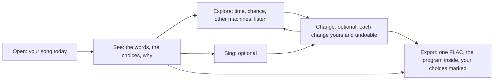
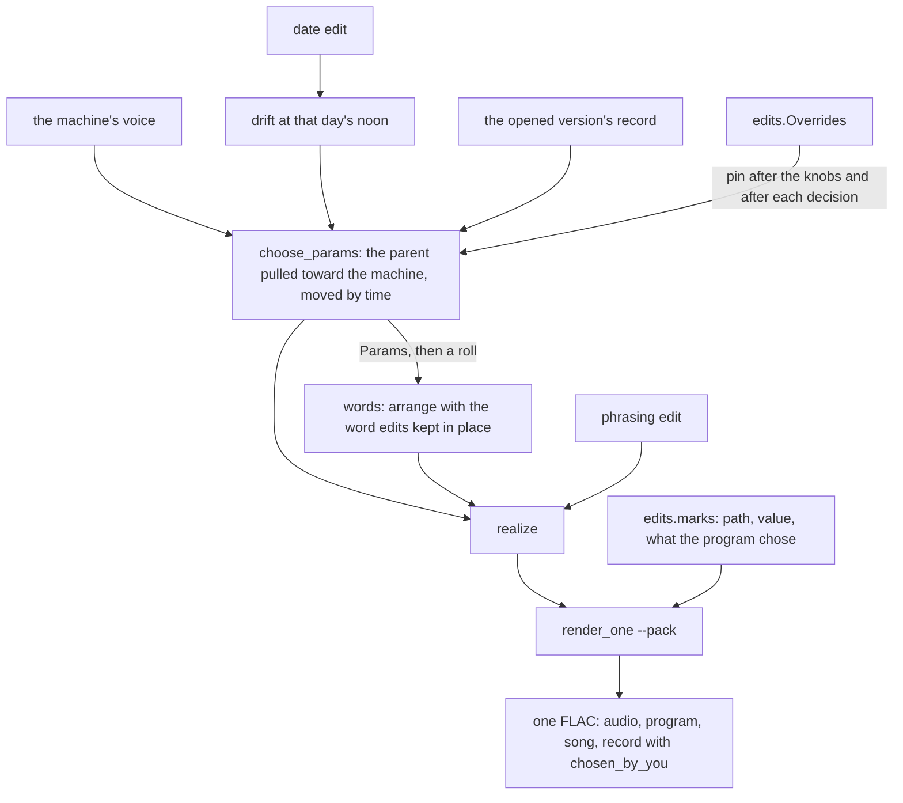

# The studio

The artist: "…for the final deliverable tool to allow the user to explore the
procedural generation and optionally edit the song before recording."

`songbird studio` opens a page on this computer that shows *your song today*:
the version this machine would sing now, from the rendition it was opened on
(or from the song as it began). The page shows every choice the program made
and why, lets you move through time, roll chance again and hear other
machines, lets you change what you like (each change marked as yours and
undoable), lets you sing it where the program has its singing page, and
exports the finished rendition: one FLAC carrying the program, the song and
its record, your choices marked as yours.

It is a local web page served by the standard library's `http.server` on
127.0.0.1, with plain HTML, CSS and JavaScript (songbird/studio/) and nothing
fetched from anywhere else: system fonts, no libraries, no build step, only
the program's own runtime dependencies. So it runs offline from a seed
packet's program. Opening the studio changes nothing about how a song is
made: the studio's version of today is `songbird render --date <today>`'s,
byte for byte.

The same studio runs in public at studio.itsby.you; docs/WEB-STUDIO.md
describes that site.

## Running it

From a checkout:

    uv run songbird studio                                   # the lead song, from the song as it began
    uv run songbird studio renders/some-version.flac         # a child of that rendition (a packet, or a FLAC with its record)
    uv run songbird studio --machine fictional:ada --port 8766 --out renders/ --no-open

From a rendition (docs/PACKET.md):

    python3 now-its-by-you.flac studio

The file's bootstrap unpacks its program and runs `songbird studio --packet
FILE` with it, so the studio opens on the rendition the packet came from and
exports its child. `--packet` (or the positional parent) takes any packet;
the studio reads its record with `pack.read_record` and its song from the
`genome.json` inside it. With no parent it looks for an unpacked packet
beside the program, else (in a checkout) the lead song. `--machine` is the
command line's (here, none, fictional:NAME, a voice file or a record),
default here; `--out` is where exported files go (default `renders/` in a
checkout, the current folder from a packet); `--port` is 8766 or the next
free one. It prints the address and opens it in the default browser.

The page also opens someone else's version: a rendition's .flac dropped on
the page, or chosen under *Time*, *Someone's version*. The studio reads it as
data (it never runs the program the file carries), keeps its record and song,
and the page moves to `/v/<id>`, the studio with that version as the parent,
as if it had been given on the command line. docs/WEB-STUDIO.md, "Opening
someone's version", has the design, the threat model and the limits.

## How it looks: a page from a copied tune book

The artist: "how can an app feel more like a folk song or something passed
down? I don't want to go overboard with this."

The studio looks like a page from a tune book copied by hand, person to
person: the song set in a book face on warm paper, in one ink, with *your*
changes in a second ink, as a later hand annotates a copy it was given.
Nothing is drawn to look old.

- **Paper and ink.** Warm off-white paper and a brown-black ink. In the dark,
  dark paper and cream ink. Every colour is a token; nothing else changes
  between the two schemes.
- **A second hand.** Everything a person chose is in a blue-black ink: the
  words they picked, the choices they changed, the notes they moved.
- **Rubrics.** Section names (Verse 1, Refrain 2) are in small capitals, in a
  copyist's red. The same red marks the playhead.
- **Set like a songbook.** The words are set in a book face with generous
  leading and a single margin rule down their left. Controls use the system's
  sans; only reading text is serif.
- **Broadside rules.** The header ends in a thin-and-thick double rule, as a
  ballad sheet's title does. Buttons are small squared blocks.
- **The line it came down.** Beside the version's name, a small row of marks,
  one for each version before this one and a filled one for this.

There are no textures, images, downloaded fonts, blackletter, torn edges or
stains. System fonts and CSS only (the program aims at 8 MiB). Text contrast
is at least 4.5:1 in both schemes.

## The flow



Every step but the first is optional: opening the studio and exporting
writes what `songbird render --parent THE_PACKET --machine here --date
<today> --pack` would.

## The musical workbench

The page is **the score** (songbird/studio/score.js; its design is in
docs/notes/STUDIO-REDESIGN.md): one transport, views of the song (Page,
Arrange, Mix, and Sing where singing is on), one column that shows whatever is
selected, *Tools* as a sheet and *Time* as a drawer. studio.js keeps the
edits, the history, the drafts and the listening; composer.js the notes and
the sketch; author.js a line of words; players.js where the sketch's players
go; perform.js notes in; model.js the pure parts.

- **The header** names the day ("Today, Wednesday, November 4, 2026"), then
  the parent (when it isn't the song as it began) and the machine.
- **The transport** has play, Sketch or Sung, loop, click, the tempo as a
  number field (a whole number in the style's range, with Reset beside it when
  the tempo is yours), the key and scale, New performance (chance drawn
  again), undo, redo, Export and Tools.
- **Page** is the words as this version sings them. A word with a dashed line
  under it can change. A sung section's name is followed by **Edit** (a click
  on a line does the same), which turns its lines into fields ("Words",
  below). **Write lyrics** at its top takes the whole song's words in one
  field, a paragraph for each section of words in the song's order (a refrain
  once; a line in brackets, `[Verse 2]`, names one): each line changed is
  written, its notes fitted to it where its count differs from its tune's
  (`SongbirdModel.lyricSheetPatch`), and all go in as one checked edit and
  one undo step. A paragraph or a line too many is refused; a line the singer
  can't sing says why beside it.
- **Arrange** is the song as a timeline: its sections over a ruler of bars,
  and a row for each player, a cell saying whether that player plays there and
  how hard ("Arrangement control", below). Drag a section to move it, its
  right edge for its length; double-click it for its notes (the tune and
  chords editor, "Tune", below), or the singer's row for its words. Selecting
  the seam between two sections opens its transition ("Sound design", below).
- **Mix** is a strip for each player (its level, mute and solo, pan, pump and
  sound), then the voice (mute and solo, `mix.voices`) and the room.
- **The column** shows whatever is selected: what it is, why the program chose
  it, and how to change it. With nothing selected it lists this version's
  choices, a row each: Style, Singer, Band, Shape, Room, Melody, Choir, Words,
  Machine.
- **Yours** is a colour: a choice a person made is drawn in the second ink
  wherever it shows, and *Reset* gives it back to the program.
- **Tools** has Export (Song file, MIDI, Stems, Piano page, Draft) and Import
  (MIDI file, MIDI keyboard, Sing, Draft).
- **Time** has Through time (the six-year timeline, by day, month and year),
  Other computers, and Someone's version.

Help is there when asked for and quiet otherwise (the artist: "Labeling
everything makes it busy and confusing"):

- a **?** beside each view opens two or three sentences on what it is, and
  each choice in the column has *How this choice works*;
- **Help** (or the ? key) opens the whole studio in plain words, with **Show
  me around**;
- **Show me around** walks four steps, each pointing at one thing: hear it,
  change something in the transport, select a section, export it. Skip or Esc
  ends it. songbird/studio/help.js has both.

### Tune (Arrange)

The tune editor opens on a section: a phrase strip and one piano roll for the
whole section, its phrases end to end on one time axis (a line where each
begins, each phrase's chords over it), each note carrying its sung syllable.
A note belongs to its phrase and stays inside that phrase's bounds, pickup
included; choosing it chooses its phrase, which the scope, the tools, the
words' draft and the clipboard then act on (the selected phrase is shaded).
The rows are semitones: the scale's own tones plain, the tonic marked, the
ones between shaded. Drag up/down for pitch, left/right for timing, or the
right edge for length. Select a note for exact pitch, start and duration
controls. Arrow keys nudge notes; Shift+Left/Right changes duration. Snap and
zoom set the editing grid.

Several notes: Shift-click adds a note to the selection or takes it away;
Shift-drag on the grid draws a rectangle that selects the notes it touches
in the phrase it began in; Ctrl/⌘+A selects the phrase. A selection lies in
one phrase. Dragging one of its notes, the arrow keys, **↑/↓ Step** and
Delete act on all of it as one edit (one undo step, and for a sung line one
words draft). Ctrl/⌘ with C, X, V and D copy, cut, paste and duplicate it
(never while typing in a field); **Copy notes** and **Paste notes** use the
same clipboard. A click on the empty grid puts a cursor there and lets the
notes go: a paste goes to the cursor, else after the selection, else to the
phrase's start, each pasted note in place of any note it overlaps; nothing
selected (or all) copies the whole phrase, which pastes fitted to the
destination phrase as before. A paste that doesn't fit is refused and says
why. **Quantize** puts the selection's (or the phrase's) starts and ends on
the snap, a melisma kept joined and the next line's pickup clear. A new phrase edit starts with **here only**; choose **everywhere** to change
all appearances, including instrumental echoes. Existing edits open at the
scope they already use ("This place only, or everywhere", below).

Sections can be rearranged by dragging or with Earlier/Later. The backend
checks the arrangement before accepting it. Repeated verses and refrains keep
their story order (the lyric bank's rules depend on it) but can move around
other kinds of section.

**Add note**, a drag on the empty grid (a note as long as the drag) or a
double-click (a note the snap's length) draws; **Delete note** (or Delete
on a selected note) leaves a rest. A different count of syllables opens a
line draft: write its words, or use **Fit notes to words** to give your new
words a rhythm following the melody's contour. **Write line** starts with
words directly. Apply words and notes together; drafts survive phrase
navigation and song refreshes during the visit, but are not exported until
applied. Pronunciation errors leave the draft available to correct.

An authored melody may reach ten scale steps past the song's range, use wide
leaps, and end on any scale degree. A sung line's note moves by semitones: a
pitch between the scale's tones is stored as the neighbouring degree with a
half step (`alter`), sharp when it was reached going up, else flat
(`SongbirdModel.spell`), and goes with the line's words as a line of its own
(only a line of its own holds a half step). The **Pitch** menu lists every
semitone for it. A tune line without words of its own (an instrumental
echo) and a melisma's notes keep to the scale's rows; a melisma still
carries one syllable over up to four scale notes. The singer
needs nonoverlapping notes of at least a quarter beat, room before the next
phrase's pickup, and one to 32 syllables in a written line. **Step** transposes the whole phrase, its ending included. **Soften leaps**
and **Even rhythm** remain optional transformations. **Restore phrase/order** removes the local
edit and returns to the version inherited by this studio: a released order
gives the form back to the machine, which chooses it from the parent's as it
would with no order (with no machine, the parent's form stays).

**Play sketch** plays a phrase, section or the whole song at once through a
few Web Audio oscillators: the tune, its chords (a soft strum on each beat,
the triad between G3 and F♯4) and a bass (each chord's bass note on its first
beat, its fifth halfway through a four-beat chord), with **Chords** and
**Bass** to leave either out. It reads the page's own score (each tune line's
`harmony` from `composition.view`: every chord where the band lays it, its
name and pitch classes, bass first), so a key, mode, tempo or chord change is
heard with no render. Loop and click are practice tools; the playhead follows
the score. It is a sketch: no swing, no style, no singer. Its players and the
band's parts can go to a musician's own instruments over MIDI ("Learning it at
the piano", below). **Hear sung section** and the transport's Sung use the
real singer, phrasing, arrangement and mix, rendering locally when needed. The
two players stop each other. Audio made before the latest edits is marked as
such.

### Instrument notes and reusable contents

The notes editor's **Part** chooses Melody or a pitched member of the band.
Double-click an instrument's arrangement cell, or choose **Edit notes** in
its inspector, to open that part directly. The piano roll loads its generated
notes; editing makes the phrase yours. It shows the whole section as the
melody's roll does, each phrase's notes kept as that phrase's own part edit,
with the same selection, clipboard keys, drawing and Quantize (a paste for an
instrument that plays one note at a time takes the place of what it
overlaps). Draw, drag, resize or delete notes; set pitch, start, length and
velocity precisely. Polyphonic instruments accept
chords. **Clear notes** makes a rest; **Reset part** restores procedural
playing, including an override inherited from a parent. **Hear phrase** is an
instant oscillator sketch; use Sung to hear the instrument's real sound.
Extra phrases generated by a section-length extension are not edited in this
roll. A percussion player opens a step grid instead (Drum parts, below).

**Copy notes / Paste notes** reuses a phrase's notes. Melody notes fit the
destination's span; a different syllable count asks for its words. Instrument
notes retain their beat positions and relative pitches, and are checked
against the destination instrument's range and polyphony.

The **Phrase** menu copies words, melody, chords and custom instrumental notes
together. A section's inspector has **Section contents** with Copy/Paste for
sections with equal phrase counts. It also copies player patterns, entrances,
levels and the sung/played choice. The destination keeps its place and length;
notes are scaled to its phrases and harmony fitted to its bars. A copied
procedural part releases an old custom part at the destination; a copied rest
stays a rest. Every paste is checked in full before it becomes one undo step.

These commands use the existing `line.`, `tune.`, `chords.`, `part.` and
`arrange.` edits. They add no packet format, sample assets, dependencies or
network services. The design and the remaining structural boundary are in
[Composing beyond the seed](notes/STUDIO-COMPOSITION.md).

### Words

Each section shows the lyrics as sung. A word that can change offers its
alternatives in the line; a verse, couplet or head offers the others beside
its section, the one sung marked and the ones the song refuses there greyed
with why. Coupled words and refrain trades follow the bank's rules. Options
load automatically, and a stale reply never replaces a newer choice.

**Edit** on a sung section opens the line editor (author.js; *Write your own
lines*). Each line shows its syllable target and a live count, as written:
`car-ry` for syllables, `*heart*` for the word the line leans on (the singer
gives it a little more; docs/history/DELIVERY.md), `bass{base}` for how a word
is said (below), with a legend of the three under the fields. **Use these
lines** checks the count and the singer's pronunciation before changing the
song, as one undoable step. Unsupported words and wrong counts are explained;
unapplied typing stays in place while choices refresh. **Discard typing**
drops it. **Fit notes to words** accepts a different syllable count and fits
the line's melodic contour to a new rhythm, applying words and notes together.
Editing words on an already authored melody preserves that melody. The writer
is responsible for meaning and rhyme. **Use the song's
line** releases written text, including text inherited from a parent.

Written text belongs to the words it replaces, not to every use of its tune or
to a place in the form: a verse's lines to that verse (`verse:wire`, or
`verse:seed2` in a song without a bank), a refrain's, bridge's or tag's to its
round (`refrain:0`, `bridge2:0`; the last refrain is `refrain:last`, which the
bank always sings the same way). It follows that section through arrangement
moves. A later version that still sings the verse sings the line in it,
wherever it comes; one that doesn't sing the verse doesn't sing the line.
Restoring a bank line shows the current procedural words. Written lines
travel in the composition data (`lines`), and the exported lyric sheet is
taken from the sung score. A record that kept lines by place (`lyrics`) still
sings them there, and its next version takes them by the verses it sang.

#### Words said two ways

Some words are spelled the same and said two ways (heteronyms): *bass*,
*wind*, *live*, *read*, *tear*, *lead*, *bow*, *close*, *sow*, *record* and
others. The CMU dictionary lists both readings, and its first is often wrong
for the line.

A line a person writes has each such word said as the words beside it say
(songbird/heteronyms.py, 48 words). Each word has its senses, the one most
common in songs first, and a few rules: *bass* is the low note unless a fish,
a hook, a lake or a boat is in the line; *live* is "to live" unless it's a
live show, a live wire, "a live one"; *read* is "reed" after to/will/can/don't
and "red" after had/was/been or in a line told in the past; *wind* is the air
unless someone winds a clock or winds it up; *tear* is crying unless it's torn
apart or wear and tear; *close* is near unless it closes your eyes or the
door. The rules are data (a word just before, a word just after, a word
anywhere in the line, a line in the past, a capital) and few: where none
applies, the common sense. tests/test_heteronyms.py checks them over example
lines.

Under the line the editor shows each such word and its readings, the one to be
sung chosen: **bass: low note · fish**. Choosing the other writes it into the
line, `The bass{fish} is a heartbeat…`, marked yours. The say is kept with the
line's text, so the record replays it and a child inherits it with the line;
it is never a syllable and never shown in the score, the arrangement or the
file's words. Any word can be said a chosen way, checked before the line is
used:

- `bass{fish}`: one of the word's readings, as the toggle writes it
- `bass{base}`: said like another word; `min-ute{my-newt}` for several
- `bass{B.EY1.S}` (or `bass{B EY1 S}`): ARPAbet, a stress digit on every vowel

A say overrides the song's own lexicon too. The editor applies the same rules
as the singer to a line as it's typed (the view sends the table;
tests/studio_author.test.cjs and tests/golden/say-lines.json keep the
JavaScript and the Python in agreement).

The rules apply only to lines a person writes; the song's own lines are sung
as the song says them. Where the dictionary's first reading was wrong, the
song's line carries a say:

| Song | Line | Sung as |
| --- | --- | --- |
| D | "I *live{verb}* in your head" | to live |
| E | "colours that *live{verb}* on your screen" | to live |
| H | "the *wind{air}* took it down to the farms" | air |
| H | "why there were *tears{crying}*" | crying |
| K | "half was *wind{air}* and half was shoe" | air |
| K | "No one *sowed{planted}* her" | planted |
| L | "In March the *wind{air}* blew down the sleeve" | air |
| A | "Each copy was *per-fect{perfect}*" | PER-fect |
| H | "The men in the mine *used{habit}* to sing it", "A nurse *used{habit}* to hum it" | YOOST |

In a song's lines, braces that start a word are a slot (`{kin}`) or a turn
(`{made|sang}`); braces right after a word are its say.

### Sound

The column exposes the style, form, players, room, vocal presence and other
choices, with reasons and provenance folded away. Every band player has a gain
(0–200%), a mute that remembers its previous level, and a solo that restores
the previous mix when released. The voice has mute and solo too: its mute
takes the singer and the choir out and leaves the band as the record has it
(`mix.voices`), and a solo is one channel alone, the voice or a player. A solo
or a batch of mix changes is one undoable edit. A new style brings its own
instruments, pace, feel and arrangement options. Patches, kits, pumps and
transitions are in "Sound design", below.

### Time

*Time* holds the six-year timeline with day, month and year steps, other
machines for comparison, and someone's version. A person's edits stay in place
while the machine and time change the rest of the song. The same fictional
machine name always makes the same machine.

### Drafts, history and recording

Edits are saved in browser storage on this device, keyed by the song genome's
fingerprint, so a changed song file doesn't bring back tune or lyric edits
made for the old one. The date and chance are not kept across reloads, so
tomorrow opens on tomorrow. Undo/redo covers note drags, word changes,
arrangements and mixer actions (100 steps in the current visit). Cmd/Ctrl+Z
works outside text fields; text fields keep their own editing history.

**Draft** under Tools, Export, downloads a small `.songbird.json` file with
the song's fingerprint and edit map. **Draft** under Import checks the file
and its edits before replacing the current draft; opening is itself undoable.
Drafts contain no audio or software and belong to the song genome they were
written for. They are for saving alternatives; the finished FLAC is the
complete portable artifact.

**Export** makes the song file with the normal renderer and marks every chosen
value. The FLAC carries the program, song, composition, lyrics and record.
Opening it in the studio makes the next generation from those choices.
*Export* (the key E) always means the file; *Record* only ever means a
take, sung or played in.

## How edits flow

An edit is one entry in a flat map from a path to a value: what the person
chose, on top of what the program chose. The page holds the map (its browser
storage keeps it across a reload, all but the day and chance) and sends it
with every request; the server keeps nothing else but caches, so any request
can be replayed.

| Path | Value | Acts on |
|---|---|---|
| `form.order` | section occurrence IDs (`verse:0`, `refrain:0`, …) | validated arrangement order, inherited in children |
| `tune.<phrase>` | `{degree, onset, duration}` for each note, in beats (`"slur": true` on a melisma's later notes) | pitch/rhythm of every appearance of that phrase |
| `tune.<section>:<n>.<i>`, `tune.<section>:last.<i>` | as `tune.<phrase>` | one place's line ("This place only, or everywhere") |
| `chords.<phrase>` | a list of chords a bar (`[["vi"], ["IV/3", "Vsus4"]]`), or null for the song's own | the harmony of every appearance of that phrase: the band, the choir, the backing voices ("Changing the chords") |
| `chords.<section>:<n>.<i>`, `chords.<section>:last.<i>` | as `chords.<phrase>` | one place's line |
| `part.<player>.<section>:<n>.<line>` | `[[onset, length, pitch, velocity], ...]`, whole numbers (96ths of a beat, semitones from the key's note), `[]` to rest, or null for the program's own | one player's notes in one line of one place in the form, played in or brought back from a MIDI file ("Notes in") |
| `lyrics.<section>:<verse-or-round>.<line-index>` | syllable-hyphenated text, or null to release inherited text | one original lyric line (`lyrics.verse:wire.0`, `lyrics.refrain:last.2`), checked against its tune; kept only where this version sings that verse or round |
| `date` | "YYYY-MM-DD" | the moment time is read at: noon UTC that day, as `--date` |
| `roll` | 1, 2, 3... | chance drawn again: the day's seed drawn again that many times (`edits.rolled`), so chance still follows the day |
| `tonic`, `mode`, `tempo` | a MIDI note, a mode, beats a minute | `Params` |
| `form.verses`, `form.pairs`, `form.intro`, `form.turn`, `form.break`, `form.tag`, `form.outro`, `form.bridge2` | a count; on or off | `Params.form`: the program's shape with just these parts changed |
| `band.pattern`, `band.lead`, `band.density`, `band.brightness`, `band.<instrument>` | as `Band`; an instrument's gain (0 sits it out) | `Params.band` |
| `mix.space`, `mix.width`, `mix.forward`, `mix.intimacy`, `mix.rt60`, `mix.predelay` | as `MixParams` (the room: how long it rings, 0.3 to 2.5 s; how soon it answers, 5 to 80 ms) | `Params.mix` |
| `mix.voices` | 0 to 1: 0 mutes the singers (the lead and the lineage choir), leaving the band as the record has it, still making way where they sing | `Params.mix` (left out while 1) |
| `variants.<name>` | as the variant takes | `Params.variants`, once it exists (refused until then) |
| `words.verse.<i>` | `{"id": verse, "slots": {slot: words}}` | the i-th verse section's verse (from 0) |
| `words.refrain.<i>` | `{"id": couplet, "head": head, "slots": {slot: words}}`, any of the three, or just a couplet | the i-th refrain's own words: its couplet (never the last's), its head (between the first and last), its words (the question too, between them) |
| `words.refrain` | `{slot: words}` | words for every refrain whose head sings them ("while"), unless one chooses its own; the question and "then" are each refrain's own |
| `words.bridge` | `{slot: words}` | the bridge's once-a-song words |
| `words.bridge2`, `words.tag` | a stanza, a syllable | the second bridge, every tag |
| `phrasing` | a phrasing's name on this computer | whose way it is sung |
| `arrange.<section>:<n>.<player>.level`, `.pattern`, `.from`, `.fill`; `arrange.<section>:<n>.bars`, `.sung`, `.build` | out, soft, plays, hard; a pattern; a line; a fill; 2 to 16 bars; played; a build | the arrangement taken over, by place ("Arrangement control", below; docs/ARRANGE.md) |
| `style.intro`, `style.stops`, `style.alone`, `style.alone_with`, `style.bridge` (and `style.entrances`, `style.breakdown`, `style.lift`, `style.ending`, `style.backing`) | as `Style` | the style's options, chosen whole |
| `sound.<player>.patch`, `.cutoff`, `.resonance`, `.envelope` | a patch's name; Hz, 0-1, octaves | a synth's sound and its filter ("Sound design", below) |
| `sound.<player>.kit`, `.kick`, `.snare`, `.hat` | `808`, `909`, `lofi`, `acoustic`; `{tune, decay, snappy}` | a drum player's kit and its pieces' character |
| `mix.<player>.pan`, `.send`, `.sidechain` | -1 to 1; 0 to 3 times; a preset or `{depth, release, key, sections}` | the player's channel: its place, its send to the room, its pump on the kick or the beat |
| `transition.<section-id>` | `{riser, roll, sweep, stop, impact, down}` | what happens at the boundary into that section |

Each part of the shape is a separate edit, so "no intro" holds while the day
moves the rest of the shape. The edits go in inside the program's table, not
after it, so a decision that reads one reads the person's: a chosen minor
mode leans the words darker, as the machine's own minor would (and the words
card says so). That is the only such knock-on; `songbird/edits.py` lists
them.



In code, all additive (a call without edits is the plain call, and the seed
render and the word draw are byte for byte the same):

- `songbird/edits.py` is the override interface: `check()` holds each value
  to its bounds or says why not; `Overrides` puts them in place inside the
  table and draws chance again; `resolve()` makes the whole rendition with a
  person's edits (parameters, then the words, each chosen word kept only if
  the rules can keep it beside the ones before it), with `applied`,
  `problems` and `marks`; `pins()` turns word edits into arrange's choices;
  `shape()`, `build()`, `reshape()` and `shapes()` read a form as its parts,
  build it back and say which part changes can be sung; `marks()` makes the
  record's block, `from_record()` turns it back into edits; `keep_words()`.
- `realize.choose_params(..., overrides=None)`, and `variation.choose(...,
  pin=None, trace=None)`: the pin is called after the knobs and after each
  decision; the trace receives each knob's arithmetic.
- `arrange.arrange(..., chosen=None)`, `arrange.keep()` (a person's words kept
  in place, the rest drawn around them), `arrange.problem(genome, form,
  chosen=None)` (why a form or a choice can't be sung), `arrange.options()`
  (every choice for one section, allowed or refused with why, and where else a
  refused verse could go); `_VerseRules.why()` and `pinned()` say which rule.
- `cli.render_one(..., chosen_by_you=None, progress=None)`; `songbird render
  --edits FILE` (today's version with those choices: an edits file, or a
  record whose marks are made again) and `--replay RECORD` (a rendition again
  exactly as its record says: its parameters and the words it recorded, from a
  packet or a record; a person's phrasing given again with `--phrasing`).
- `synth.render(..., progress=None)`: told which part it is making, for the
  progress bar.
- `songbird/explain.py` says each choice in plain words, with its reasons,
  draws the timeline and compares machines; `songbird/studio.py` is the
  server; `songbird/studio/` the page.

### Why a choice was made

- **A number** the table works out (tempo, the key's note, the band's density
  and brightness, the mix, the words' era and appetite for rare verses, the
  singer's day) is traced as it is made: what it was in the parent, how far
  the machine pulled it and how far time moved it (the child hears 0.6 of
  each). Each is said, with its direction, only when it is big enough to hear
  (a beat a minute, half a semitone, 4% of a range); when they pull opposite
  ways and cancel, the card says "so in the end it is about as it was"; when
  neither is heard, "kept from the version before".
- **A choice among a few** (the mode, the shape, the band's pattern and lead,
  the room) is asked again without time (every dimension of the drift at
  zero, and no past to read) and without the machine (one with no signals, at
  the same moment): what changes when the machine is taken away is its doing,
  what changes when time stands still is time's. The words' mood is said from
  what leans it: the screen's brightness and warmth, a minor key, these weeks.
- The words and every small detail of the sound are **chance**; anything
  changed is **yours**, with what the program chose; a value the version
  before kept from a person says "kept from the version before, where a person
  chose it".

The page never says genome, drift, harvest, knob, params or seed
(tests/test_studio.py checks every text it shows). It says the song, the song
as it began, the version before, your machine, time (today, these weeks, this
season, this year), chance and you.

## Listening

A preview is a section (or the whole song) made when asked. A section is cut
from the whole rendition's score by what is sounding: the notes from a breath
before its first pickup (at least a beat of the band before it) to where the
next section's pickup begins, an instrument's note already ringing brought in
a second early so it has settled, and no sung syllable from before it. It is
brought up by the gain mastering gives a whole rendition (5.3 dB, measured on
H: 5.1 to 5.4) under the same ceiling, so a quiet verse stays quiet and a turn
isn't pushed to the loudness of a refrain, and faded in and out. A section of
H takes a second or two, the whole song about fifteen seconds (the band, the
choir and the vocoder run on threads; docs/notes/PERFORMANCE.md). The page
calls it a preview: a part heard alone is not the record's exact samples, and
the mix's balance is judged on the whole song.

The whole song starts at the score's playhead, sung or in the sketch, on the
bar line of the ruler's bar it was put at. Sung, that bar is found in the
audio by the rendition's clock: a whole song's job ends with `bar_seconds`,
each bar line of the ruler in seconds of its audio (by `realize.timeline`, so
a count-in, a slow air and the final ritardando are counted), whether it was
made now, before, or in the visitor's browser. The sketch counts beats from
the song's first pickup, as the composition view does, and the ruler counts
from bar 1's bar line, as the arrangement does; the score converts between
them (`M.sketchOffset`, half a beat on this song and a bar more with a
count-in), so the transport shows the bar being played. Bar 1, or no
playhead, is the very start, with the breath and the first pickup. At a later
bar, a pickup sung just before its bar line isn't heard; the audio is silent
until it sounds there, then comes up over 24 ms. A selected section is
previewed from its own start.

One renderer works at a time: exports first, then the newest preview (a
preview still waiting is dropped when another is asked for). Every render is
cached by what it depends on (the parameters, the words, the phrasing, the
section, the program's version) under `~/.songbird/studio/` (or
$SONGBIRD_HOME), kept under 300 MB, least recently heard going first. The
whole song's preview is the exported file itself, so exporting after hearing
it all only copies it.

## Singing

In a checkout, *Sing it* starts the singing page (`tools/karaoke.py`) on
127.0.0.1:8765 for the same song, if it isn't running there already (it
checks the song's title), opens it in a new tab, and stops it when the studio
stops. Back in the studio, the singer's choice offers the phrasings made on
this computer: each person who kept takes of this song, and everyone's
together; never the reference voices. The singing page's own "hear the
machine" sings the song as it began, not the studio's version; the studio's
preview is where to hear your version sung your way. A packet's program has
no singing page, and the studio says so: singing needs a checkout, or the
studio at studio.itsby.you (docs/WEB-SINGING.md).

Started with `--web-singing` (a checkout, with the singing kit), the studio
takes singing in its own Sing view instead, as the web studio does: the
visitor sings to the guide in the browser, the take is measured on the server
and its audio deleted there, and the singer's choice offers *your way*.
docs/WEB-SINGING.md.

## Exporting the song file

*Export* renders the whole rendition as `songbird render --pack` does
(`cli.render_one`, as the child of the version opened) and writes one file:
`<song>.<day>.<first six of its id>.flac`, into `renders/` from a checkout or
the current folder from a packet. It plays anywhere, and carries the program,
the song, the words and its record, whose `params` are what was sung (a
person's choices among them) and whose `chosen_by_you` marks, for each edit
that took effect, the value chosen and what the program had chosen:

```json
"chosen_by_you": {
  "date": {"value": "2027-09-26", "was": "the day it was made"},
  "mode": {"value": "aeolian", "was": "ionian"},
  "words.verse.1": {"value": {"id": "ink", "slots": {...}}, "was": {"id": "mind", "slots": {...}}}
}
```

A phrasing is marked by what it is, never whose: `{"value": "a person's way",
"detail": "2 sung take(s)", "digest": ...}`. `songbird render --replay FILE`
renders it again byte for byte (tests/test_studio.py does). Run with Python,
the file makes the next version: its children inherit what was sung, a
person's choices among them.

## MIDI and stems

Tools, Export, makes two files of the version on the page, with every change
in it:

- **MIDI**, at once: a format 1 file (songbird/midi.py, standard library
  only) made from the score the render sings (realize, `variation.lay`, a
  style's lift), so it is what is heard. The singer's notes with the words as
  lyric events (`num-` `bers`), each lineage voice, every band part on a
  separate track with the nearest General MIDI program (percussion on channel
  10, its strokes on GM drum keys), and a **Chords** track: each chord voiced
  plainly (its bass below middle C, the other tones above), named (`Bm`,
  `G/B`, `Dsus4`, `A7`) as a text event, a person's harmony included. The
  first track has the time signature, the key (a mode by its relative major; a
  style's lift as a key change), the sections as markers and the tempo map.
- **Stems**: each part alone and dry, as `synth.render_stems` and
  `songbird render --stems` make them, as 24-bit
  FLAC, with the MIDI file and a README, zipped. One gain for all of them if
  any would clip, so they keep their balance.

**Time.** The notes keep their performed timing (a phrasing's pushes, swing,
the band's small human timing); the tempo map follows the rendition's clock
(`realize.timeline`) beat by beat, so the final ritardando is tempo changes
and a song re-barred in three (a waltz feel) is written in 3/4 (6/8 for a slow
six), a foot to a bar. Bar 1 is the bar the first pickup sits in, which begins
a little before the audio's first sample (1.6 s for H); the stems are padded
by exactly that, so the stems and the MIDI file dropped at the start of a
project line up. `songbird render --midi` writes the same file beside a render
and says where bar 1 falls against its FLAC.

**The stems belong to a recording.** They come with the song file of the same version, and are
named after it: `<song>.<day>.<id6>.stems.zip` (the day the record's), a folder of the same name
inside, the MIDI file too, and the README names the recording they belong to by its file name and
full id. Making a whole song keeps them (songbird.stems.Kept): the mix is handed each part dry, which
is packed as it comes at the gain the peaks so far give; once the song is made, a part packed before
a louder one is turned down from its file (within a step of 24 bits of making it again), and the zip
is written beside the song. So *Stems* after the song file is at once (H: the song 16 s instead of
15, the stems 0 s instead of 9); before it, the stems' job makes the song file, in the same place in
the queue. Either isn't saved into the output folder until the person exports it.

In a public studio the MIDI file is made at once, as here; the stems wait
their turn in the one queue, one at a time for each visitor, and count as a
whole song against the visitor's and the address's hourly limits. Both are
served from the previews' cache, streamed, so the stems' zip (75 MB for H)
goes first when the cache is full.

The stems are dry (the room, the mix's balance and mastering are in the
recording, so the parts don't sum to it exactly); the MIDI is not quantized;
lyrics are syllables with a trailing hyphen inside words, the karaoke
convention most sequencers read. Changed in a sequencer, the file comes back
in: "Notes in", below.

## Changing the chords

**Where the chords live.** Each tune line (a phrase of the genome) carries its
chords as roman-numeral functions, a bar at a time, the bar's chords sharing
its beats (`I | V I`: a bar of I, then V and I two beats each). Their quality
comes from the mode (vi is minor in major and a major VI in minor:
`theory.chord_tones`); an accidental borrows a major chord (bVII). `realize`
hands the phrases to the band (`band.Context`: every player's chords, the
bass's roots, the guitar's shapes, the harp's spread), the lineage choir's
harmony (`theory.choir_voicing`: each voice takes a tone of the chord under
the note) and the backing voices, so one place feeds everything that sounds.

**What a person may change.** A tune line's chords, bar by bar, in the shape
the genome has: `chords.<line>` is one list of chords a bar, as many bars as
the line has, a bar shared evenly on its beats: 1, 2 or 4 chords in 4/4, 1 or
2 in 6/8, 1 or 3 in 3/4 (three in 4/4 would be 1 + 2 + 1 beats as the band
lays them, while the singer's chord under a note is found by an even split).
A change on a weak beat is written with repeats (`I I I V`), which the band
plays as a new strike of the same chord. A pickup sings over its line's first
chord. Each chord is:

- a **root**, as a function of the key: I, bII, II, bIII, III, IV, #IV, V,
  bVI, VI, bVII, VII (so the chords move with a key change);
- a **quality**: as the key has it (the default, which follows a mode
  change), or a fixed one, kept whatever the mode: major, minor, diminished,
  augmented, sus2, sus4, or a lead sheet's four-tone chord ("Sevenths, sixths
  and added ninths", below);
- a **bass**: the root, the third, the fifth, or the seventh on a chord that
  has one (G/B, C/G, A7/G).

Written as the genome writes chords, extended (`theory.parse_symbol`): `V`,
`Vmaj`, `ivm`, `viidim`, `IVsus4`, `I/3` (first inversion), `V/5`, `V7`. The
numeral's case never carries a quality (the genome's `v` and `V` are one
function); the quality is a lower-case suffix, so `IM` is refused rather than
read as minor. A plain numeral means what it always has, so every song and
record reads the same. Adding a passing chord is splitting a bar (`I` becomes
`I I`, then change the second); taking one away is joining it.

**How it is stored and replayed.** As the tune is:
`params.composition["chords"]` maps a line to its bars, carried in the
record's parameters and handed down to children. `realize` sings from the song
with those lines' chords in place (`composition.harmonized`: the same genome,
untouched, when nobody changed one, so the goldens hold; made once per set of
chords and kept). The record marks `chords.<line>` with the chords chosen and
what the program had (`edits.marks`); `from_record` makes them edits again;
`--replay` renders from the record's parameters, byte for byte. A null
releases the line's chords, inherited ones included, to the song's own.

**Who follows.** Everything that sounds from the chords: every band part, the
lineage choir's harmony and the backing voices, the sketch, the MIDI file's
Chords track and its names. The singer's melody does not move. An inversion's
bass is taken only by whatever plays the bass line (`band.Context.bass()`: the
bass part's roots and walks, every style's bass idiom, a pedal, the thumb's
bass string, the harp's lowest string); `pcs()` and `root()` stay the chord's
own, root first, so every other player's sense of root, third and fifth is
unchanged, and the guitar keeps its open root-position shape (and the song's
capo).

**The melody against the new chord: allowed, and shown.** A sung note that
isn't a tone of its chord (a rub) is allowed: passing tones, suspensions and
modal rubs are how folk harmony works, and the band already keeps out of the
singer's way. The chord card names the sung notes under a chord that aren't
its tones, by the band's own test (pitch class not in the chord), and marks the
chord in the lane where one is a half step from a chord tone (a sharp rub);
selecting it outlines those notes in the roll. What a chord chosen against the
tune does to the band: the comping holds its last chord tone through each note
that rubs (`held_through`), so a chord fighting the tune gives long holds; the
woven counter-line drops out where its notes stop being chord tones; the
choir's lowest voice seeks the chord's root, not an inversion's bass, and a
sus chord's fourth can sit a minor ninth over a sung third.

**Limits.**

- A line's chords change everywhere it is sung, as its melody does, unless the
  change is kept for one place (`chords.refrain:last.1`): "This place only, or
  everywhere", below.
- Changes fall on beats, a bar shared evenly; half-beat anticipations and a
  line's length are the tune's.
- The bass is a chord tone. A bass outside the chord (IV over a tonic pedal, a
  walking line's passing bass) is not offered.
- The tune's evolution reads the song's chords: the lineage's melodic variants
  (songbird.variants, evolve) are chosen against the chords the song was
  written with (the person's chords never reach choose_params), so a
  reharmonized line can gain a variant note that rubs, shown like any rub.
  Which modes a machine may choose also stays the song's
  (`variation.allowed_modes`); the card names each chord as the current mode
  makes it (a plain `vi` a dorian machine chose is shown as the diminished
  chord it has become).
- No new tune lines, and no chords under the quote or a style's amen.

**The page.** The harmony lane's chords are buttons, named in the key (`Bm`,
`G/B`), laid where the band plays them; a person's in the second ink.
Selecting one strums it and opens a chord card: the chords in the key as
one-press choices, a row of the key's sevenths, then root (each numeral with
its note), quality, bass, the bar's number of chords, ♪ to hear it, and
Restore chords. Each change is one undoable edit, heard at once in Play sketch
and sung with Hear sung section.

## Learning it at the piano, and the sketch's players on your own instruments

Two ways to take the version on the page to a keyboard, neither of which
renders anything.

**The piano page.** Tools, Export, *Piano page*, opens the piano page
(docs/PIANO.md: falling notes, the chord above, the words below; speed, key,
hands, loops, wait-for-me, Web MIDI in and out, fitting the song to the
player's keyboard) teaching *your* version: its key, tempo, chords, words,
form and tune, a style's band and lift. It is the page web/piano/ serves (its
files live in `songbird/studio/piano/`; web/piano/'s are links to them), fed
a score the studio lays out at once (`Studio.piano`, `/api/piano`:
`songbird.piano`, the export tools/piano_score.py writes the release's score
with) and keeps in its cache under the version's key, at
`/piano/?score=score/KEY.json`, so the tab can be reloaded. It opens in a new
tab; after a change, pressing it again sends that tab the new version (where a
browser won't open a tab, a link says so). The page's settings (speed,
keyboard, hands) stay in the browser. In a public studio it is made at once,
like the MIDI file, and held to the requests limit.

**Players: here, on your own instruments (MIDI), or off.** In a player's
column. Play sketch's players (the tune, its chords, its bass) and every part
of the band (the lineage voices among them) can each play on this page, go to
a channel of a MIDI output (a synth, a sequencer, a virtual port such as the
IAC driver for a DAW on the same computer), or sit out, in time with the
sketch, looped with it, at its tempo. The band's parts come from the studio at
once (`Studio.players`, `/api/players`: the score the render sings, laid out
as the MIDI file lays it, `midi.layout`), so the channels and General MIDI
programs are the MIDI file's. Program changes are sent unless unticked; drums
go to channel 10. Each note is in beats of the song's grid (`midi.in_beats`
reads the rendition's clock backwards, so the final slowing, a swing and a
re-barring come back to the grid, while the band's small human timing stays).
"Everyone to MIDI, as the file" sends every player to its file channel (the
sketch's bass to the band's bass channel). The choices are kept in this
browser.

How it keeps time and keeps quiet (songbird/studio/players.js): notes go out
0.2 s ahead, stamped on the MIDI clock with the page's audio output latency
added, so the synth and the page's sound meet; a key sounding again ends its
last note just before; every note-on's note-off is kept until it's sent. Stop
sketch (and a new version, the tab hidden, the page left) ends every note
sent, each after its note-on even if that was still ahead, then sends
all-notes-off and the sustain pedal up on each channel used; **Panic** tells
all 16 channels to stop, note by note. Connect MIDI asks the browser once; a
browser that already allowed it connects by itself. Without Web MIDI
(Safari), with it refused, with no output chosen, or with the output unplugged
mid-song, a player set to MIDI plays on the page instead.

The tune the sketch sends is on the grid, as the sketch plays it, not the
singer's phrased timing (the MIDI file has that). The page plays the band's
parts plainly (a pluck, a drum's tap). Web MIDI needs a secure page (https,
or this computer), so a studio shared over plain http on a network plays
everything on the page.

## Notes in: playing a part, and bringing a MIDI file back

A musician can play a part on their own keyboard along with the sketch, or
bring the MIDI file back from their sequencer after changing it. What comes in
is notes as numbers (when, how long, which, how hard), never a sound; each
change is an edit in the second ink, undoable, recorded and replayed like any
other.

### A part's notes

`part.<player>.<section>:<n>.<line>`: the notes one player plays in one line
of one section of the form (`part.fiddle.verse:1.0`: the fiddle in the first
line of the second verse). The value is a list of notes, each four whole
numbers:

    [onset, length, pitch, velocity]

onset and length in 96ths of a beat (the composition's beat, the one the tune
editor and the sketch count in), onset from the line's first bar line (back to
its pickup, as the tune's notes may start); pitch in semitones from the key's
note (`params.tonic`), so the part moves with a key change; velocity 1 to 127,
as played. `[]` is the player resting through the line; null gives the line
back to the program. About 16 bytes a note in JSON.

- **By place, a line at a time.** A section is its lines, the whole song every
  line, taken in one undoable step. Unlike a tune line, a performance belongs
  to one place: the fiddle's second verse isn't its first. The place is the
  arrangement's id (`verse:1`, the second verse in story order, as
  `form.order` names it; not a lyric key, whose `verse:wire` names the verse's
  words), which follows the section when the order changes. The bars before
  the song (a count-in, a quoted older song) and a style's ending bars (an
  amen, the last line sung again) have no place and can't be played in.
- **What it replaces.** That player's notes in the line, found where the band
  writes them, in grid units before they are placed in time (so no timing
  wobble moves one across a line's edge): every note it was given from the
  line's pickup to the next line's is left out, and one it began before and
  still sounding into the person's run of lines (a held pad, a ringing harp
  string, the drone) stops where the run begins. `composition.make_room`,
  called last by `band.arrange` and `idioms.arrange_style`. The other players'
  notes, the choir and the mix stay as they were.
- **Where it acts.** The person's notes join in `realize`, after the band and
  before the last chord's ring, so the render, a section's preview, the stems,
  the MIDI file and a replay all hear the same notes. A note is placed on the
  rendition's clock beat by beat (the tempo, the final ritardando), straight
  within a beat, as the MIDI file's tempo map is: a style's swing is not laid
  over a person's timing. It lasts as held, but not past the end of the run of
  lines the person played, and the last line's notes ring out with the rest.
  A style's key lift for the last refrain lifts them too. The MIDI file's
  ticks are linear in grid units (`midi.tick_grid`), so a part exported and
  brought back lands where it was.
- **What the instrument keeps.** Its sound and its way of playing a plain
  note (no strum direction, slur or cut is invented). An instrument that plays
  one note at a time (the synth's `poly` is false: the fiddle, whistle, lute,
  bass, and some of the styles' players) has each note end where the next
  begins, done once when the edit is checked, so the numbers kept are the
  numbers played.
- **Who can be played.** Every pitched player in this version's band: the
  eight, and a style's (the piano, the organ, a synth bass...); the percussion
  players as strokes (Drum parts, below). Not the lineage voices (harmony made from the tune and the chords), and not
  the singer, whose notes are the tune (below). A performance for a player
  this version's band hasn't got or for a section this form doesn't sing is
  kept, silent, and said.
- **What it follows.** The key and the tempo. Not the chords or the mode: a
  part is kept as played, and a chord changed under it rubs.

**Checked** (`composition.check_part`, through `edits.check`), whole, a line
at a time: the player known and pitched; the section in the song, its
occurrence under 48, the line one it has; whole numbers only; each onset
inside the line or its pickup, each length from a 96th to 32 beats; each
pitch in the instrument's range at the song's key, with five semitones either
side for the key moving; velocity 1 to 127; at most 512 notes a line, 32
starting in any one beat, 10 sounding at once (a one-note player: two starting
together is refused, overlaps trimmed); sorted, exact duplicates dropped. At
most 4,096 notes across all of a version's performances (about 70 KB of
edits, sent with every request under the server's 1 MiB; the record carries
them once, in its parameters). A refusal says which note and why.

**Recorded** as the tune is: `params.composition["parts"][player]["verse:1.0"]`,
in the record's parameters, so `--replay` renders from them byte for byte and
children inherit them; the record's `chosen_by_you` marks each by its count
(`{"value": {"notes": 8}, "was": "the program's own part"}`), and
`from_record` makes the edits again from the parameters. A person's notes for
a place this version doesn't play, or a player its band hasn't got, are said
and put back as the version before had them; inherited ones wait, silent, for
a version that plays them. With no part edits every function returns what it
was given: the goldens hold.

### Drum parts

A percussion player's part is the same edit, `part.<player>.<section>:<n>.<line>`,
with each note's pitch naming one of that player's pieces:

    [onset, length, piece, velocity]

The piece is a place in the player's list (`composition.DRUM_PIECES`), which
only ever grows at its end. The view's player has its pieces
(`{"name": "kit", "label": "Kit", "drums": [{"index": 0, "name": "kick",
"label": "Kick"}, ...]}`), so the editor needs no list of its own.

| Player | Pieces |
| --- | --- |
| `kit` | kick, snare, rim shot, cross-stick, hi-hat, open hat, hat pedal, ride, ride bell, crash, high, mid and floor toms, brush, brush sweep |
| `drum` (frame drum) | bass, tip, muted, rim, top |
| `drummachine` | kick, snare, clap, rim, hi-hat, open hat, hat pedal, ride, crash, three toms, cowbell, clave, three congas, maracas |
| `claps` | claps, one clap, snap |
| `stomps` | stomps, one stomp |
| `shaker` | shake, roll |
| `tambourine` | hit, shake, tap, roll |
| `cajon` | bass, slap, middle, tap |

A chip console's drums are not yet a player of their own and can't be written.

- **What it replaces.** As a pitched part: the player's own strokes in that
  line; `[]` rests it; null gives it back.
- **Where it acts.** A stroke is its piece's articulation on the player's own
  synth, at the velocity written, held for its length where the synth reads
  one (an open hat, a brush's sweep, a shaken tambourine, a roll). Strokes lie
  on the rendition's own clock, swung or re-barred in three as the program's
  strokes are, so a groove written on the grid keeps the style's feel. A
  person's sound for the player (a drum machine's kit, the pieces'
  character) applies to written strokes too.
- **Checked** as a part is, except the piece must be one of the player's and
  any number of pieces may sound at once; a piece struck twice at the same
  onset is kept once.
- **The starting part.** `/api/players` gives a writable percussion player's
  strokes as pieces (`strokes`, beside its General MIDI `notes`); a take on a
  percussion player reads its notes as pieces, so the editor opens on the
  program's own strokes in the phrase.
- **MIDI.** On channel 10, each piece on its General MIDI key, as the
  program's strokes are.

The editor (`drums.js`) is a step grid: a row a piece, a column a step of the
snap from the line's pickup. Click to strike or clear, drag to paint; ⇧-click
louder, ⌥-click softer; Ghost, Normal and Accent set the level drawn. The
keys: arrows move, Space or Enter strikes or clears, Delete clears, ⇧↑↓ the
level, ⇧←→ how long a stroke is held. Copy, Paste (within one player), Clear,
Reset part and Hear phrase work as in the piano roll; the piece's name plays
it.

### The tune, played

A take on the singer's line becomes tune edits (`tune.<line>`), never a part:
each note a syllable, so the tune's limits hold. Its pitches are read as
degrees of the key's scale (a note outside the scale is refused), its times as
beats, and the line goes through `check_phrase`: the count of syllables, the
range, the leaps, room before the next pickup. A line that doesn't pass is
refused with the reason ("this line needs 11 notes, one for each syllable").
A note held into the next ends where it begins (one singer), and one too
short for its syllable is given a quarter beat where there's room. A take
gives an everywhere edit, so the first place it was played is taken, and a
later place played differently is said. A take gives one note a syllable; a
melisma is made on the page or in a MIDI file.

### Playing a part in (the page)

Tools, Import, **MIDI keyboard** (*Play a part in*, over the selection): pick
a player (or the tune), how much (this line, this section, the whole song),
whether to keep the timing as played or tidy it to the nearest eighth,
sixteenth or eighth-note triplet, and press Record. A bar of clicks counts in,
then the sketch plays the tune and its chords (not the player being
replaced), with a click if wanted, and the keyboard is listened to through
Web MIDI (the browser asks first). Only the notes are recorded: the key, the
moment it went down and up (the event's timestamp, moved by the audio's
output latency so the note is where it was heard), and how hard. It stops at
the end of the last line (or at Stop); **Hear it back** plays it over the
sketch; **Keep it** sends it to the server, which checks each line and says
what it takes (lines covered where nothing was played: the player rests there)
and what it can't; **Apply** puts them in as one undoable step, and **Hear
sung section** plays them with the real instrument. *Played in by you* lists
each player's lines, with **give it back**. songbird/studio/perform.js; its
capture, timing and quantizing are pure functions
(tests/studio_perform.test.cjs).

### Bringing a MIDI file back

Tools, Import, **MIDI file** takes a Standard MIDI File (the one exported,
changed in a sequencer). The server:

1. **Reads it defensively** (`midi.parse`, standard library, beside the
   writer): at most 256 KiB (the export of H is about 21 KB; sent as base64 in
   a request of at most 1 MiB), 64 tracks, 100,000 events; header, chunk and
   event lengths checked against what is there; a variable-length number at
   most four bytes; running status only after a status; a note-off paired with
   the earliest unended note-on of its channel and key (kept in order, never
   searched, so a key struck 40,000 times is read as fast as once); format 0
   (split by channel) or 1 at any division by ticks (SMPTE refused); one pass,
   linear in the file. A file it can't read is refused with why, and nothing
   changes.
2. **Knows the version it came from.** It makes the MIDI file of the version
   on the page again and compares: the section markers, the time signature
   and the key must match (else "it was made from another version of the song:
   download the MIDI again from this version, change that, and bring it
   back"). A file without markers is read against this version's bars, and
   said.
3. **Matches tracks** by the names the export writes (Voice, Chords, Fiddle,
   Lineage voice 1...); a track it can't name is listed and the page asks
   which part it is (or to leave it). Of two tracks with one name, the first.
4. **Compares line by line** against the export, both sides turned into the
   numbers an edit keeps, each place against that place as the version has it:
   a line whose notes are the same (pitch exact, onset within a 48th of a
   beat, length within a 24th, velocity within 2) is no change, so a file
   brought back unchanged is no edits at all, even saved again at another
   division with its note-offs as note-ons. A changed line becomes:
   - a band track's: a part edit, its notes as they are in the file;
   - the Voice's: a tune edit, each note moved as the file moved it (pitch to
     a degree, onset and length by as much as they moved in beats) from the
     line's written notes, not from the performed timing, then through the
     limits; a note added or taken away is refused with the count;
   - the Chords': chord edits (`chords.<line>`): the chord sounding at each
     beat, the bar shared as evenly as the changes allow, each named from its
     notes (`notesin.name_chord`: the lowest the bass; three notes a triad or
     sus chord on one of the twelve roots, the key's quality if it is that,
     else named, so A major in D minor is `Vmaj`, not `bVI`; four different
     notes the grammar's chord with those tones and that bass, preferring the
     root in the bass among chords with the same notes, Am7 over C6/A). Five
     notes or more, a set the grammar hasn't got, a bass outside the chord or
     a change off the beat is refused with the bar; a chord voiced differently
     but the same is no change.

   A line changed alike in every place it comes is changed everywhere; one
   changed in some of its places only, there (place edits). Lineage voices,
   the drums, the words, the tempo and the key in the file are not taken, and
   said.
5. **Shows a preview**: what will change, place by place, and what couldn't
   be taken and why. **Apply** puts them in as one undoable step; nothing
   changes before.

The endpoint is `/api/notes-in` (JSON: the edits, and the file as base64 or a
take's notes), the same for a take and a file; in a public studio it is
throttled with every other request and makes no render.

## Looser harmony and melody: sevenths, one place or everywhere, melisma

### 1. Sevenths, sixths and added ninths

**The grammar** (`theory.parse_symbol`) also takes the chords a lead sheet
writes, each a fixed chord over its root whatever the mode (as the named
triads are): `7` (the dominant seventh), `maj7`, `m7`, `m7b5`
(half-diminished), `dim7`, `6`, `m6`, `add9`, `madd9`, `7sus4` and `7sus2`. A
bass can be `/7`, the seventh, on a chord that has one. So `V7`, `iim7`,
`IVmaj7`, `viim7b5`, `Iadd9`, `V7sus4`, `V7/7`.

- *A fixed chord.* A musician reads `V7` as the dominant seventh in any key,
  so `V7` is the dominant seventh in a minor song too. The key's own sevenths
  are one press away: the card offers them as a row (in D major Dmaj7, Em7,
  F♯m7, Gmaj7, A7, Bm7, C♯m7♭5), each written as the chord it is.
- *`I6` is a sixth chord*, not figured bass's first inversion: inversions are
  written `/3`, and the card names every chord (`D6`, `D/F♯`).

**The chord's tones.** `theory.chord_tones` gives the root, the third (or the
sus chord's second or fourth), the fifth, and then the added tone: the
seventh, the sixth, or the ninth (as 14 semitones), so four for an extended
chord and three for any other. Every reader that takes three (the harp, the
machine's mode choice, the piano page) takes the triad and, where it voices
the chord, the fourth tone.

**Who follows**, from the one place (`realize` sings the song with the
person's chords in it):

- *The band's sense of chord tone.* `band.Context.pcs()` gives all four pitch
  classes, root first, so every player's test "is this a tone of the chord"
  (a walking bass's passing and approach notes, a note held through a rub,
  fills, the woven counter-line, the drone's fit, the choir-avoiding
  voicings) counts the seventh as the chord's.
- *The guitar's shapes.* `guitar_voicing` searches open, capoed shapes whose
  strings sound only the chord's tones, the root on the lowest, the third
  required. A person's added tone is required too (`guitar_voicing(pcs, capo,
  need=4)`), so it finds the shapes a guitarist plays (G7 320001, Cmaj7
  x32000, Am7 x02010, D7 xx0212) and, where none fits, the plain triad on the
  middle strings with the added tone on top. A style's chance colour, which
  the styles' guitars pass as a fourth tone, stays optional (need 3), so
  coloured shapes are found as before. The bass carries an inversion; the
  guitar keeps root position.
- *The harp's spread* (root, fifth, octave, tenth, twelfth) takes the added
  tone in place of the twelfth; the high voicing climbs through all four.
- *The bass*: roots, fifths and walks; a `/7` bass is the seventh.
- *A style's players* (songbird.idioms). The style's chance colour (`COLOURS`:
  7, maj7, 6, add9, drawn as often as its harmony knob says) is drawn only for
  a chord of three tones, so a person's `IVmaj7` never gains a 7 as well.
  Unlike a style's colour, which steps aside where it would rub against the
  tune, a person's added tone stays in the chord; the voicing (`fits()`)
  keeps it off the sung note itself. The keys' rootless voicing over a bass
  leaves out the bass's tone, so a `IVmaj7/3` keeps its root in the hands.
- *The lineage choir* (`theory.harmony`) picks its harmony notes from all the
  chord's tones, so a voice may sing the seventh; the lowest voice seeks the
  root.
- *Rubs on the page* (`composition.harmony`): a sung note on the chord's
  seventh is not a rub; a chord's added tone a half step from a sung note (a
  maj7 under the tune's tonic) is a sharp rub, said on the card as "the
  chord's seventh is a half step from the tune here".
- *The sketch* plays the four pitch classes (the view's `pcs`).
- *The MIDI file*: the Chords track voices four tones (the bass below middle
  C, the tones close above it) and names them `A7`, `Bm7`, `Gmaj7`,
  `F♯m7♭5`, `B°7`, `D6`, `Dadd9`, `A7sus4`, `A7/G`.

Not offered: ninth, eleventh and thirteenth chords (five tones and up: the
guitar's six strings and a harp's five would drop tones, and the choir has
three voices); `mmaj7`, `aug7`, altered dominants; a bass that isn't a chord
tone. The machine's choices (its mode, the lineage's variants) read the song's
chords, not a person's.

### 2. This place only, or everywhere

A chord or tune edit can name one appearance of a line:

| Path | Acts on |
|---|---|
| `chords.<line>`, `tune.<line>` | the line everywhere it's sung or played |
| `chords.<section>:<n>.<i>`, `tune.<section>:<n>.<i>` | the i-th line (from 0) of the n-th time that section comes (the arrangement's id: `refrain:2`, the third refrain in story order, as `form.order` and a played part name it) |
| `chords.<section>:last.<i>`, `tune.<section>:last.<i>` | the i-th line of the last time that section comes |

So `chords.refrain:last.1` is the last refrain's second line and
`tune.intro:0.0` the instrumental intro's first line (a refrain's tune the
band plays), with the refrain itself untouched. Places are checked and kept
one way (`refrain:02.1` is `refrain:2.1`).

**Which wins**, line by line of the form: the place by its number, then by
`last` (if this is the last time), then the line everywhere, then the
lineage's variants, then the song's own. A place edit holds the whole line
(its chords, or its notes), so a later everywhere edit doesn't reach a place a
person set separately; restoring the place gives it back to the everywhere
edit.

**Why the arrangement's id and `last`.** The id follows the section when the
order changes (`verse:1` is the second verse wherever it comes). `last` is
there because the last refrain is where a reharmonization most often goes, and
a child can sing more or fewer refrains than its parent. "The second of two
refrains" and "the last refrain" are different wishes once a child sings
three, so the page never picks one for the person: at the last of several
times it offers both, *Only here (Refrain 2)* and *The last refrain, however
many there are*. Where a place has both a number and `last`, the number wins
and the card says so.

**Stored** in the same maps, `composition["chords"]` and
`composition["tune"]`, keyed by place (`"refrain:last.1"`: a place has a
colon, a line's id never does), so the record carries both, `--replay`
renders them byte for byte, and children inherit them.

**Where it acts.** `composition.form_phrases(genome, params)` makes the
phrase for each line of the form: the line itself (the same object, where no
place has its own), or a copy with the place's chords and its place in
`Phrase.place` (its `id` stays the line's, so a phrasing's gestures, the
lineage's variants and everything else keyed by the line still find it);
`played` reads a place's notes by it. `realize` lays these out, so the band,
the choir, the backing voices, the preview, the stems and a replay hear them;
`idioms.chord_times` (the MIDI file's Chords track, and the checks against the
band), the piano page and the page's view read the same list.
`composition.harmonized` is the song with the everywhere chords, under the
places. A style that ends by singing the last line again sings it as the last
place has it (a `last` change covers the repeat too). A turn that quotes a
sung line (`band.quote`) quotes it as it is everywhere.

**A place this version doesn't have** (a child with fewer verses, an intro
switched off): the edit stays in the parameters and waits, silent, for a
version that has it; made by a person there, it is said ("this version
doesn't play that section; your change waits for one that does") and put back
as it was, as a played part is. Where an arrangement lengthens a section
(songbird.takeover), its added lines have no place; where it lays a section to
other lines, a place's change waits for a version that sings that line there.

**Marked** in the record like the everywhere edits: `{"value": bars or
notes, "was": what the program had at that place}`; `from_record` makes them
edits again.

**Notes in.** Each line of a file is compared with that place as the version
has it. A line changed the same way everywhere it comes gives the everywhere
edit; one changed in only some of its places gives place edits there. A take
played on a keyboard gives an everywhere edit for the singer's line.

**The page.** In the chord card and over the phrase tools, one choice:
*Everywhere it's sung (n places)*, *Only here (Refrain 3)*, and at the last of
several times *The last refrain, however many there are*. It chooses the path
an edit is written to. New edits start on here only; an existing edit starts
on the scope it already uses; *Restore* restores the
chosen scope. A line with a place of its own is drawn in the second ink.

### 3. A freer melody

What each limit on a person's tune is for:

| Limit | Its reason | Rule |
|---|---|---|
| a note for each syllable, in order | the singer schedules one syllable a note, its consonants and vowel (`synth.voice.schedule`), and the lyric bank's lines are counted against the tune | a syllable may carry up to four notes (melisma); one line may have its own count, with its own words (below) |
| the ending's scale degree | identity matters to automatic evolution, not to a deliberate rewrite | freely editable; departures are advice |
| the song's range plus ten scale steps either way | bounded pitches for portable synthesis, with room for a new register | extreme registers may sound unlike the trained singer |
| no overlaps, room before the next line's pickup, inside the line | one voice and a shared clock | kept; wide leaps are allowed |

**Melisma.** A syllable may be sung over up to four notes: its own and up to
three more, each starting where the one before ends (legato: the vowel goes
on). In the edit a note continuing the syllable before is marked
`"slur": true`:

    tune.v1 = [{"degree": 5, "onset": -0.5, "duration": 0.5},
               {"degree": 1, "onset": 0, "duration": 0.5}, {"degree": 2, "onset": 0.5, "duration": 0.5, "slur": true},
               ...]

The singer still schedules one note for the syllable, held from its first
note's start to its last's end, and its pitch moves through the others inside
it (`synth.voice.pitch_track` moves the voice with a quick raised-cosine turn
at each point, as it does for the lineage's ornaments). So the consonants, the
word's timing, the breaths and a phrasing's gestures (kept by syllable) are
unchanged. The turns are carried as times: `Note.melisma` holds each turn's
seconds after the syllable's written start and its semitones, set by
`realize` from the grid (so a coda consonant or a phrasing's shorter hold
doesn't move them; a phrasing that sings the syllable early takes its turns
with it). Where the vowel is short the turns get quicker; a melisma is never
dropped for want of room. The band hears the melisma's notes as notes (the
tune it keeps clear of, and the lead playing the line where nobody sings), the
choir holds its harmony note under the syllable, and the page's rubs count
every note. Each note of a melisma is a degree of the scale, at least a
quarter beat long. There is no additional limit on the leap between them. *Split* on a note
makes it two (the second slurred, on the same degree, ready to be moved);
*Join* merges a slurred note back into the one before.

Stored beside the syllables' notes, so a line without a melisma is stored and
sung exactly as a plain line: `composition["tune"][key]` keeps each
syllable's `[degree, onset, duration]` (the duration through its melisma) and
`composition["melisma"][key]` its turns, `{syllable index: [[degree, onset],
...]}` in grid units from the syllable's onset. `phrase_value` gives the notes
back as the edit wrote them, slurs and all, so the record's marks, undo, a
replay and notes in agree; a line restored loses its melisma with it. The
piano page shows a melisma's syllable on its first note only.

**A line with its own count.** One sung line may have more syllables or
fewer than its tune line, written with its words: in the note card, **New
syllable** splits a note into two syllables and **Merge** sings a note on the
syllable before, and a card asks for the line's words for the new count. Its
words and notes are one edit, `line.<section>:<which>.<line>` (`{"words",
"notes"}`, a note's half step as `alter` beside its degree), kept with the
verse or round they're written for, as a written line is, so they never part.
docs/notes/OWN-COUNT-LINES.md has the design: what a round, a played section,
a hymn, the trio and a MIDI file do with such a line, and why a program that
doesn't know it sings the song's line there.

**A freed ending.** The program accepts an ending off the line's home note,
and says so beside the line as advice ("this line now ends on 2, not on 1 as
the song's does: it sounds open, like a question; the chord under it, D,
doesn't have it"). An ending moves like any other note; there is no separate
permission switch. Nothing extra is stored for it (the notes say it), so a MIDI file or keyboard take with another ending, a replay and a child
all take it the same way. The lineage's variants and the machine's choices
read the song's own line.

**The MIDI file** writes a melisma's notes as notes (the lyric on the first),
at their times from the grid; a file brought back unchanged is no edit, and a
melisma note moved in a sequencer comes back as a tune edit. Notes added or
taken away there are refused with the count.

**Even rhythm** (`composer.js`, `feelGrids` and `evenRhythm`) evens the notes
on the phrase's own grid: thirds of a beat where its notes sit on thirds (a
six feel, a triplet lilt), halves where they all sit on halves, quarters
otherwise; each note the same number of grid steps, counted in whole steps so
a third stays exactly a third, the last held to where the line ended, and a
finer grid of the same kind only if the notes can't fit.

### 4. The smaller things

- **The stars** in the words (`*sung*`) mark the word a line leans on (the
  singer sings it a little louder and lifts it: docs/history/DELIVERY.md). The
  editor explains them beside the lines.
- **The stems are named after their recording**: "MIDI and stems", above.

## Arrangement control

A person can take over any of the arrangement, section by section and player
by player, and see what the program chose and why beside it (docs/ARRANGE.md,
"Taking over the arrangement": the edits, what each does, how it is checked,
stored, replayed and handed down). The Arrange view draws its grid from this
API.

**The edits** (`songbird/takeover.py`; by the form's section ids, `refrain:1`
the second refrain):

| Path | Value |
|---|---|
| `arrange.<section>:<n>.<player>.level` | out, soft, plays, hard |
| `arrange.<section>:<n>.<player>.pattern` | one of the player's patterns (the grid lists them) |
| `arrange.<section>:<n>.<player>.from` | the line it comes in at, 0 from the start |
| `arrange.<section>:<n>.<player>.fill` | true or false: a kit's or a drum machine's fill into the next section |
| `arrange.<section>:<n>.bars` | 2, 4, 8 or 16 (the grid's `bar_options` for that section) |
| `arrange.<section>:<n>.sung` | false: played, not sung (a drop) |
| `arrange.<section>:<n>.build` | true: a build toward the next section |
| `style.intro`, `style.stops`, `style.alone`, `style.alone_with`, `style.bridge` | beside `style.entrances`, `style.breakdown`, `style.lift`, `style.ending`: the style's options, chosen whole |

null gives any of them back to the program. **A lock** is the same edit with
the program's own value (the cell's, section's or option's `program` below):
the version doesn't change, a new performance can't move it, and the record
marks it `locked: true` in `chosen_by_you` (beside `value` and `was`); the
grid says `locked`. The tempo's range follows the style (`edits.tempo_range`:
the style's range a tenth wider each way, never narrower than 0.75 to 1.3 of
the song's tempo, inside 0.4 to 1.6): the tempo card has it as `range`. The
transport's tempo field takes any tempo from 40 to 220 (`bounds.tempo.free`,
`edits.free_tempo_range`): one outside the style's range goes in with
`tempo.free: true`, which the style doesn't hold; a tempo without it is held
as above.

**`POST /api/arrangement`** `{"edits": {...}}` (the page's token and JSON, as
every request; made at once from the score laid out, no audio, about half a
second for H; a public studio's request limit holds):

```
{
  "key": "…",                                   the version's render key, as /api/listen's
  "sections": [{
     "index": 3, "id": "refrain:1", "name": "refrain", "label": "Refrain 2", "role": "refrain",
     "energy": 0.66,                            how full the band is there, 0..1 (the program's arc)
     "bars": 16, "own_bars": 8, "bar_options": [8, 16],
     "sung": false, "can_play": true, "build": false,
     "lines": [{"index": 0, "phrase": "r1", "sung": false, "start_beat": 96.0}, …],
     "start_beat": 96.0, "duration_beats": 64.0, "start_seconds": 46.9, "end_seconds": 76.9,
     "pair": [],                                the other section it is one with to the band (verses in pairs)
     "options": [{"field": "breakdown", "value": false, "path": "style.breakdown", "by": "chance",
                  "text": "the last refrain starts stripped down"}],
     "paths": {"bars": "arrange.refrain:1.bars", "sung": "…", "build": "…"},
     "program": {"bars": 8, "sung": true, "build": false},
     "by": {"bars": "you", "sung": "you", "build": "program"},
     "problems": []
  }, …],
  "players": [{"name": "drummachine", "label": "drum machine", "family": "drum machine", "plays": true,
               "patterns": [{"id": "four", "label": "four on the floor"}, …], "fills": true}, …],
  "cells": [{
     "section": "refrain:1", "player": "drummachine", "plays": true,
     "value":   {"level": "hard", "pattern": "four", "pattern_label": "four on the floor", "from": 0,
                 "fill": false, "enters_beat": 0.0},
     "program": {"level": "plays", "pattern": "four", "from": 0, "fill": false},
     "by": "you",                               program, you, or before (a person's, in the version before)
     "chance": false,                           a value chance drew (an entrance, a stripped start...): dashed
     "locked": false,                           a person's lock: the program's own, kept
     "why": [{"kind": "you", "text": "chosen by you; the program had the drum machine play four on the floor"},
             {"kind": "rule", "text": "synth folk: the drum machine plays four on the floor in a refrain"}, …],
     "paths": {"level": "arrange.refrain:1.drummachine.level", "pattern": "…", "from": "…", "fill": "…"},
     "problems": []
  }, …],                                        one for every section and player, in the sections' order
  "levels": [{"id": "out", "label": "out"}, {"id": "soft", …}, {"id": "plays", …}, {"id": "hard", …}],
  "tempo": {"value": 128.0, "min": 72.0, "max": 134.1, "song": 96, "style": "synth folk",
            "feel": "played straight", "by": "you"},
  "problems": [{"path": "arrange.verse:9.guitar.level", "why": "this version doesn't play that section; …"}]
}
```

A `why` has the explain layer's kinds (`you`, `rule`: the style's own way,
`chance`: drawn for this machine and season, `parent`/`lineage`: the version
before, `song`), in the page's words, never the code's (tests/test_studio.py
checks every text). `enters_beat` is where the player comes in, in beats from
the section's start (a line chosen, a build's bar, or the entrance chance
drew). A choice the version can't play (a section it hasn't got, a player its
band hasn't got, a pattern its player doesn't play, a build at the song's end)
is in `problems`, with why; one kept from the version before waits there,
silent.

**On the page.** A cell's energy bar is `value.level`; the second ink where
`by` is `you` (the program's drawing inside a second-ink line where
`locked`), a dashed outline where `chance`; its column shows `pattern_label`,
the player's `patterns`, `from` against the section's `lines`, `fill` where
the player `fills`, the `program` value to go back to (send null), and `why`
folded. A region's edge offers `bar_options`; *Who sings* is `sung` where
`can_play`; *Moment* is `build` and the section's `options` (each a `style.*`
path). Changing any of them is one undoable edit; the grid is asked for again
after each (it is made from the same edit map as `/api/song`, so they always
agree).

## Sound design

Electronic sound a producer reaches for (a sidechain pump, patches and a
filter, risers, sweeps and rolls, several drum kits) is each an edit, marked
as the person's, undoable, recorded, replayed byte for byte and handed down,
as every other. The design and how it is built are in docs/SOUND-DESIGN.md;
this is what a person (and the page) gets. In the page: a Mix strip's pump and
sound, a player's column (patch, filter, kit and pieces), and a seam's
transition in Arrange.

**What can be chosen.** A player's *pattern* is what it plays (the
arrangement's); its *patch* or *kit* is what it sounds like.

- **A synth's patch** (`sound.<player>.patch`), each named for its sound, the
  program's own first: the synth bass *analog*, *sub*, *reese*, *pluck*; the
  synth lead *saw*, *square*, *supersaw*; the pad *warm*, *glass*, *wide*; the
  arpeggio *pluck*, *bell*; the chip *own*, *thin*, *reedy*, *hollow* (its
  pulse's width). Each sits within a decibel of the program's own (the sub 1.8
  dB under, as K-weighting reads a sub), so choosing one changes the sound and
  not the balance; the balance is the player's gain (`band.<player>`).
- **Its filter** (`.cutoff` Hz, `.resonance` 0-1, `.envelope` octaves): the
  ladder's, in place of the patch's. A person's cutoff replaces the band's
  brightness for that synth (the maker's trim, the key tracking and the
  velocity still move it).
- **A drum player's kit** (`sound.<player>.kit`, for the drum machine and the
  drum kit): *808* (the drum machine's own), *909*, *lofi* (the 808 soft and
  worn, its top rolled off, as a sampler keeps it), *acoustic* (the kit, a
  drummer). A pattern written for one is played by another with its strokes
  renamed (a hi-hat's foot is a machine's pedal hat, a brush sweep is left
  out), so a drum machine's pattern on the acoustic kit is played as a drummer
  would. **Its pieces** (`.kick`, `.snare`, `.hat`) on a machine: tune (±12
  semitones), decay (a quarter to four times), the snare's snappy.
- **A player's channel** (`mix.<player>.pan`, `.send`, `.sidechain`): its
  place (the stems carry it too); its send to the room (0 to 3 times its
  designed send); and a **sidechain pump**: the channel ducks `depth` dB on
  each kick the band's drum player really plays, its human timing included (or
  on every beat, `"key": "beat"`, for a pump with no kick; a verse with no kick
  doesn't pump otherwise), in 3 ms, and comes back over `release` beats on a
  raised cosine, its send to the room with it. Presets *subtle* (4 dB, 0.35 of
  a beat), *classic* (8 dB, 0.55), *heavy* (14 dB, 0.85); `sections` names
  where it pumps (`refrain`, or `refrain:2`). The band's ducking for the
  singer is separate and unchanged.
- **A transition** (`transition.<section-id>`, into that section of the form,
  `refrain:1` the second refrain, following it when the order changes): over
  the bars before, a *riser* (noise through a band-pass rising 250 Hz to
  9 kHz, swelling 18 dB, a sine climbing under it, gone at the downbeat), a
  snare *roll* (on the band's drum player, quarters to thirty-seconds,
  velocity rising; its snares under it left out), a *sweep* (the band through
  a high-pass rising to 1.5 kHz, or a low-pass falling to 350 Hz) and a *stop*
  (the band silent for its last 1, 2 or 4 beats, the singer going on); on the
  downbeat an *impact* (a falling boom and a burst, its low end left to a kick
  that lands with it); after it a *down*lifter. Bars 1, 2 or 4. Nothing builds
  into the song's first section (said); an impact there is fine. A transition
  adds sound; it doesn't change who plays or a section's length (the
  arrangement's edits do).

A choice for a player this version's band hasn't got is refused with why (a
style changed); one inherited waits, silent, for a version that has it. A
transition into a section this form doesn't sing is refused. Every value is
made canonical when checked (a preset spelled out, keys in one order, numbers
held to their ranges and rounded), so the record, a child's seed and a replay
don't depend on how the page wrote it. Any sound edit changes the seed a child
draws from its parent, as a person's chords or parts do. The sidechain's key
track is not in the MIDI file.

**The API.** `POST /api/sound {"edits": {...}}` (made at once, no render):
every player of the version's band with its `gain`, `patch` (value, options
with a line each), `filter` (cutoff, resonance, envelope, each with the
patch's own), `kit` and `pieces` (where it has them), `pan`, `send` and
`sidechain` (with its presets, keys, ranges and whether the band has a kick to
key on); every boundary with its transition, its name ("Refrain 2") and
whether anything may build into it; the problems. Each value carries its
`path` (the edit to set), `value` (as sung), `program` (as the program has
it, a parent's choice among it) and `yours`. Hearing and exporting use the
edits as ever (`/api/listen`, `/api/record`); a section's preview carries the
pump, the sweeps and a riser begun before it, as the whole song has them.

**Measured** on a real run (`songbird render --edits` with synth folk at 124,
a sidechained pad (*classic*) and bass (6 dB, 0.4 beat), the 909 with its kick
2 semitones down and 1.4 times as long, a reese bass, the pad a little left,
the arpeggio's send up, and into the second refrain a 2-bar riser and sweep, a
1-bar roll and an impact; 149 s, -14.0 LUFS; `--replay` of the packet gives
the same id):

- the pad's channel against the same unpumped, around the refrains' kicks:
  -8.0 dB 10 ms after, -5.7 at 100 ms, -1.3 at 200, level again by 300; its
  envelope's strongest modulation is at 2.07 Hz, the beat. The bass: -6.0 dB,
  back by 200 ms.
- the riser, quarter by quarter: centroid 409, 878, 2,201, 5,541 Hz; level
  -44.7, -40.3, -34.0, -26.3 dB.
- the kick: the 808's 52 Hz, the 909's (tuned down 2) 48 Hz, brighter at its
  click.
- the roll: 15 strokes in the bar before the refrain, velocity 0.35 to 0.93.
- memory, the whole song on two threads (`MallocLargeCache=0`,
  tools/render_memory.py `--edits`): 1.13 GB, against 1.07 GB for the same
  synth folk without the sound design; 13.2 s against 12.1 s.

The transitions and the pump are numpy and scipy, with no new compiled
kernel.

## What stays on the machine

Nothing leaves it (unless it is shared for a preview: see below). The server
answers only 127.0.0.1 and only requests that name it (so no web page can
reach it under another name); it takes changes only as JSON carrying the
token its page was given (a header no other page can send without asking
first, which it never answers); it serves only its page, its answers and its
renders by their hashes, under a content policy that lets the page load
nothing from anywhere else. The record keeps what a command-line record
keeps, plus the marks of what was chosen. The browser's storage keeps the
edits in progress on this browser only.

## Sharing the studio for a preview

The studio is made for one person on their own computer. It can also be
served from one computer to a few people, for a short preview, and only when
asked: `--host` (where it listens) or `--allow-host` (a name visitors reach it
by through a tunnel). Either one makes it *shared*:

- **A link with a key.** Every visitor needs the link it prints, ending
  `/?key=…`. The first visit keeps the key in a cookie for that browser; a
  visit without it gets a page saying to ask for the whole link. The key is
  new each time the studio starts unless `--key WORD` fixes it (so links
  survive a restart). It is the only lock: anyone holding the link can use
  the studio, and taking it back from one person means restarting with
  another key.
- **Its names.** It refuses a request that names it by any name it wasn't
  given (the guard against DNS rebinding), and a change from any page but its
  own. Bound to `0.0.0.0` it answers to this computer's addresses and its
  name; a tunnel's name is given with `--allow-host` (a leading dot allows
  every name under it, as a quick tunnel's names are random).
- **It says what it means**, in the terminal, when it starts: whom the link
  lets in, that the song is made on this computer's time, where exported files
  go, and whose machine shapes the song.

What changes for several people at once:

| | With a few people | What the studio does |
|---|---|---|
| Their changes | each browser keeps its own; the server keeps none | nothing to share or clash |
| Listening and exporting | one renderer for everyone: a section takes seconds, a whole song about a minute | exports first, then the newest preview; the page says how many are ahead; past 12 waiting it asks people to try again in a minute |
| Exported files | written on the serving computer, into `renders/` (a checkout) or the folder it ran from (a packet) | the page offers each visitor **Download it**; the file is theirs to run |
| The machine | "your machine" is the serving computer's (its languages, size, screen) for everyone | the page and the terminal say *the computer serving this studio*; `--machine fictional:NAME` or `none` if its facts shouldn't shape everyone's version |
| Singing | the singing page listens on the serving computer only | off while shared; the singer's choice offers only *everyone who has sung it*, never one singer's way or name |

Limits:

- **A visitor's computer doesn't shape their version.** Reading it would need
  the page to gather their browser's languages, screen and size and send
  them: a second harvest, with its own consent.
- **Plain http on a home or office network.** Anyone on that network could
  read the link as it travels. A tunnel gives https.
- **No limit per person.** One visitor can keep the renderer busy for
  everyone; the queue's cap keeps it from growing without end, and exported
  files fill the disk at about 15 MB each. (A public studio, `--public`, has
  limits per person and keeps no files: docs/WEB-STUDIO.md.)
- **Previews are shared by what they are.** Two visitors with the same
  choices hear the same cached render; nobody can list anyone else's.

### The recommended way (the artist, from the other computer)

Through a Cloudflare quick tunnel, which needs no account: the studio stays
on 127.0.0.1, so nothing on the local network sees it, and visitors get
https. In one terminal, from the checkout:

    uv run songbird studio --port 8790 --allow-host .trycloudflare.com --key pick-a-long-word --no-open

(or beside a rendition: `python3 now-its-by-you.flac studio --port 8790
--allow-host .trycloudflare.com --key pick-a-long-word --no-open`). In a
second terminal, with `cloudflared` installed:

    cloudflared tunnel --url http://127.0.0.1:8790

It prints an address like `https://some-random-words.trycloudflare.com`.
Send people that address with `/?key=pick-a-long-word` on the end. Ctrl-C in
both terminals ends the preview; the address dies with the tunnel.

Other ways:

- **Tailscale**, for people on the artist's tailnet: `tailscale serve --bg
  8790` publishes the local port inside the tailnet at
  `https://MACHINE.TAILNET.ts.net` (`tailscale funnel` instead opens it to
  anyone; the syntax varies between versions, so check `tailscale serve
  --help`). Start the studio with `--allow-host MACHINE.TAILNET.ts.net`.
- **The same network** (a room, a house): `uv run songbird studio --host
  0.0.0.0 --port 8790 --no-open` prints `http://ADDRESS:8790/?key=…` links for
  this computer's addresses. Plain http: for people in the room. macOS asks
  once whether Python may accept incoming connections; say yes for this.

Before sending the link: render one section yourself so the first visitor
doesn't wait on the synthesis compiling (10 to 15 s), keep the computer awake
(`caffeinate -i` on macOS), and choose `--out` if exported files should land
somewhere other than `renders/`.

## Design choices

1. **A person's choices pass to children.** A rendition's parameters are what
   was sung, so a child pulls from the person's choices as from a machine's.
   An instrument sat out comes back in the child at half level at least,
   because the table's bounds catch it.
2. **Today is a day.** The studio's today is noon UTC of today's date, as
   `--date` has it: the same machine opens on the same version all day, and a
   new performance draws another. The command line without a date draws a
   new one every second.
3. **The singer is the machine's.** Only its phrasing changes, by singing.
4. **A person's ranges are the designed ones**, wider than a machine's own:
   the tempo the style's range a tenth wider (0.75 to 1.3 times for the
   ballad; docs/ARRANGE.md), or any tempo from 40 to 220 as their own
   (`tempo.free`), any of the seven modes, every instrument can sit out (all
   of them for the voice alone), the mix's full ranges.
5. **A mode chosen by a person leans the words**, as the machine's own mode
   would; the rest of an edit changes only what it names.
6. **A singer's gestures don't travel.** Replaying a rendition sung a
   person's way needs that phrasing's file (the record keeps its
   fingerprint). Carrying the gestures in the record would carry a little of
   a person's singing with every rendition.
7. **A played part is composition**, like a melody edit: its notes, timing
   and dynamics travel in the record and pass to children. Quantizing is
   offered, not imposed.
8. **Made-up machines have names** (Ada, Basil, Coral), because a name is what
   makes one; any name can be typed.
9. **Exported files are named** `<song>.<day>.<id6>.flac`, into `renders/` (a
   checkout) or the current folder (a packet).

## Verification

```sh
uv run pytest tests/test_composition.py tests/test_studio.py tests/test_edits.py tests/test_evolve.py tests/test_pack.py \
    tests/test_studio_piano.py tests/test_piano_score.py
uv run pytest tests/test_chords.py tests/test_heteronyms.py tests/test_arrange_choices.py tests/test_sound.py
uv run pytest tests/test_notes_in.py tests/test_midi_in.py tests/test_midi.py
node --test tests/studio_*.test.cjs tests/test_studio_drafts.cjs   # the score's model and renderer among them
```

What they cover:

- tests/test_arrange_choices.py: the word draw without choices is byte for
  byte the plain draw; every refusal agrees with the rules; every verse
  offered is kept in its place with nothing else moving; choices and rules
  hold as chance changes; each alternative offered can be sung.
- tests/test_edits.py: no edits change nothing; each edit takes its place in
  its bounds; a minor mode darkens the words; refusals say why; the shape
  changes part by part; the marks replay; a phrasing is never marked with a
  name; places and which edit wins.
- tests/test_studio.py: the server refuses other hosts, other origins, pages
  without its token and anything but JSON; no card ever says the code's
  words; a packet opens as the parent; a section is made on demand and served
  with byte ranges; an export is a packet with the person's choices marked,
  and replays byte for byte; the clock against the ruler; `/api/notes-in`;
  the stems named after their recording.
- tests/test_chords.py, tests/test_notes_in.py, tests/test_midi_in.py,
  tests/test_midi.py, tests/test_sound.py, tests/test_composition.py: the
  chords, played parts, MIDI in and out, sound design and melisma as described
  above; the goldens (tests/test_determinism.py) hold with no edits.
- The node tests use dependency-free DOM and audio doubles for history,
  races, selection, dragging, playback, the playhead, the players, notes in
  and lyric drafts. Live browser checks cover layout and native controls.
