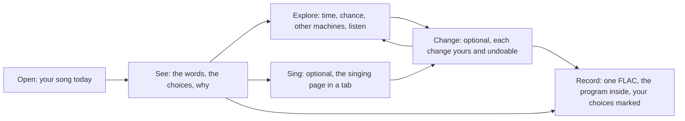
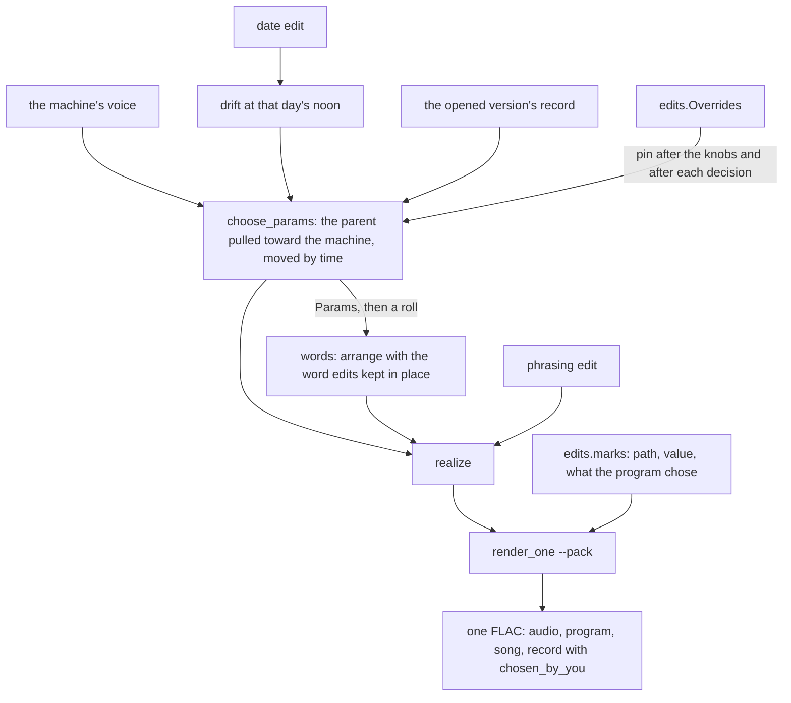

# The studio (2026-09-27)

The artist: "…for the final deliverable tool to allow the user to explore the
procedural generation and optionally edit the song before recording."

`songbird studio` opens a page on this computer that shows *your song today*:
the version this machine would sing now, from the rendition it was opened on
(or from the song as it began). The page shows every choice the program made
and why, lets you move through time, roll chance again and hear other
machines, lets you change what you like (each change marked as yours and
undoable), sends you to sing it if the program has its singing page, and
records the finished rendition: one FLAC carrying the program, the song and
its record, your choices marked as yours.

It is a local web page served by the standard library's `http.server` on
127.0.0.1, with plain HTML, CSS and JavaScript (songbird/studio/)
and nothing fetched from anywhere else: system fonts, no libraries, no build
step, only the program's own runtime dependencies. So it runs from a seed
packet's own program, offline. Nobody editing anything changes nothing about
how a song is made: the studio's version of today is `songbird render
--date <today>`'s, byte for byte.

## Running it

From a checkout:

    uv run songbird studio                                   # the lead song, from the song as it began
    uv run songbird studio renders/some-version.flac         # a child of that rendition (a packet, or a FLAC with its record)
    uv run songbird studio --machine fictional:ada --port 8766 --out renders/ --no-open

From a rendition (docs/PACKET.md):

    python3 now-its-by-you.flac studio

The file's bootstrap unpacks its program and runs `songbird studio --packet
FILE` with it, so the studio opens on the rendition the packet came from and
records its child. `--packet` (or the positional parent) takes any packet;
the studio reads its record with `pack.read_record` and its song from the
`genome.json` inside it. With no parent at all it looks for an unpacked
packet beside the program, else (in a checkout) the lead song. `--machine`
is the command line's (here, none, fictional:NAME, a voice file or a
record), default here; `--out` where recordings go (default `renders/` in a
checkout, the current folder from a packet); `--port` 8766 or the next free
one. It prints the address and opens it in the default browser.

## How it looks: a page from a copied tune book

The artist: "how can an app feel more like a folk song or something passed
down? I don't want to go overboard with this."

**Direction.** The studio is a page from a tune book that has been copied by
hand, person to person: the song set in a book face on warm paper, written in
one ink by the hand that copied it, with *your* changes in a second ink, as a
later hand annotates a copy it was given. Nothing is drawn to look old; it
borrows the conventions that make such a page readable, not its wear.

- **Paper and ink.** Warm off-white paper and a brown-black ink, instead of a
  green app palette. In the dark, the same page by lamplight: dark paper,
  cream ink. Every colour is a token; nothing else changes between the two.
- **A second hand.** Everything a person chose is in a blue-black ink (it was
  already its own colour; now it has a reason): the words they picked, the
  cards they changed, the notes they moved.
- **Rubrics.** Section names (Verse 1, Refrain 2) in small capitals, in the
  red a copyist used for headings, as hymnals and tune books still do. The
  same red marks the playhead.
- **Set like a songbook.** The words are the page: book face, generous
  leading, a copybook's single margin rule down their left. Controls stay in
  the system's sans at a readable size; only reading text is serif.
- **Broadside rules.** The header ends in a thin-and-thick double rule, as a
  ballad sheet's title does; the player sits under one. Buttons are small
  squared blocks (a letterpress's), not pills; cards are index cards with a
  ruled heading, as a field recordist's.
- **The line it came down.** Beside the version's name, a small row of
  marks, one for each version before this one and a filled one for this, so
  "passed down" is something seen.

**Not done, on purpose:** no textures, images, downloaded fonts, blackletter,
torn edges or stains (kitsch, weight, and worse to read); no change to what is
where. System fonts and CSS only (the program aims at 8 MiB). Contrast stays at
least 4.5:1 for text in both schemes, and phones keep the same layout rules.

## The flow



Every step but the first is optional: opening the studio and pressing Record
records what `songbird render --parent THE_PACKET --machine here --date
<today> --pack` would.

## The musical workbench

The first screen holds only what matters most: **Hear the song**, a few simple
changes (key, scale, tempo, a new performance), undo and redo, **Record it**
(or **Sing or record**, where the singing page exists), and **Help**. Everything
else is a step deeper, in four areas under them, opening on the words: **Words**,
**Tune** (the arrangement and melody editor, called Arrange in the code and in
links), **Sound** and **Other versions** (time and other computers). The bottom
player always plays and records. **Sing, record & pass it on**, at the foot,
holds singing, recording and saving the changes as a draft file.

Help is there when asked for and quiet otherwise (the artist: "Labeling
everything makes it busy and confusing"):

- a **?** beside each area (and beside the line saying which version this
  is) opens two or three sentences on what it is; the longer notes that used
  to sit under the controls (how the sketch differs from the sung preview,
  the keyboard for notes, what mute and solo do, how a style moves) live
  there, or in each card's *How this choice works*;
- the **Help** button (or the ? key) opens the whole studio in plain words,
  with **Show me around**;
- a first visit is walked through four steps, each pointing at one thing:
  hear it, change something simple, go deeper, record it. It is shown once
  per browser (and never on a link into a particular view), and Skip or Esc
  ends it. songbird/studio/help.js has both.

### Tune (Arrange)

A full-song overview shows every section, in proportion to its musical length.
Select one to open it; the scrollable detail strip underneath shows its miniature
melody and bar position. Drag sections to rearrange them, or use Earlier/Later.
The backend checks the arrangement before accepting it. Repeated verses and
refrains retain their story order: their chronological and canonical lyric rules
still matter. They can move around other kinds of section. This is a musical
arrangement, not arbitrary audio clips.

Every section opens a phrase strip and a scale-based piano roll. Each note carries
its sung syllable. Drag up/down for pitch, left/right for timing, or drag the right
edge for length. Select a note for precise pitch, start and duration controls.
Arrow keys nudge notes; Shift+Left/Right changes duration. Snap and zoom adjust the
editing grid. The harmony lane shows the chords beneath the tune. A shared phrase
edit updates every appearance, including instrumental echoes; the interface shows
how many places share it.

Notes retain their syllable count and order, stay within the song's range, keep
space before the following phrase's pickup, and preserve the ending's scale-degree
class. Validation rejects overlaps, non-finite values, excessive leaps and notes
outside the phrase. **Step**, **Soften leaps**, and **Even rhythm** offer small,
undoable compositional transformations. **Restore phrase/order** removes the local
override and returns to the version inherited by this studio: a released order gives
the form back to the machine, which chooses it from the parent's as it would with no
order (with no machine, the parent's form stays; never the seed's in its place).

**Play sketch** auditions a phrase, section or whole song immediately through a
small Web Audio oscillator. Loop and click provide practice tools; the playhead
follows the score. This is a melody guide. **Hear sung section** and **Hear the
song** use the real singer, phrasing, arrangement and mix, rendering locally when
needed. The two players stop each other. Existing audio is marked when it belongs
to earlier edits.

### Words

Each section shows the lyrics as sung. Native dropdowns sit directly in the lines
where a singable word can change; the verse, couplet or head has a dropdown beside
its section. Coupled words and refrain trades still follow the bank's rules. The
rules, unavailable alternatives and valid placements are folded underneath each
section. Options are loaded automatically and stale replies never replace newer
choices.

**Write your own lines** opens an original-lyrics editor in each sung section.
Each line displays its syllable target and a live count. Words with more than one
syllable are written with syllable hyphens (`car-ry`). **Use these lines** checks the
count and the singer's pronunciation before changing the song, as one undoable
transaction. Unsupported words and mismatched counts receive an explanation;
unapplied typing stays in place while choices refresh. The writer is responsible
for the meaning and rhyme. **Use the song's line** releases authored text, including
text inherited from a parent recording.

Authored text belongs to the words it replaces rather than to every use of its
tune or to a place in the form: a verse's lines to that verse (`verse:wire`, or
`verse:seed2` in a song without a bank), a refrain's, bridge's or tag's to its time
round (`refrain:0`, `bridge2:0`; the last refrain is `refrain:last`, which the
bank always sings the same way). It follows that section through arrangement
moves. The bank continues evolving underneath it: a later version that still
sings the verse sings the line in it, wherever it now comes; one that no longer
sings it doesn't sing the line. Restoring a bank line reveals the current
procedural words. Original lines travel in compact composition data (`lines`),
and the exported lyric sheet is taken from the actual sung score. A recording
made before lines were kept this way kept them by place (`lyrics`); it still sings
them there, and its next version takes them by the verses it sang.

### Sound

Cards expose the style, form, players, room, vocal presence and other choices.
Reasons and provenance are folded away. Every band player has a gain control
(0–200%), a mute that remembers its previous level, and a solo control that restores
the previous band mix when released. Solo leaves the singer audible. A solo or a
batch of mix changes is one undoable edit. A new style brings its own instruments,
pace, feel and arrangement options.

### Other versions (Explore)

The existing six-year timeline, day/month/year controls, and other-machine
comparison live here. Your explicit edits remain in place while the machine and
time change the rest of the song. The same fictional machine name always produces
the same machine.

### Drafts, history and recording

Edits save in browser storage on this device, under the song genome's fingerprint as
a draft is, so a changed song file doesn't bring back tune or lyric edits made for the
old one (edits saved before the fingerprint was part of the key keep only the choices
any genome takes: key, tempo, shape, band, mix, style). Date and chance are deliberately not
retained across reloads, so tomorrow opens on tomorrow. Undo/redo covers note drags,
word changes, arrangements and mixer actions (100 steps during the current visit).
Cmd/Ctrl+Z works outside text fields; text fields keep their own editing history.

**Save your changes as a file** (a draft, under Sing, record & pass it on) downloads a small `.songbird.json` file with the song's fingerprint
and edit map. **Open a saved file** validates the file and its edits before replacing the
current draft; opening is itself undoable. Drafts contain no audio or software,
and belong to the exact song genome they were written for. They are useful for
saving alternatives while the finished FLAC remains the complete portable artifact.

**Record it** uses the normal renderer and marks every chosen value. The finished
FLAC carries the program, song, composition, lyrics and record. Opening it in the
studio makes the next generation from those choices. No browser libraries, sample
packs, build tools or external services are required by the editor.

## How edits flow

An edit is one entry in a flat map from a path to a value: what the person
chose, on top of what the program chose. The page holds the map (and its
browser storage keeps it across a reload, all but the day and chance drawn
again, so tomorrow opens on tomorrow) and sends it with every request; the
server keeps nothing else but caches, so any request can be replayed.

| Path | Value | Acts on |
|---|---|---|
| `form.order` | section occurrence IDs (`verse:0`, `refrain:0`, …) | validated arrangement order, inherited in children |
| `tune.<phrase>` | `{degree, onset, duration}` for each note, in beats | pitch/rhythm of every appearance of that phrase |
| `lyrics.<section>:<verse-or-round>.<line-index>` | syllable-hyphenated text, or null to release inherited text | one original lyric line (`lyrics.verse:wire.0`, `lyrics.refrain:last.2`), checked against its tune; kept only where this version sings that verse or round |
| `date` | "YYYY-MM-DD" | the moment time is read at: noon UTC that day, as `--date` |
| `roll` | 1, 2, 3... | chance drawn again: the day's own seed drawn again that many times (`edits.rolled`), so chance still follows the day |
| `tonic`, `mode`, `tempo` | a MIDI note, a mode, beats a minute | `Params` |
| `form.verses`, `form.pairs`, `form.intro`, `form.turn`, `form.break`, `form.tag`, `form.outro`, `form.bridge2` | a count; on or off | `Params.form`: the program's shape with just these parts changed |
| `band.pattern`, `band.lead`, `band.density`, `band.brightness`, `band.<instrument>` | as `Band`; an instrument's gain (0 sits it out) | `Params.band` |
| `mix.space`, `mix.width`, `mix.forward`, `mix.intimacy` | as `MixParams` | `Params.mix` |
| `variants.<name>` | as the variant takes | `Params.variants`, once it exists (said refused until then) |
| `words.verse.<i>` | `{"id": verse, "slots": {slot: words}}` | the i-th verse section's verse (from 0) |
| `words.refrain.<i>` | `{"id": couplet, "head": head, "slots": {slot: words}}`, any of the three, or just a couplet | the i-th refrain's own words: its couplet (never the last's), its head (between the first and last), its words (the question too, between them) |
| `words.refrain` | `{slot: words}` | words for every refrain whose head sings them ("while"), unless one chooses its own; the question and "then" are each refrain's own |
| `words.bridge` | `{slot: words}` | the bridge's once-a-song words |
| `words.bridge2`, `words.tag` | a stanza, a syllable | the second bridge, every tag |
| `phrasing` | a phrasing's name on this computer | whose way it is sung |

Each part of the shape is its own edit, so "no intro" holds while the day
moves the rest of the shape. The edits go in inside the program's table, not
after it, so a decision that reads one reads the person's: a chosen minor
mode leans the words darker, as the machine's own minor would (and the words
card says so). That is the only such knock-on so far; `songbird/edits.py`
lists them.



In code, all additive (a call without edits is the call as it was, and the
seed render and the word draw are unchanged, byte for byte):

- `songbird/edits.py` (new) is the override interface: `check()` holds each
  value to its bounds or says why not; `Overrides` puts them in place inside
  the table and draws chance again; `resolve()` makes the whole rendition with
  a person's edits (parameters, then the words, each chosen word kept only if
  the rules can keep it beside the ones before it), with `applied`,
  `problems` and `marks`; `pins()` turns word edits into arrange's choices;
  `shape()`, `build()`, `reshape()` and `shapes()` read a form as its parts,
  build it back and say which part changes can be sung; `marks()` makes the
  record's block, `from_record()` turns it back into edits; `keep_words()`.
- `realize.choose_params(..., overrides=None)`, and `variation.choose(...,
  pin=None, trace=None)`: the pin is called after the knobs and after each
  decision; the trace receives each knob's arithmetic.
- `arrange.arrange(..., chosen=None)`, `arrange.keep()` (a person's words kept
  in place, the rest drawn around them), `arrange.problem(genome, form,
  chosen=None)` (why a form or a choice can't be sung), `arrange.options()`
  (every choice for one section, allowed or refused with why, and where else a
  refused verse could go); `_VerseRules.why()` and `pinned()` say which rule.
- `cli.render_one(..., chosen_by_you=None, progress=None)`; `songbird render
  --edits FILE` (today's version with those choices: an edits file, or a
  record whose marks are made again) and `--replay RECORD` (a rendition again
  exactly as its record says: its parameters and the words it recorded, from a
  packet or a record; a person's phrasing given again with `--phrasing`).
- `synth.render(..., progress=None)`: told which part it is making, for the
  progress bar.
- `songbird/explain.py` (new) says each choice in plain words, with its
  reasons, draws the timeline and compares machines; `songbird/studio.py`
  (new) is the server; `songbird/studio/` the page.

### Why a choice was made

- **A number** the table works out (tempo, the key's note, the band's density
  and brightness, the mix, the words' era and appetite for rare verses, the
  singer's day) is traced as it is made: what it was in the parent, how far
  the machine pulled it and how far time moved it (the child hears 0.6 of
  each). Each is said, with its direction, only when it is big enough to hear
  (a beat a minute, half a semitone, 4% of a range); when they pull opposite
  ways and cancel, the card says "so in the end it is about as it was"; when
  neither is heard, "kept from the version before".
- **A choice among a few** (the mode, the shape, the band's pattern and lead,
  the room) is asked again without time (every dimension of the drift at
  zero, and no past to read) and without the machine (one with no signals, at
  the same moment): what changes when the machine is taken away is its doing,
  what changes when time stands still is time's. The words' mood is said from
  what leans it: the screen's brightness and warmth, a minor key, these weeks.
- The words and every small detail of the sound are **chance**; anything
  changed is **yours**, with what the program chose; a value the version
  before kept from a person says "kept from the version before, where a person
  chose it".

The page never says genome, drift, harvest, knob, params or seed
(tests/test_studio.py checks every text it shows). It says the song, the song
as it began, the version before, your machine, time (today, these weeks, this
season, this year), chance and you.

## Listening

A preview is a section (or the whole song) made when asked. A section is cut
from the whole rendition's score by what is sounding: the notes from a breath
before its first pickup (a beat of the band before it at least) to where the
next section's pickup begins, an instrument's note already ringing brought in
a second early so it has settled, and no sung syllable from before it (none is
begun halfway). It is made,
brought up by the gain mastering gives a whole rendition (5.3 dB, measured on
H: 5.1 to 5.4) under the same ceiling, so a quiet verse stays quiet and a turn
isn't pushed to the loudness of a refrain, and faded in and out. A section of
H takes a second or two, the whole song about fifteen seconds on this Mac (the band, the choir and the vocoder now run on threads; docs/PERFORMANCE.md). The page calls it a
preview: a part heard alone is not the record's exact samples, and the mix's
balance is judged on the whole song.

One renderer works at a time: recordings first, then the newest preview (a
preview still waiting is dropped when another is asked for). Every render is
cached by what it depends on (the parameters, the words, the phrasing, the
section, the program's version) under `~/.songbird/studio/` (or
$SONGBIRD_HOME), kept under 300 MB, least recently heard going first. The
whole song's preview is the recording itself, so Record after Hear it all
only copies it.

## Singing

In a checkout, *Sing it* starts the singing page (`tools/karaoke.py`, reused,
not copied) on 127.0.0.1:8765 for the same song, if it isn't running there
already (it checks the song's title), opens it in a new tab, and stops it when
the studio stops. Back in the studio, the singer's card offers the phrasings
made on this computer: each person who kept takes of this song, and everyone's
together; never the reference voices. The singing page's own "hear the
machine" sings the song as it began, not the studio's version: the studio's
preview is where to hear your version sung your way. A packet's program has
no singing page yet (songbird.quadule.com will take takes online), and the
card says so.

## Recording

*Record it* renders the whole rendition as `songbird render --pack` does
(`cli.render_one`, as the child of the version opened) and writes one file:
`<song>.<day>.<first six of its id>.flac`, into `renders/` from a checkout or
the current folder from a packet. It plays anywhere, and carries the program,
the song, the words and its record, whose `params` are what was sung (a
person's choices among them) and whose `chosen_by_you` marks, for each edit
that took effect, the value chosen and what the program had chosen:

```json
"chosen_by_you": {
  "date": {"value": "2027-09-26", "was": "the day it was made"},
  "mode": {"value": "aeolian", "was": "ionian"},
  "words.verse.1": {"value": {"id": "ink", "slots": {...}}, "was": {"id": "mind", "slots": {...}}}
}
```

A phrasing is marked by what it is, never whose: `{"value": "a person's way",
"detail": "2 sung take(s)", "digest": ...}`. `songbird render --replay
FILE` renders it again byte for byte (tests/test_studio.py does). Run with
Python, the file makes the next version: its children inherit what was sung,
a person's choices among them.

## What stays on the machine

Nothing leaves it (unless it is shared for a preview: see below). The server
answers only 127.0.0.1 and only requests that
name it (so no web page can reach it under another name); it takes changes
only as JSON carrying the token its own page was given (a header no other
page can send without asking first, which it never answers); it serves only
its page, its answers and its renders by their hashes, under a content
policy that lets the page load nothing from anywhere else. The record keeps
what a command-line record keeps, plus the marks of what was chosen. The
browser's storage keeps the edits in progress on this browser only.

## Sharing the studio for a preview

The studio is made for one person on their own computer. It can also be
served from one computer to a few people, for a short preview, and only when
asked: `--host` (where it listens) or `--allow-host` (a name visitors reach it
by through a tunnel). Either one makes it *shared*:

- **A link with a key.** Every visitor needs the link it prints, ending
  `/?key=…`. The first visit keeps the key in a cookie for that browser; a
  visit without it gets a page saying to ask for the whole link. The key is
  new each time the studio starts unless `--key WORD` fixes it (so links
  survive a restart). It is the only lock: anyone holding the link can use
  the studio, and taking it back from one person means restarting with
  another key.
- **Its names.** It still refuses a request that names it by any name it
  wasn't given (the guard against a page elsewhere reaching it by
  rebinding a name), and a change from any page but its own. Bound to
  `0.0.0.0` it answers to this computer's addresses and its name; a
  tunnel's name is given with `--allow-host` (a leading dot allows every
  name under it, as a quick tunnel's names are random).
- **It says what it means**, in the terminal, when it starts: whom the
  link lets in, that the song is made on this computer's time, where
  recordings go, and whose machine shapes the song.

What changes for several people at once:

| | With a few people | What the studio does |
|---|---|---|
| Their changes | each browser keeps its own, as ever; the server keeps none | nothing to share or clash |
| Listening and recording | one renderer for everyone: a section takes seconds, a whole song about a minute | recordings first, then the newest preview; the page says how many are ahead; past 12 waiting it asks people to try again in a minute |
| Recordings | written on the serving computer, into `renders/` (a checkout) or the folder it ran from (a packet) | the page offers each visitor **Download it**; the file is theirs to run |
| The machine | "your machine" is the serving computer's (its languages, size, screen) for everyone | the page and the terminal say *the computer serving this studio*; `--machine fictional:NAME` or `none` if its facts shouldn't shape everyone's version |
| Singing | the singing page listens on the serving computer only | off while shared; the singer's card offers only *everyone who has sung it*, never one singer's own way or name |

Left as they are, for the artist:

- **A visitor's own computer doesn't shape their version.** Reading it
  would need the page to gather their browser's languages, screen and size
  and send them: a second harvest, with its own consent. Worth doing only if
  the studio goes on being shared.
- **Plain http on a home or office network.** Anyone on that network could
  read the link as it travels. A tunnel gives https.
- **No limit per person.** One visitor can keep the renderer busy for
  everyone; the queue's cap keeps it from growing without end, and
  recordings fill the disk at about 15 MB each.
- **Previews are shared by what they are.** Two visitors with the same
  choices hear the same cached render; nobody can list anyone else's.

### The recommended way (the artist, from the other computer)

Through a Cloudflare quick tunnel, which needs no account: the studio stays
on 127.0.0.1, so nothing on the local network sees it, and visitors get
https. In one terminal, from the checkout:

    uv run songbird studio --port 8790 --allow-host .trycloudflare.com --key pick-a-long-word --no-open

(or beside a rendition: `python3 now-its-by-you.flac studio --port 8790
--allow-host .trycloudflare.com --key pick-a-long-word --no-open`). In a
second terminal, with `cloudflared` installed:

    cloudflared tunnel --url http://127.0.0.1:8790

It prints an address like `https://some-random-words.trycloudflare.com`.
Send people that address with `/?key=pick-a-long-word` on the end. Ctrl-C in
both terminals ends the preview; the address dies with the tunnel.

Other ways, described only (nothing here was set up):

- **Tailscale**, for people already on the artist's tailnet:
  `tailscale serve --bg 8790` publishes the local port inside the tailnet
  at `https://MACHINE.TAILNET.ts.net` (`tailscale funnel` instead opens it to
  anyone; the command's syntax has changed between versions, so check
  `tailscale serve --help`). Start the studio with
  `--allow-host MACHINE.TAILNET.ts.net`.
- **The same network** (a room, a house): `uv run songbird studio --host
  0.0.0.0 --port 8790 --no-open` prints `http://ADDRESS:8790/?key=…` links for
  this computer's addresses. Plain http: for people in the room. macOS asks
  once whether Python may accept incoming connections; say yes for this.

Before sending the link: render one section yourself so the first visitor
doesn't wait on the synthesis compiling (10 to 15 s), keep the computer awake
(`caffeinate -i` on macOS), and choose `--out` if the recordings should land
somewhere other than `renders/`.

## How it was checked

- tests/test_arrange_choices.py: the word draw without choices is byte for
  byte as before (a golden of 600 draws taken before the change); every refusal
  agrees with the rules (4,000 random sets); every verse offered is kept in its
  place with nothing else moving; choices hold, and the rules hold, as chance
  changes; couplets and heads trade, words for every refrain hold everywhere; each alternative
  offered can be sung.
- tests/test_edits.py: no edits change nothing; each edit takes its place in
  its bounds; a minor mode darkens the words; refusals say why; the shape
  changes part by part and holds as the day moves; words kept or refused; the
  marks replay; a phrasing is never marked with a name; keep these words holds
  through a roll.
- tests/test_studio.py: the server refuses other hosts, other origins, pages
  without its token and anything but JSON; the page gets the song, its choices
  and bounds; no card ever says the code's words (four machines, three days);
  today is the command line's today; a packet opens as the parent; a section is
  made on demand and served with byte ranges; a recording is a packet with the
  person's choices marked, and replays byte for byte.
- In a browser (the built-in one, laptop and phone sizes, and headless Chrome
  for the pictures): opening, choosing a verse and its words, the refusals and
  their alternatives, changing the key, mode, band and mix, moving through
  time, other machines, a section made and played (−14.4 LUFS, −1.2 dBTP, a
  verse's level), recording a packet, and opening that packet as the next
  version's parent. The song view answers in about 20 ms, six years of the
  timeline in about 2 s.
- A Fable review of the design (read-only) before it was built: its findings
  are in (the phrasing mark, roll for seed, edits inside the table, the knobs'
  trace, cutting by what sounds, the token, the refusals' alternatives,
  --replay). A second Fable review of the built studio found that a replay of
  a child lost its parent's choir voices, that "today:" ignored the person's
  own choices, that held words counted as changes, that a preview could begin
  the line before's last syllable, and some holes in the server (a refusal
  that left a kept-alive connection out of step, a short listen queue, a
  verse count unchecked): all fixed and tested, with its wording notes.

## Decisions for the artist

1. **A person's choices pass to children.** A rendition's parameters are what
   was sung, so a child pulls from the person's choices as from a machine's.
   The alternative hands children only what the program chose. (Found in
   review: an instrument sat out comes back in the child at half level at
   least, because the table's bounds catch it; clipping the machine's own
   value instead of the child's would let it ease back in.)
2. **Today is a day.** The studio's today is noon UTC of today's date, as
   `--date` has it: the same machine opens on the same version all day, and
   Roll chance again draws another. The command line without a date draws a
   new one every second.
3. **The singer is the machine's.** Only its phrasing changes, by singing.
4. **A person's ranges are the designed ones**, wider than a machine's own:
   tempo 0.75 to 1.3 times, every instrument can sit out (all of them for the
   voice alone), the mix's full ranges.
5. **A mode chosen by a person leans the words**, as the machine's own mode
   would; the rest of an edit changes only what it names.
6. **A singer's gestures don't travel.** Replaying a rendition sung a
   person's way needs that phrasing's file (the record keeps its fingerprint).
   Carrying the gestures in the record would make every rendition replayable
   anywhere, and would carry a little of a person's singing with it: whether
   the consent in docs/SINGERS.md covers that is the artist's call.
7. **Made-up machines have names** (Ada, Basil, Coral), because a name is what
   makes one; any name can be typed.
8. **Recordings are named** `<song>.<day>.<id6>.flac`, into `renders/` (a
   checkout) or the current folder (a packet).

## Verification

```sh
uv run pytest tests/test_composition.py tests/test_studio.py tests/test_edits.py tests/test_evolve.py tests/test_pack.py
node --test tests/studio_*.test.cjs tests/test_studio_drafts.cjs
```

Composition regression tests cover validation, provenance, replay, inheritance,
actual packet reopening, compound meter, rendered note timing, and the editor's
compressed size. Browser interaction tests use dependency-free DOM/audio doubles
for history, races, selection, dragging, playback and original lyric drafts. Live
browser checks complement these for layout and native controls.
