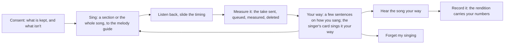

# Singing in the web studio (2026-09-29)

The studio's *Sing it* works on the web: a visitor sings along to the guide
on the studio's own page, the take is measured on the server and its audio
deleted there, and the song is sung their way: by the machine's voice, with
their timing, holds, loudness and pitch gestures, never their voice. They can
hear it and record a rendition that carries it. This is the web studio's
singing (docs/WEB-STUDIO.md has the public studio it runs in); the karaoke on
the artist's computer (tools/karaoke.py) and the contest's online page
(docs/SING-ONLINE.md) are unchanged.

    uv run python -m webstudio.prepare                  # once, on a computer with the memory: the singing kit
    uv run songbird studio --public --web-singing       # or without --public, on this computer only

`--web-singing` needs a checkout (tools/, webstudio/), the `web-singing`
dependency group (pyworld, librosa: `uv sync --group web-singing`; the dev
group has them too) and the singing kit (`--sing-kit DIR`, else
$SONGBIRD_SING_KIT, else `renders/sing-kit`). Without any of them the studio
runs as before; with a kit missing or made for another version of the song
or of the measuring code, the singing card says so and the rest works.

Nothing of this is in the song's program: `webstudio/` sits beside
`songbird/`, a packet carries `songbird/` alone, and the studio imports it
only when `--web-singing` asks.

## The flow

- **Consent first.** The first press of *Sing it here* shows what happens to
  the singing, and nothing records until the visitor ticks "I understand"
  (the page remembers the consent's version in its browser, and asks again
  if the words change):
  - *Your voice is not kept.* The microphone is recorded in the browser only
    while they sing. A take sent to be measured goes to the computer serving
    the studio, which measures it and deletes the recording straight away:
    never saved, played to anyone or used to copy a voice.
  - *What's kept is numbers*, for each note: how early or late, how long
    held, how loud, how they slid into it and off it. In their browser, and
    on the server under a code (no name, no address) for 30 days after last
    use, so the studio can sing it.
  - *Nothing is published unless they record.* A recording carries the
    numbers (rounded), as every rendition carries its singer's way.
  - *They can take it back.* Forget my singing removes the numbers from the
    browser and the server (not from a recording already made).
- **Singing** reuses the karaoke's own code, served from tools/ as it is
  (tools/karaoke.js and tools/karaoke-recorder.js; webstudio/sing.js imports
  them): the take is recorded in the guide's audio clock by the same
  worklet, cut from the same frame, auto-synced by the same pitch slide and
  written as the same 16-bit WAV, so it is measured exactly as a karaoke or
  online take is. The lane of notes and the words as they're sung are the
  karaoke's; a section or the whole song; a key from the kit (the song's
  own, and two steps either way by default; the kit's `--keys`); a device
  delay learned from each take's sync.
- **Measure it** sends the take (a small JSON of where it was sung, then the
  WAV, in one request) with the numbers of the takes measured before it,
  which the browser keeps. It waits in the studio's one queue, with the
  renders (below), and the page says how many are ahead and about how long.
  Its result is the new take's numbers and a way of singing made from all
  of them (each person counts once: tools/phrasing.py `singer_phrasing`),
  and a portrait ("You sit 12 ms behind the beat on average… You slide into
  26 of 44 notes…"). The page sets the singer's card to *your way* and
  offers *Hear the song your way* and *Record it your way*. Each further
  take joins the way (up to 12).

## What is kept, where, and for how long

| Where | What | How long |
|---|---|---|
| The visitor's browser (localStorage `songbird-web-singing`) | the consent's version, the key chosen, the device's delay, each take's measured numbers (about 40 kB for a whole take), the way made from them | until they forget it or clear the browser |
| The page's memory | the take's audio, between Stop and Measure it (listen back, slide) | until it is sent, sung again, or the page closes |
| The server's memory | the take's audio while it waits for the measuring process | until it's measured (at most 3 wait at once; a cancelled one is let go with it) |
| The measuring process | the take decoded in memory; each piece it reads in a temporary WAV (0600) in /dev/shm (memory) or /tmp | removed as soon as it has been read, whatever happens; leftovers from a killed process swept at its next start |
| The server's disk (`$SONGBIRD_HOME/studio/sung/sung-<16 hex>.json`) | the way of singing: rounded, bounded gestures by phrase and note, "1 sung take(s)"; named by its fingerprint | 30 days after it was last used, or until forgotten |
| A recording the visitor makes | the way's rounded gestures, in the record's `performance` (as any rendition's), marked "a person's way" | the file's; a public studio keeps it for download a day |

No name, address, cookie or anything about who sang is kept with any of it;
the job's result (numbers) lives in the queue's memory with the job, as a
preview's does. The server never lists the ways it keeps: a page names its
own, and only a page that made one knows its name. The access log records
`POST /api/sing/take 200` like any request, never who.

## Measuring on a server

webstudio/worker.py measures a take with tools/phrasing.py's own functions,
in a process of its own (`python -m webstudio.worker KIT`), started when a
take needs it. Two differences from the artist's computer, both for a
server:

- **No forced aligner.** MFA isn't in the container, so each vowel's start
  is found where its loudness climbs out of the consonant before it, as it
  was before MFA. **No speech recogniser either:** faster-whisper reads
  plain spoken readings (tools/phrasing.py `--speech`), never sung takes,
  so no model is chosen or loaded. (It is imported at the top of
  tools/phrasing.py; the worker puts a stand-in that refuses to work in its
  place, which saves 30 MB and four seconds, and lets the image go without
  it.) For the record, faster-whisper `base.en` int8 on this Mac: 62 MB to
  import, 395 MB loaded, 518 MB transcribing 30 s.
- **Long takes in pieces.** WORLD's pitch tracker (pyworld `harvest`) holds
  about 14 to 19 MB for every second it analyses at once, so a whole take
  (four minutes at 90%) is 3.4 GB in one piece. A take longer than 40 s is
  cut in the middle of every rest of 3 s or more between notes (the turns
  between sections; any piece still over 40 s at its longest rest), each
  piece measured from 2 s before its first note to 1 s after its end as
  tools/phrasing.py measures a take of one section (`measure_window`). A
  take of one section (31 s at 90%) is measured whole, exactly as there.

The template singer's analysis of each guide (what a take is compared
with) takes 4 GB and a minute to make, so the kit carries it, made ahead.

### The kit

`python -m webstudio.prepare [--keys -4 -2 0 2 4] [--tempos 90] [--octaves -12 0 12] [--kit DIR]`
writes, for each version offered (the first recording set, each key and
speed): its score, the melody guide (the karaoke's default mix: the tune on
a whistle over a pulse, rendered from the score alone, mono at 22.05 kHz:
6 MB of FLAC for the whole song), its words, and the template singer's
analysis in the guide's key and an octave either side. Each template is
made in a process of its own (4 GB, about a minute on an M-series Mac); the
default five keys are 15 templates, about 15 minutes; the kit is about
45 MB. Nobody's voice is in it: the guides are the song's, the templates the
machine's.

The templates are kept under the measuring code's version
(tools/phrasing.py `version()`, which hashes the singer's code), so the kit
must be made by the program the server runs; the studio checks at start
and says "the singing kit was made by another version of the measuring
code" rather than refusing every take. A take sung more than a few
semitones off the guide's key or its octaves has no template, and is
refused with what to do: "choose the key nearest your voice and sing it
again".

### How the numbers compare

- **The same as the tools.** A take of one section is measured with exactly
  the numbers tools/phrasing.py `measure_window` gives the same file without
  MFA (tests/test_web_singing.py: every note, the lag and the key).
- **A planted way is heard.** The template singer singing the first verse
  with every second note 60 ms late: those notes measure later than the
  rest by 0.14 beats against the 0.086 planted (the neighbours' onsets move
  too; the test asks for at least half).
- **Pieces against a whole take.** The machine's own singer (the spec's
  voice mix, 244 s) measured whole and in the nine pieces the worker cuts:
  every vowel start within 20 ms (all but a handful within 10 ms), timing
  and holds equal for 98% of notes, pitch gestures within a fraction of a
  cent; loudness and swell differ by about 0.9 dB (median), because each is
  read against the same vowel elsewhere in the piece rather than in the
  whole take, as for any take of one section.
- **Without MFA, against the measurements kept with it** (volunteers' takes,
  read in place from the main checkout for this comparison only, their
  audio never copied; each note's vowel start and gestures against the
  cached MFA-led measurement): see the table below. This is the accuracy
  cost of no aligner: docs/PHRASING-CALIBRATION.md measured it on planted
  takes (78% of vowel starts within 30 ms without MFA, 96% with it) and on
  windows (16 to 46% within 10 ms of the whole take's without MFA).

| take (singer, what) | notes | vowel starts the kept measurement took from MFA | within 30 ms | within 60 ms | median | r timing | r hold | r level | r scoop |
|---|---|---|---|---|---|---|---|---|---|
| A, verse 1 | 44 | 40 | 55% | 73% | 20 ms | 0.62 | 0.76 | 0.90 | 0.81 |
| A, refrain 1 | 40 | 40 | 70% | 93% | 20 ms | 0.85 | 0.82 | 0.99 | 0.70 |
| B, verse 1 | 44 | 4 | 95% | 95% | 0 ms | | 0.99 | 1.00 | 1.00 |
| B, refrain 1 | 40 | 6 | 97% | 97% | 0 ms | 1.00 | 1.00 | 0.99 | 0.95 |
| C, verse 1 | 44 | 38 | 70% | 73% | 15 ms | 0.97 | 0.99 | 0.87 | 0.90 |
| C, refrain 1 | 40 | 16 | 88% | 95% | 0 ms | | | 0.98 | 0.95 |
| D, verse 1 | 44 | 38 | 39% | 43% | 108 ms | 0.81 | 0.45 | 0.65 | 0.94 |
| D, the whole song (in 9 pieces) | 347 | 177 | 44% | 48% | 115 ms | 0.23 | 0.23 | 0.61 | 0.51 |

(Blank: too few notes timed in both to say.) Where MFA had given up on a
take (B), the two agree almost exactly, as they should: the same code. Where
it led, the web studio's vowel starts sit within 30 ms of it for 55 to 88%
of notes, and its timing follows MFA's note by note (r 0.62 to 0.97) for
three singers of four. The fourth (D) sits about 110 ms from MFA throughout,
a constant offset in a section (r 0.81) that doesn't survive a whole take cut
in pieces (r 0.23): a voice whose consonants the loudness-based starts read
very differently from MFA. Level and scoop hold up better than timing
(r 0.5 to 1.0). So a web visitor's way is a fair sketch of their phrasing,
pitch and dynamics more than timing, and weaker than what the artist's
computer measures; decision 2 below.

### Memory and time

On this Mac (M-series), one process measuring, the kit's templates ready:

| | measuring | the whole request, cold | peak memory of the measuring process |
|---|---|---|---|
| a section (31 s) | 4.5 s | 6.6 s (the process starting: about 2 s) | 610 to 870 MB |
| the whole song (244 s, in 9 pieces) | 29 s | 31.6 s | 880 MB |
| the process idle (imports, a guide) | | | 270 MB |

A slower server core will take perhaps twice as long. The studio's own
process doesn't load the measuring tools at all. The container's cap
(2.5 GB, a render up to 1.5 GB) holds because a measurement is a job in
the studio's one queue (`studio.jobs`, kind `measure`): a render and a
measurement never run at once. In a public studio the measuring process is
stopped after every take (its memory given back before the next render); on
one's own computer it waits five idle minutes for the next take.

## Limits

| | | |
|---|---|---|
| a take's size | 40 MB (a whole song at 48 kHz is 23 MB) | 413 |
| its length | 3 s to 6 minutes, and no more than 10 s past what it says it sang | 400, said |
| takes waiting in memory | 3 at once | 503 "try again in a minute" |
| takes on their way | 2 at once, one from each address (each is read into memory) | 503 "send yours again in a moment" |
| a public visitor | one thing in the queue at a time (a take or a render); `--limit takes=12` an hour, `takes-ip=30` for an address | 429 with Retry-After, as for renders |
| a way of singing | 12 takes; 256 kB; only this song's phrases, every gesture rounded and bounded | 400, said |
| kept ways | 30 days after last use | |

The take is guarded as the studio's own requests are: its address (Host,
Origin), a shared studio's key, the page's token, a content type of its own
(`application/x-songbird-take`), and a public studio's requests-a-minute.
Since 2026-09-30 every one of them, and singing's own (on, the visitor's
turn and takes this hour, room among the takes waiting, and the takes on
their way), is asked before a byte of the take is read; a refused take is
read and dropped a block at a time, nothing of it held (docs/WEB-STUDIO.md,
"Before launch").

## In the code

- `webstudio/`: `kit.py` (where the kit's files are; standard library
  only), `prepare.py`, `worker.py` (the measuring process), `singing.py`
  (the studio's side: routes, the waiting takes, the Measurer, the Store of
  ways by fingerprint), `sing.js` and `sing.css` (the page's side).
- `songbird/studio.py`: `--web-singing`, `--sing-kit`;
  `Studio.enable_web_singing`, `phrasing_choices` (a name `sung-…` is looked
  up in the Store, never listed), `sung_phrasings` (the card's "your way");
  the handler asks singing first about its routes and the take's upload,
  and the page gets `/sing.js` and `/sing.css` added. `songbird/public.py`:
  the `takes` limits. `songbird/explain.py`: a phrasing may say its own way
  ("sung your way"). `songbird/studio/studio.js`: the ways a browser made are
  offered on the singer's card beside the studio's (`phrasingChoices`), and
  its last section hands webstudio/sing.js a few of the page's functions
  (`window.songbirdStudio`).
- `tools/phrasing.py`: `sung_phrasing`/`singer_phrasing` take measurements
  already made (`measurements=`), for takes that were never files.
- `deploy/studio/`: the image installs the `web-singing` group (a compiler
  lent to build pyworld), copies tools/ and webstudio/; the compose file
  mounts the kit read-only at /kit and passes `--web-singing --sing-kit /kit`
  (`STUDIO_SINGING`, `SING_KIT`).

## Decisions for the artist

1. **Web visitors' numbers stay theirs.** Nothing sung in the web studio
   joins everyone's way or the lineage choir: the numbers live in the
   visitor's browser and, for 30 days, under a code on the server, to sing
   their own version. Gathering them into the song (with an opt-in and its
   own consent, as the contest's volunteers gave) is a separate decision.
2. **No aligner on the server.** Vowel starts without MFA are good but
   plainly less exact (the table above). MFA in the container is possible
   (a conda environment of about 1.5 GB on disk; about 20 s and more memory
   per section) but heavy; the alternative is to accept this as a web
   visitor's way, a sketch of their phrasing.
3. **30 days** for a way kept on the server after its last use (so the
   studio can sing it on a later visit). Shorter is more private; the
   browser can always give it back while it has it.
4. **A recording carries the numbers.** As every rendition does now
   (`performance` in its record). The consent says so; the alternative
   would be a web recording that can't be replayed elsewhere.
5. **Keys offered**: the song's own and two and four steps either way at
   90% (the kit's defaults); each key is a guide (6 MB) and three templates.
6. **The melody guide only.** The band's guide ("the whole song") would need
   a full render per key (6.7 GB peak on this Mac) and 20 MB downloads; the
   karaoke's default was the melody anyway.
7. **A take is one of a public visitor's turns.** Twelve an hour by
   default, one thing in the queue at a time, like a section.

## How it was checked

- tests/test_web_singing.py: without `--web-singing` nothing of it is
  served; the page gets the singing and the karaoke's own files; a kit for
  another song is said, not used; a take is refused for a wrong token, type,
  address, guide, version, length or body, and too big before its body is
  read, with nothing reaching the measuring process; a take waits in the
  queue, is measured, and no audio is held or written anywhere after; a
  refusal is said to the singer; the queue refuses a flood; a public
  studio counts takes against each visitor and holds them to one at a time;
  the song is sung "your way" by a name that is never listed, marked "a
  person's way", never whose; a way kept is rounded, bounded, stable,
  forgettable and expires; a long take is cut in its rests; and the real
  measuring process on a planted take gives tools/phrasing.py's own numbers,
  hears the planted notes late, and leaves no piece behind.
- By hand, in the built-in browser (a public studio with `--web-singing`
  and a three-key kit): the consent, the stage (lane, words, count-in,
  progress) rehearsing a verse to the guide, laptop and phone widths with
  no sideways scroll; a whole synthesized take sent as the page sends it
  (the browser pane has no microphone), measured in 31.6 s; the singer's
  card saying "sung your way"; the whole song rendered that way; Forget my
  singing removing it from the browser and the server; no measuring process
  left running and no piece of a take left in the temporary folder.
