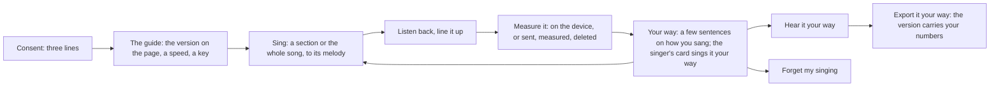
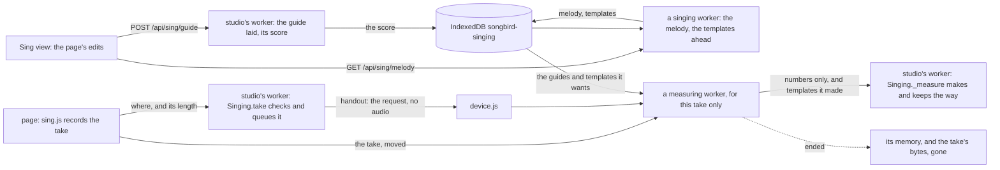

# Singing in the web studio

The studio's *Sing* view lets a visitor sing the version on the studio's page (or the released one) along with its
tune. The take is measured and the song is sung their way: by the machine's voice, with their timing, holds, loudness
and pitch gestures, never their voice. They can hear it and export a version that carries it. On studio.itsby.you the
take is measured in the visitor's own browser and never leaves it ("On the device"); a studio on a computer
(`songbird studio --web-singing`) measures it there and deletes the audio. docs/WEB-STUDIO.md has the studio it runs
in. The karaoke on the artist's computer (tools/karaoke.py) is separate, and so was the September 2026 volunteer
singing (docs/history/SING-ONLINE.md).

    uv run python web/studio-wasm/tools/build_site.py OUT   # the studio on the device: singing is in it
    uv run songbird studio --web-singing                     # a studio on this computer (--public: the server mode)

`--web-singing` needs a checkout (tools/, webstudio/) and the `web-singing` dependency group (pyworld, librosa: `uv
sync --group web-singing`; the dev group has them too). Nothing is made ahead: what measuring needs is made when it's
first needed and kept (`--sing-kit DIR`, else $SONGBIRD_SING_KIT, else `sing-kit` in the studio's home: "The kit").
Without the dependencies the studio runs and Sing says why.

Nothing of this is in the song's program: `webstudio/` sits beside `songbird/`, a packet carries `songbird/` alone,
and the studio imports it only when `--web-singing` asks (or the site is built with it, its default).

## The Sing view

- **A fourth view**, beside Page, Arrange and Mix (its tab, the phone's bottom bar, the key 4, `#view=sing`), the
  whole width (the inspector's column is hidden there). The Tools sheet has one line and a button that opens it. It
  is there only when the studio takes singing (webstudio/sing.js shows it).
- **What is sung is what the Page shows.** The guide is made from the version as the page has it (POST
  `/api/sing/guide` with the page's edits, and the page's token for someone's version): its words, tune, key and
  tempo, laid on its grid (`realize()` without a singer's phrasing or lay: webstudio/guide.py `score_for`). It is made
  again whenever the view is opened or the version changes (an edit, a key or tempo from the transport). **The
  released version** is the other choice ("This version · The released one"): opening the release in the studio
  would give its child (today's drift, other words and form), so its guide is laid once with the release's own
  program, as tools/piano_score.py lays the piano page's score (tools/released_guide.py → webstudio/released.json,
  100 kB; its words checked against the packet's lyrics.txt).
- **A speed and a key for a voice**: as written, 90% (where a singer starts, as the karaoke does) or 80%, by
  stretching the guide's times; and the key moved 2 or 4 steps either way ("Too high or too low? …" is the key
  chooser's tooltip). A take sung an octave (or a few steps) from the guide is measured in its own key; past 19
  semitones it is refused, said.
- **The consent** is three lines, a tick box and *Start* (the qualifications in tooltips):
  - *Your singing is recorded and measured on this device, then deleted. It is not sent anywhere.* (tooltip: it is
    not saved, played to anyone or used to copy a voice; a take waits in the page's memory until it is used or
    recorded again)
  - *What is kept, in this browser, is a set of numbers for each note: when you came in, how long you held it, how
    loud it was and how you slid into it.* (until Forget my singing)
  - *A version you share contains those numbers and no recording of you. Forget my singing deletes them from this
    browser.* (it can't remove them from a version already exported or shared)

  A computer's studio says instead that the take is sent to the computer that runs the studio, measured there, then
  deleted; that the numbers are also stored there with no name or address attached, and deleted 30 days after their
  last use; and that an exported version contains them. Its consent is version 3, the device's 4 (webstudio/singing.py
  `CONSENT`, studio_device.py `DEVICE_CONSENT`); a page asks again when the words change. The words show only once
  the offer says where measuring happens. The headphones advice is the *no headphones* box's tooltip; the slide is
  "Line it up: earlier … later".

## The flow



- **Consent first.** Nothing records until the visitor ticks "I understand" and presses *Start*; the page remembers
  the consent's version in its browser.
- **Singing** reuses the karaoke's code, served from tools/ as it is (tools/karaoke.js and tools/karaoke-recorder.js;
  webstudio/sing.js imports them): the take is recorded in the guide's audio clock by the same worklet, cut from the
  same frame, auto-synced by the same pitch slide and written as the same 16-bit WAV, so it is measured exactly as a
  karaoke take is. The lane of notes and the words as they're sung are the karaoke's (tools/karaoke_words.py lays
  them out); a section or the whole song; a device delay learned from each take's sync. The melody guide (the
  karaoke's default mix: the tune on a whistle over a pulse) is made a section at a time (GET
  `/api/sing/melody?guide=&from=&to=`), its first sample the section's start.
- **Measure it** hands the take over (a small JSON of where it was sung, then the WAV) with the numbers of the takes
  measured before it, which the browser keeps. It waits in the studio's one queue, with the renders. Its result is
  the new take's numbers, a way of singing made from all of them (each person counts once: tools/phrasing.py
  `singer_phrasing`), and a portrait ("You sit 12 ms behind the beat on average… You slide into 26 of 44 notes…").
  The page sets the singer's card to *your way* and offers *Hear it your way* and *Export it your way*. Each further
  take joins the way (up to 12); an earlier take sung to a guide that isn't kept is left out of it rather than
  refused.

## What is kept, where, and for how long

| Where | What | How long |
|---|---|---|
| The visitor's browser (localStorage `songbird-web-singing`) | the consent's version, the speed and key chosen, the device's delay, each take's measured numbers (about 40 kB for a whole take), the way made from them | until they forget it or clear the browser |
| The visitor's browser (IndexedDB `songbird-singing`, on the device) | the guides' scores, their melodies, the template singer's analyses: the song's and the machine's, nothing of the singer's (but a template's key, which follows their voice's octave) | until Forget my singing, which clears it too, or the browser is cleared |
| The page's memory | the take's audio, between Stop and Measure it (listen back, slide) | until it is measured (on the device) or sent (to a computer's studio), sung again, or the page closes |
| The page's measuring (on the device) | the take decoded in the measuring worker's memory; each piece it reads as a temporary WAV in Pyodide's in-memory /tmp (never storage); WORLD's memory for its analysis | each piece removed as soon as it has been read, any left by a fault swept before measuring returns; WORLD's memory let go with the take; the rest freed when measuring returns, gone when the worker ends |
| A computer's studio: its memory | the take's audio while it waits for the measuring process | until it's measured (at most 3 wait at once; a cancelled one is let go with it) |
| A computer's studio: the measuring process | the take decoded in memory; each piece it reads in a temporary WAV (0600) in /dev/shm (memory) or /tmp | removed as soon as it has been read, whatever happens; leftovers from a killed process swept at its next start |
| A computer's studio: its disk (`$SONGBIRD_HOME/studio/sung/sung-<16 hex>.json`) | the way of singing: rounded, bounded gestures by phrase and note, "1 sung take(s)"; named by its fingerprint | 30 days after it was last used, or until forgotten |
| A computer's studio: the kit (`--sing-kit`, else the studio's home) | the guides, their melodies, the template singer's analyses (the song's and the machine's) | 30 days after last use |
| A recording the visitor makes | the way's rounded gestures, in the record's `performance` (as any rendition's), marked "a person's way" | the file's |

No name, address, cookie or anything about who sang is kept with any of it; the job's result (numbers) lives in the
queue's memory with the job, as a preview's does. A computer's studio never lists the ways it keeps: a page names its
own, and only a page that made one knows its name. The access log records `POST /api/sing/take 200` like any
request, never who.

## The measuring process

webstudio/worker.py measures a take with tools/phrasing.py's functions. In a computer's studio it runs in a process
of its own (`python -m webstudio.worker KIT`), started when a take needs it; on the device the same code runs in a
worker ("On the device"). It differs from the artist's own measuring in two ways:

- **No forced aligner.** MFA isn't used, so each vowel's start is found where its loudness climbs out of the
  consonant before it. **No speech recogniser either:** faster-whisper reads plain spoken readings
  (tools/phrasing.py `--speech`), never sung takes, so the worker puts a stand-in that refuses to work in its place
  (it is imported at the top of tools/phrasing.py), saving 30 MB and four seconds.
- **Long takes in pieces.** WORLD's pitch tracker (pyworld `harvest`) holds about 14 to 19 MB for every second it
  analyses at once natively, so a whole take (four minutes at 90%) would be 3.4 GB in one piece. A take longer than
  40 s is cut in the middle of every rest of 3 s or more between notes (the turns between sections; any piece still
  over 40 s at its longest rest), each piece measured from 2 s before its first note to 1 s after its end as
  tools/phrasing.py measures a take of one section (`measure_window`). A take of one section (31 s at 90%) is
  measured whole.

### The kit

The kit (webstudio/kit.py) is a folder of what has been made:

    song/<song>.json                                    the song a way of singing is made for
    guides/<song>.<digest>.score.json                   each guide's score (the voice and the parts that state
                                                        the tune, its beats and words: about 120 kB)
    audio/<digest>.<from ms>-<to ms>.wav                a stretch of a guide's melody (a computer's studio)
    measured/parts/<notes>.<key>.<measuring code>.npz   the template singer's analysis of a piece's notes

- **The template singer sings only what was sung.** For each piece a take is measured in, the notes that start in it
  are sung alone, from a frame of the guide's a second before the first, as tools/phrasing.py `template()` sings a
  whole guide (the formant singer, flat, its tract by the key), and analysed as a take is; the analysis is placed on
  the guide's clock (silence before) and handed to `measure_window` in the guide's place (`g.templates`:
  webstudio/worker.py `PartTemplates`), so tools/phrasing.py, whose measuring functions `version()` hashes, needs no
  change. It is kept by a digest of those notes (as the singer reads them) and the words' sounds, its key and the
  measuring code's version, so the same notes in another version of the song are the same template.
- **Against the whole guide's template.** Over the first refrain's frames (49 notes at 90%), the part template is
  the whole guide's to a median of 0.52 cents, voiced on 99.0% of the same frames, its loudness within 0.45 dB
  (median); tests/test_web_singing.py holds it to 2 cents, 97% and 1.5 dB. The only difference is that the note
  before the section isn't sung into its first.
- **Its key is the take's.** `measure_window` reads the take's key (its octave, or a few steps off) and asks for the
  template in it, which is made then, once (natively 0.8 s to sing a 28 s section and 2.9 s to analyse it; on the
  device, 5.7 s); a page asks for its singer's likely key ahead (the key of their last take, else the guide's) while
  they rehearse or sing, so a take rarely waits for it. A take more than 19 semitones from the guide is refused
  ("…too far to compare it with the tune: choose another key for the guide").
- **The melody**: tools/guides.py `render_melody`'s whistle, octave, pulse and room, made a stretch at a time and
  added up (webstudio/guide.py `melody`): a section (29.5 s) in 0.7 s natively; a whole song (204 s) in 2.5 s and
  about 1 GB at most. Mono 16-bit WAV at 22.05 kHz (1.3 MB a section, 9 MB a whole song), set to -18 LUFS.
- **In a computer's studio** the kit is the studio's folder; a file not used for 30 days goes, and past 512 MB in all
  the longest unused (`Kit.prune`, at start and at most every ten minutes after). Only the stretches a page sings are
  made (the whole song, or a sung section's window and a second more: `guide.stretches_offered`). The melody is made
  by the measuring process (in the server mode, as a job in its one queue, so its memory never runs beside a
  render's); a guide's score by the studio's own process (`realize`: a fraction of a second).
- **In a browser** the store keeps at most 40 guides, 24 melodies and 60 templates, the longest unused going first,
  never a guide an earlier take was sung to; the singing worker lets its memory go 10 s after it has made a
  section's melody and templates, after 45 s idle, and at once when a song is made (`SongbirdDevice.renderStarts`).

### How the numbers compare

- **The same as the tools.** A take of one section is measured with exactly the numbers tools/phrasing.py
  `measure_window` gives the same file without MFA (tests/test_web_singing.py: every note, the lag and the key).
- **A planted way is heard.** The template singer singing the first verse with every second note 60 ms late: those
  notes measure later than the rest by 0.14 beats against the 0.086 planted (the neighbours' onsets move too; the
  test asks for at least half).
- **Pieces against a whole take.** The machine's own singer (244 s) measured whole and in the nine pieces the worker
  cuts: every vowel start within 20 ms (all but a handful within 10 ms), timing and holds equal for 98% of notes,
  pitch gestures within a fraction of a cent; loudness and swell differ by about 0.9 dB (median), because each is
  read against the same vowel elsewhere in the piece rather than in the whole take.
- **Without MFA, against measurements made with it** (volunteers' takes from September 2026; each note's vowel start
  and gestures against the MFA-led measurement): the table below. docs/history/PHRASING-CALIBRATION.md measured the
  same cost on planted takes (78% of vowel starts within 30 ms without MFA, 96% with it).

| take (singer, what) | notes | vowel starts the kept measurement took from MFA | within 30 ms | within 60 ms | median | r timing | r hold | r level | r scoop |
|---|---|---|---|---|---|---|---|---|---|
| A, verse 1 | 44 | 40 | 55% | 73% | 20 ms | 0.62 | 0.76 | 0.90 | 0.81 |
| A, refrain 1 | 40 | 40 | 70% | 93% | 20 ms | 0.85 | 0.82 | 0.99 | 0.70 |
| B, verse 1 | 44 | 4 | 95% | 95% | 0 ms | | 0.99 | 1.00 | 1.00 |
| B, refrain 1 | 40 | 6 | 97% | 97% | 0 ms | 1.00 | 1.00 | 0.99 | 0.95 |
| C, verse 1 | 44 | 38 | 70% | 73% | 15 ms | 0.97 | 0.99 | 0.87 | 0.90 |
| C, refrain 1 | 40 | 16 | 88% | 95% | 0 ms | | | 0.98 | 0.95 |
| D, verse 1 | 44 | 38 | 39% | 43% | 108 ms | 0.81 | 0.45 | 0.65 | 0.94 |
| D, the whole song (in 9 pieces) | 347 | 177 | 44% | 48% | 115 ms | 0.23 | 0.23 | 0.61 | 0.51 |

(Blank: too few notes timed in both to say.) Where MFA had given up on a take (B), the two agree almost exactly.
Where it led, the web studio's vowel starts sit within 30 ms of it for 55 to 88% of notes, and its timing follows
MFA's note by note (r 0.62 to 0.97) for three singers of four. The fourth (D) sits about 110 ms from MFA throughout,
a constant offset in a section (r 0.81) that doesn't survive a whole take cut in pieces (r 0.23). Level and scoop
hold up better than timing (r 0.5 to 1.0). So a web visitor's way is a fair sketch of their phrasing, pitch and
dynamics more than timing, and weaker than what the artist's computer measures.

### Memory and time

Natively on this Mac (M-series), one process measuring, the templates ready (a template made when a take needs it
adds about 3.7 s a section, once):

| | measuring | the whole request, cold | peak memory of the measuring process |
|---|---|---|---|
| a section (31 s) | 4.5 s | 6.6 s (the process starting: about 2 s) | 610 to 870 MB |
| the whole song (244 s, in 9 pieces) | 29 s | 31.6 s | 880 MB |
| the process idle (imports, a guide) | | | 270 MB |

The studio's own process doesn't load the measuring tools at all. A measurement is a job in the studio's one queue
(`studio.jobs`, kind `measure`), so a render and a measurement never run at once. In the server mode the measuring
process is stopped after every take (its memory given back before the next render); on one's own computer it waits
five idle minutes for the next take.

## On the device

A take is measured in the visitor's own browser, so the singing never leaves their device: the same code as the
measuring process, in Pyodide beside the program the browser renders with (docs/notes/BROWSER-RENDER.md). The studio
on the device calls it ("In the studio's page").

### The design

- **The same code.** `web/studio-wasm/py/sing_measure.py` runs webstudio/worker.py's `take` (its pieces,
  tools/phrasing.py's `measure_window` and `singer_phrasing`), unchanged, with three modules stood in for in
  `sys.modules`, in the browser only: **pyworld** by WORLD in wasm (`py/world_wasm.py`), **librosa** by its DTW in
  numpy (`py/sing_dtw.py`), **faster_whisper** by worker.py's stub that refuses. MFA is off. worker.py imports
  `resource` (which Pyodide hasn't) only where it reads it.
- **WORLD in wasm** (`web/studio-wasm/world/`): the measuring calls `harvest(x, 44100, f0_floor=60, f0_ceil=900,
  frame_period=5)` and `cheaptrick(x, f0, t, 44100)` with its defaults (q1 -0.15, an FFT of 2048), nothing else
  (tests/test_world_wasm.py checks that). pyworld 0.3.5's WORLD sources (`src/`, BSD, its licence beside them and in
  the bundle) are compiled with zig 0.16's clang for wasm32-wasi (`build.sh`), with a glue (`glue.cpp`) that runs
  CheapTrick a chunk of frames at a time, carrying its noise generator from chunk to chunk, so the spectrogram is
  never whole in WORLD's memory. Two things hold its memory down, neither changing a number:
  - **An allocator of its own** (`alloc.h`). zig's libc allocates in wasm with `std.heap.WasmAllocator`, which never
    splits a freed block for a smaller request: Harvest frees a few 12 MB buffers and then makes tens of thousands of
    1 kB rows, so with it the memory grows to 2.5 times what WORLD holds.
  - **A lean Harvest** (`harvest_lean.cpp`, built in `src/harvest.cpp`'s place, each change marked). Upstream,
    FixStep3 gives every voiced section (at its 1 ms frames) a channel as long as the whole contour, which grows as
    the square of the length (140 MB at 35 s); here each channel holds only the 101 frames either side of its section
    where anything can be written, and reads as zero beyond. SmoothF0Contour filters one channel at a time, and the
    candidates' scores are made once the raw candidates are gone. On 23 signals (the artist's takes in 35 s pieces
    and sections, the machine singer's) its f0 is bit for bit the unmodified build's.

  The module (83 kB, 37 kB sent) has its own memory, not Pyodide's: one instance per take, its pieces reusing the
  same memory, let go when the take is measured. It is committed with the digests of what it was built from
  (`world/sources.json`, `tools/world_sources.py`), so the bundle builds without zig and a source changed without a
  rebuild is caught.
- **librosa's DTW in numpy** (`py/sing_dtw.py`): exactly the call align_by_pitch makes (a cost matrix,
  `subseq=True`, steps (1,1) (1,2) (2,1), no weights), a row at a time since every step advances the row, with
  librosa's first-strict-minimum rule, its default steps of infinite weight, its swapped path columns when the cost
  has more rows than columns (a take cut at its edge) and its refusals. Natively tools/phrasing.py keeps librosa
  (decision 2).
- **The bundle**: `web/studio-wasm/tools/build_render.py` adds, in a block of its own (`tools/sing_bundle.py`),
  `singing.zip` (79 kB: tools/phrasing.py and the six tools modules it imports, webstudio's worker.py and kit.py, the
  three Python files above; unpacked into `/app` beside the program, byte for byte, since `version()` hashes their
  source) and `world/` (world.wasm, its loader world.mjs, WORLD's licence) in the app folder.

### How to call it

In a browser worker, once Pyodide, numpy, scipy and soundfile and the program are loaded (as `studio-worker.mjs`
does: its `kit`, `sing` and `measure` commands):

```js
const { loadWorld } = await import(`${app}world/world.mjs`);
py.registerJsModule('songbird_world', await loadWorld(await (await fetch(`${app}world/world.wasm`)).arrayBuffer()));
py.unpackArchive(new Uint8Array(await (await fetch(`${app}singing.zip`)).arrayBuffer()), 'zip', { extractDir: '/app' });
const measure = py.pyimport('sing_measure');
// the guides sung to, under /kit/guides/<song>.<digest>.score.json (the page keeps them: the studio made them)
// the templates it wants, by name: measure.op_json("parts", request) -> {ok: {parts: ["<notes digest>.", ...]}};
// those storage has go under /kit/measured/parts/
const answer = JSON.parse(measure.answer_json(takeWavBytes, py.toPy({ song, guide, from_s, to_s, earlier, kit: '/kit' })));
// { ok: { measurement, phrasing, portrait, skipped, templates, audio_seconds, seconds, peak_mb } }
// | { refused: "what the singer can do" } | { error: "what went wrong" }
// a template it made is a new file in /kit/measured/parts/ (named in templates): storage keeps it
```

`measure(take, request)` is the same returning the result and raising `Refused` (worker.py's) for what the singer
can act on. The request is the studio's (`webstudio/singing.py` `where()`: song, guide, from_s, to_s, earlier,
seconds) plus `kit`; the checks `where()` makes before a take is queued (a guide the studio made, the take inside
it, its length) are the caller's. `op_json("melody" | "template", request)` makes a stretch of a guide's melody
(written to a WAV in Pyodide's memory) or the template singer's analyses ahead, as the measuring process's ops of
those names do. One take at a time; nothing is uploaded.

### In the studio's page

The studio on the device (docs/WEB-STUDIO.md, "On the device") carries singing unless it is built with
`--no-singing`: singing.zip, WORLD and the released guide, about 0.3 MB, and nothing made ahead. Its singing is
webstudio/singing.py's `Singing`, in the studio's worker (the offer, the guide, the checks, the queue, the way kept,
forget), with the measuring process replaced by workers in the page:



- **The guide**: the studio's worker lays it (`Singing.guide`, the version the page's token names) and answers with
  its words; device.js keeps its score (about 120 kB) in IndexedDB (`songbird-singing`, store `guides`), by its
  digest. A guide's digest on the device needn't be a native studio's: Pyodide lays the same notes, but a number may
  print differently.
- **The singing worker** (the full worker: the whistle is a kernel) is started when a melody is first wanted, makes
  it (store `melodies`, by program, guide and stretch), then the template singer's analyses for the section in the
  singer's likely key (store `parts`), and is let go when idle or before a take is measured, so its memory (about
  390 MiB once it has made a section and its template) is never held beside the measuring's.
- **The take never reaches the studio's worker, storage or the network.** device.js splits the page's `POST
  /api/sing/take`: where it was sung and the take's length (from the WAV's header) go to the studio's worker; the
  audio stays in the page until a measuring worker, started for that take (studio-worker.mjs, `init` with `lean`:
  Pyodide and the program, none of the renderer's kernels), takes it with the guides sung to and the templates
  storage has for its pieces, and answers. Any template it made comes back to be kept. The page ends the worker
  then, so its memory goes back at once. One take is measured at a time; a failure after the handout ends the take's
  job, and the takes after it carry on.
- **The way is made as a computer's studio makes it.** The answer finishes the take's job through `Singing._measure`
  itself (`Device.measured`): the way made and kept by its fingerprint, a refusal said as the singer's, a fault as a
  failure ("this device ran out of memory measuring it (one section at a time may fit)"; "the browser stopped
  measuring it, perhaps for want of memory" when it didn't say). No server is asked instead: sending the take
  elsewhere would break "It is not sent anywhere".
- A take is held to the same 40 MB as on a computer, and a damaged earlier take gets worker.py's refusal.
- *Forget my singing* forgets the ways kept and clears `songbird-singing` too.
- The page's policy needs nothing more: the workers are `'self'` module workers, WORLD's wasm compiles under
  `'wasm-unsafe-eval'`, and nothing is fetched from elsewhere.

**Measured in the built-in browser** (serve_site.py over the built site, this Mac, the bundle in the browser's cache,
the pane hidden, so the page's timers were throttled): the page's version of the day at 90%, the take played into
the karaoke's recorder as a microphone (the machine singer singing the page's guide with every third note 50 ms
late, at 48 kHz):

| on the device (this Mac, Chromium) | time | Pyodide's heap after (MiB) | natively |
|---|---|---|---|
| the guide's words (the studio's worker lays the version) | 0.2 to 0.4 s | (the studio's worker) | 0.2 s + 0.3 s words |
| a section's melody (29.5 s), the singing worker warm | 0.9 s | | 0.7 s |
| ... the singing worker cold (started from the browser's cache) | 5.9 s | | |
| the whole song's melody (204 s), warm / cold | 5.8 s / 11.2 s | 464 | 2.5 s, about 1 GB |
| a section's template, made ahead (while you sing) | 5.7 s | 387 (with its melody) | 3.7 s |
| measuring a section (31 s), its template ready | 12.2 s from *Measure it* (6.5 s measuring) | 225 | 4.3 s |
| ... its template made by the measuring worker | 17.3 s (12.2 s measuring) | 388 | 10.2 s with the process starting |
| measuring the whole song (204 s, 8 pieces), templates ready | 41.6 s (36.6 s measuring) | 322 | |
| ... all 8 templates made by the measuring worker | 82 s (77 s measuring) | 557 | 49.8 s, 1.6 GB |

Every number of the measurement, the way of singing and the portrait were the native measuring process's, for a
section (49 notes) and the whole song (345 notes, 8 pieces). WORLD's memory (about 110 MiB a section) is beside the
heap. The take is never in the studio's worker.

### How it agrees with native

On the artist's three takes (each whole, 151 s, cut in pieces; and two sections cut from each as the page cuts one,
28 to 98 s) and the machine singer's (a section and the whole song, every third note planted 50 ms late, at 48 kHz as
a browser records), against webstudio/worker.py natively on this Mac with the same kit: **every case identical, byte
for byte**: each note's onset, offset and gestures, the lag, key and pieces, the stamp, the phrasing made and its
portrait (11 takes, 1,030 notes measured). Underneath:

- **WORLD**: on twelve 35 s pieces of the artist's takes, Harvest's f0 is native pyworld's to within 9e-15
  (relative; the Mac's build fuses multiply-adds, wasm doesn't, and their maths libraries differ at the last bit),
  voiced on exactly the same frames; CheapTrick's spectrogram within 2e-9 relative, the loudness tools/phrasing.py
  reads from it within 1e-12 dB and its activity the same. tests/test_world_wasm.py holds a sung signal to that.
- **DTW**: bit for bit librosa's (costs and path) on 160 random cost matrices with ties and every shape, on
  align_by_pitch's own costs from made-up lines sung late, flat, an octave down and cut short
  (tests/test_sing_dtw.py), and on every one of the 180 alignments (160 million cells) the eleven takes above made.
- **The rest** (numpy 2.4.6 and scipy 1.18.0 in Pyodide, 2.5.3 and 1.18.1 natively): resampling a 48 kHz take to
  44.1 kHz differs by at most 7e-16 (half the samples identical); everything after it gives the same numbers.

Bit-identical isn't promised for every take: a few bits of f0 can sit on either side of a threshold (a voicing
decision, a rounding to the nearest frame), and a vowel's start then moves a frame (5 ms). Linux, with no fused
multiply-adds and another maths library, differs from this Mac by as much.

### Memory and time

Under node (Pyodide 314.0.7), each in a fresh worker, this Mac:

| | measuring (native) | measuring in Pyodide | Pyodide's heap at most | WORLD's memory at most | together |
|---|---|---|---|---|---|
| a section (28 to 33 s) | 3.2 to 5.4 s | 5.0 to 6.3 s | 269 to 279 MiB | 99 to 112 MiB | 367 to 391 MiB |
| a long section (98 s, in pieces) | 12 to 14 s | 18 to 19 s | | | |
| the whole song (151 s, in pieces) | 18 to 21 s | 28 to 34 s | 322 MiB | 114 to 151 MiB | 436 to 473 MiB |

(Times measured with the machine otherwise quiet; under a heavy load they were three to five times longer. Loading
Pyodide and the program, about 2 to 5 s, comes before, once per worker.) Pyodide's heap is 75 MiB loaded, 130 MiB
once the measuring code is imported; the rest is the take, its piece's spectrogram (CheapTrick's, 1.6 MB a second,
which tools/phrasing.py reads whole) and the measuring. WORLD's memory follows the longest piece (Harvest holds about
3.3 MB a second analysed: 117 MiB for 35 s); a take is measured in pieces of at most about 43 s (40 s and its lead
and tail), so a whole song needs no more than a long section. It is given back when the take is measured; Pyodide's
heap only grows, so it is given back when the worker ends.

### Privacy

Nothing is uploaded: the take goes from the recorder to the measuring worker in memory, and only numbers come back
to the page. Each piece's WAV lives in Pyodide's in-memory file system for as long as it is read, and any left by a
fault is swept before `measure` returns; the take's bytes, once freed, are memory the worker reuses, gone when it
ends. Nothing of it reaches the Cache API, IndexedDB or localStorage (the guides, their melodies and the template
singer's analyses do: they are the song's and the machine's; a template's key follows the singer's octave).

## Limits

| | | |
|---|---|---|
| a take's size | 40 MB (a whole song at 48 kHz is 23 MB) | 413 |
| its length | 3 s to 6 minutes, and no more than 10 s past what it says it sang | 400, said |
| takes waiting in memory | 3 at once | 503 "try again in a minute" |
| takes on their way (a computer's studio) | 2 at once, one from each address (each is read into memory) | 503 "send yours again in a moment" |
| a visitor in the server mode | one thing in the queue at a time (a take or a render); `--limit takes=12` an hour, `takes-ip=30` for an address | 429 with Retry-After, as for renders |
| a way of singing | 12 takes; 256 kB; only this song's phrases, every gesture rounded and bounded | 400, said |
| kept ways (a computer's studio) | 30 days after last use | |

On a computer's studio the take is guarded as the studio's own requests are: its address (Host, Origin), a shared
studio's key, the page's token, a content type of its own (`application/x-songbird-take`), and the server mode's
requests-a-minute. Every one of them, and singing's own (on, the visitor's turn and takes this hour, room among the
takes waiting, and the takes on their way), is asked before a byte of the take is read; a refused take is read and
dropped a block at a time, nothing of it held.

## In the code

- `webstudio/`: `guide.py` (a guide from the version on the page or the released one, its words, its melody a stretch
  at a time), `released.json` (the released version's guide, made by tools/released_guide.py), `kit.py` (where what
  measuring needs is kept; standard library only), `worker.py` (the measuring process; the template singer's part:
  `part_notes`, `part_template`, `PartTemplates`, `parts`; its ops `take`, `melody`, `template`, `parts`),
  `singing.py` (the studio's side: routes, the guide, the melody, the waiting takes, the Measurer, the Store of ways
  by fingerprint), `sing.js` and `sing.css` (the Sing view). tools/karaoke_words.py: the karaoke's words, sections
  and windows.
- `songbird/studio.py`: `--web-singing`, `--sing-kit`; `/api/sing/guide` answered on the page's version;
  `Studio.enable_web_singing`, `phrasing_choices` (a name `sung-…` is looked up in the Store, never listed),
  `sung_phrasings` (the card's "your way"); the handler asks singing first about its routes and the take's upload,
  and the page gets `/sing.js` and `/sing.css` added. `songbird/public.py`: the `takes` limits.
  `songbird/explain.py`: a phrasing may say its own way ("sung your way"). `songbird/studio/studio.js`: the ways a
  browser made are offered on the singer's card beside the studio's (`phrasingChoices`), and it hands
  webstudio/sing.js a few of the page's functions (`window.songbirdStudio`). The Sing view's tab, its panel
  (`#view-sing`) and the phone bar's button are in index.html, hidden until sing.js shows them; score.js `showView`
  takes `sing`, model.js the key 4.
- `tools/phrasing.py`: `sung_phrasing`/`singer_phrasing` take measurements already made (`measurements=`), for takes
  that were never files.
- `deploy/studio/` (the server mode): the image installs the `web-singing` group and copies tools/ and webstudio/;
  the compose file passes `--web-singing` (`STUDIO_SINGING`), and the kit is kept in the studio's data volume.
- On the device, in `web/studio-wasm/`: `py/sing_measure.py` (`measure`, `answer`, `op_json`), `py/world_wasm.py`
  (pyworld's harvest and cheaptrick over world.wasm), `py/sing_dtw.py` (librosa's DTW), `world/` (WORLD's sources,
  the glue, the allocator, the lean Harvest, `build.sh`, the committed world.wasm and `sources.json`),
  `tools/sing_bundle.py` and `tools/world_sources.py`, the block in `tools/build_render.py`, and `node/sing_run.mjs`
  (a Python file run in that Pyodide under node). The page's side: `studio-worker.mjs` (`init` with `lean`, `kit`,
  `sing`, `measure`, `handout`, `measured`), `device.js` (IndexedDB `songbird-singing`, the guide kept, the singing
  worker, the melody and the templates ahead, the take split, the measuring worker per take),
  `py/studio_device.py` (`/api/sing/guide` with its score as a file, `Device.handout`, `Device.measured`,
  `Measuring`), `tools/build_site.py` (singing in by default, `--no-singing`) and webstudio/sing.js.

## Tests

- tests/test_web_singing.py: without `--web-singing` nothing of it is served; the page gets the singing and the
  karaoke's files, and a stretch of a guide's melody, made once and kept; a guide is the version on the page (its
  words line for line, its tempo; at 90% its times stretched, 2 steps down its notes) or the released one; a take is
  refused for a wrong token, type, address, guide, version, length or body, and too big before its body is read; a
  take waits in the queue, is measured, and no audio is held or written anywhere after; the queue refuses a flood;
  the server mode counts takes against each visitor; the song is sung "your way" by a name that is never listed; a
  way kept is rounded, bounded, stable, forgettable and expires; a long take is cut in its rests; the real measuring
  process on a planted take gives tools/phrasing.py's numbers and hears the planted notes late; the part template is
  the whole guide's over the refrain.
- tests/test_studio_device.py: on the device a guide is laid from the page's edits and handed to the page as a file;
  the released one at its own tempo; a take is checked against the guides the studio made; the melody is never the
  studio worker's to make.
- tests/test_sing_measure.py (the planted refrain measured in Pyodide, its template made there, as natively, where
  Pyodide is installed), tests/test_world_wasm.py and tests/test_sing_dtw.py.

## Decisions for the artist

1. **Web visitors' numbers stay theirs.** Nothing sung in the web studio joins everyone's way or the lineage choir:
   the numbers live in the visitor's browser (and, in a computer's studio, for 30 days under a code there), to sing
   their own version. Gathering them into the song (with an opt-in and its own consent) is a separate decision.
2. **librosa natively, or the numpy DTW everywhere.** The port is bit for bit librosa's, so tools/phrasing.py could
   use it and drop librosa (and numba with it). But align_by_pitch's source is hashed into `version()`, which names
   every kept measurement and every template: switching re-measures every kept take (some of whose audio is
   deleted); the templates are made again as they're needed. Suggested: switch at the next change that moves
   `version()` anyway.
3. **No aligner.** Vowel starts without MFA are good but plainly less exact (the table above). MFA in a container is
   possible (a conda environment of about 1.5 GB on disk; about 20 s and more memory per section) but heavy, and
   impossible on the device; the alternative is to accept this as a web visitor's way, a sketch of their phrasing.
4. **The measuring's memory on phones.** About 380 MB for a section and 430 to 470 MB for the whole song at most, in
   a worker that ends after each take; about 390 MiB more, briefly, in the singing worker when it makes a guide's
   melody and template (let go before a take is measured). Phones aren't gated; a phone that can't hold it says
   "this device ran out of memory measuring it (one section at a time may fit)".
5. **WORLD's sources are ours to keep.** world/src is pyworld 0.3.5's, the lean Harvest our change to it; a new
   pyworld natively (the test pins 0.3.5) means taking its sources again, checking the f0 bit for bit against the
   unmodified build, and rebuilding with zig.
6. **A recording carries the numbers** (`performance` in its record), as every rendition does. The consent says so;
   the alternative would be a web recording that can't be replayed elsewhere.
7. **Keys and speeds offered**: the version's key and two and four steps either way; as written, 90% (the default)
   and 80%. Each is a guide made when asked for.
8. **The melody guide only.** The band's guide would need a full render per key (6.7 GB peak on this Mac) and 20 MB
   downloads; the karaoke's default is the melody anyway.
9. **No kit made ahead, even for the release.** A precomputed kit for the released version would save a first singer
   about 6 s once per section, and would need making again (and redeploying) at every change to the measuring code
   or the program's synthesis.
10. **The released version is laid by its own program** (released.json, made again with `uv run python
    tools/released_guide.py` if the release changes). Its notes and words are the release's; measured against
    today's song, a phrase the release sang differently is left unmeasured.
