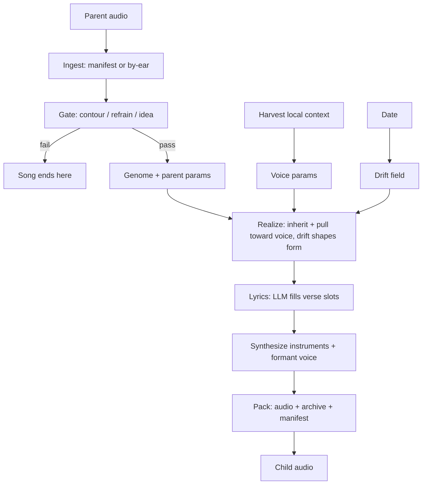

# Songbird: plan

> *History: the plan as it stood on September 24, 2026, four days before the first version. Much of it was built differently:*
> - *the verses are drawn from the song's own bank of lines ([ARRANGE.md](../ARRANGE.md)); no language model writes them, and the program calls no service;*
> - *there is no lineage gate and no ear path: a new version is made from its parent's file and record ([EVOLUTION.md](../EVOLUTION.md));*
> - *the voice sounds through a small learned model ([THROAT.md](../THROAT.md)) in place of formant synthesis;*
> - *`songbird sing` became `python3 song.flac new` and the studio ([PACKET.md](../PACKET.md), [STUDIO.md](../STUDIO.md)).*

The design this prototype is built against, as signed off on 2026-09-24.
Open decisions at the bottom were open then; working notes on them are in the
commit history.

## Concept

Songbird is a folk song whose real artifact is the program that sings it. Each rendition is an audio file with the program embedded inside it. Anyone who runs the program on an existing rendition gets a new one: same song, sung by a voice and instruments derived from the personal but non-identifying context of their own machine, shaped by the moment it was run.

The song's theme is ideas and memories moving through time, and the vehicles that carry them: thoughts that never leave a mind, words put to ink and bits, videos seen around the world, and songs, which stick, mark moments, and cross cultural barriers on their own. The piece confronts the blurred authorship of AI music directly. A rendition is by you, by everyone, and by no one. It can die unheard, or be passed on.

## Principles

These are the invariants. Any design choice that breaks one is wrong even if it sounds better.

1. The program is the artifact. Every rendition ships with the code that made it and the code that makes the next one.
2. Transmission is by record or by ear. Feeding a parent rendition file in is the normal path. Feeding in a human singing from memory is an equally valid path and adds a second layer of drift.
3. The genome is stable, the flesh is regenerated. Melodic contour, stress pattern, rhyme scheme, refrain text and chord functions persist. Pitches, mode, ornaments, tempo, timbre, arrangement and verse lyrics are re-realized every generation.
4. The machine is the voice. A given machine's voice and instrumental timbre are stable, derived from its context. Two machines singing the same parent must sound like two people singing one song, not one machine on two settings.
5. Time is the drift. Drift is always subtle on one machine - the song changes a little day to day, more month to month, most year to year, fuzzily and never on calendar boundaries.
6. Children inherit. A child pulls its parameters from the parent's toward its own context rather than re-deriving from the seed, so lineages accumulate history.
7. The gate checks lineage against the parent, not the seed. Chains may drift as far as they like; the archive records the distance.
8. Nothing identifying leaves the machine. Context is reduced through many-to-one mappings; raw data and listener recordings never travel forward by default.
9. Every rendition is replayable without the network. LLM prompts and responses are stored in the manifest.
10. The LLM is bounded. It fills lyric slots and judges the idea gate. It never touches melody, harmony, timbre or voice by itself **but** the program can be prompted with a command line option to rewrite the code for these (this would be a one-shot change to a limited section of code, not a full-blown coding harness)
11. Death is a valid outcome. If no gate passes, the program says so plainly and the song ends there.
12. Ownership is set aside. CC0 on code and seed. No names in the manifest unless a person chooses one.

## Pipeline

One command: `songbird sing <parent.flac> [--out child.flac] [--date YYYY-MM-DD]`. Parent audio goes in, child audio with embedded program comes out.



The voice harvest and drift sampling are independent of the parent and can be computed once per machine per run. The realize step is the only place the three inputs meet. Each box should be its own module with a pure function interface so any stage can be swapped or tested alone.

## Seed packet

A rendition is one file that is both a playable audio file and a zip archive. A zip appended to a FLAC or WAV stays a valid zip (readers scan from the end) and a valid audio file (players ignore trailing bytes). Alternative if the polyglot proves fragile: a FLAC APPLICATION metadata block holding the archive.

Archive contents:

- `songbird/` the program source, pinned dependency list, and a small bootstrap script
- `manifest.json` this rendition's record
- `genome.json` the song skeleton (see Genome)
- `lyrics.txt` the words as sung
- `LICENSE` CC0

Manifest fields:

| Field | Contents |
| --- | --- |
| `id` | SHA-256 of the audio payload |
| `generation` | integer, seed is 0 |
| `parent_id` | hash of the parent rendition, or null for the seed |
| `ancestry` | list of ancestor ids, oldest first |
| `gate` | which tier passed: `manifest`, `contour`, `refrain`, `idea`, plus the score |
| `path` | `record` (parent file had a manifest) or `ear` (raw recording) |
| `rendered_at` | ISO timestamp used for the drift field |
| `voice` | the derived voice parameter vector, never the raw context |
| `drift` | the sampled drift vector |
| `params` | the realized parameters actually used (key, mode, tempo, form, instruments) |
| `llm` | backend name, model id, every prompt and response verbatim |
| `program_version` | git hash or semver of the embedded program |
| `name` | optional, chosen by the person; default absent |

The listener's own recording on the ear path is not included unless they pass `--keep-recording`.

## Voice

The voice is a fixed-length parameter vector derived from the machine's context. It must be stable across runs on one machine, distinct across machines, and audible in the output. The mapping is many-to-one so the vector cannot be reversed into a fingerprint.

| Signal (local only) | Reduced to | Drives |
| --- | --- | --- |
| Inter-key intervals from a short typing sample, or recent input timing where the OS exposes it | mean, variance, skew | swing ratio, rubato depth, how far ahead or behind the beat the voice sits |
| Locale, keyboard layout, system language | one of a small set of phoneme inventories and mode families | vowel set of the formant voice, which modes the contour is realized in |
| Two-second mic capture of the room, or a clap | impulse response reduced to RT60 and a 5-band tonal profile | the reverb every rendition on this machine lives in |
| File age distribution on the home directory | median age and spread, bucketed | tempo range, how worn the arrangement sounds (detune, noise floor) |
| Wallpaper or screen color histogram | 3-bin hue mass and mean brightness | spectral tilt and brightness of the instruments |
| Word frequencies from the person's own documents | top 200 common words only, proper nouns and rare words dropped | vocabulary offered to the LLM for verse slot fills |
| CPU count, RAM, uptime bucket | coarse buckets | polyphony, layering density |

Rules:

- Each signal collapses to at most a handful of floats before it touches anything else.
- Raw captures (audio, text, file listings) are deleted after reduction and never written to the manifest.
- Everything is opt-out per signal with a flag; a missing signal falls back to the parent's value, so a locked-down machine still sings but sounds more like its parent.
- The reduction is deterministic and documented so a reader can audit exactly what left the machine.
- The typing sample should be a prompt the program shows, not passive keylogging.

## Drift

Time shapes song structure, key and instrumentation through a smooth noise field, so a machine's song changes a little day to day, more month to month, and most year to year with no calendar edges.

Treat the render time as a continuous value t in days since a fixed epoch. Sample a k-dimensional simplex noise field seeded by the voice hash at three octaves and sum them:

```latex
d(t) = 0.15\, N_1\!\left(\frac{t}{1}\right) + 0.35\, N_2\!\left(\frac{t}{30}\right) + 0.5\, N_3\!\left(\frac{t}{365}\right)
```

Each N is an independent noise function with its own seed derived from the voice, so two machines drift along different paths even on the same day. Periods of 1, 30 and 365 days are starting values; a slight irrational scaling (e.g. 1.0, 29.3, 371.6) avoids repeating patterns. The amplitudes are the knob for how much day-to-day change is audible; tune by ear.

Dimensions of d(t) map to:

- form: number of verses, whether the refrain doubles, instrumental break placement
- key: tonic offset in semitones, chosen from the parent's key plus a bounded drift
- mode: which member of the voice's mode family is used
- instrumentation: which of the instrument set play, and their balance
- tempo: a bounded multiplier on the voice's tempo range

Same machine, same instant, same parent gives an identical child. `--date` overrides the clock for testing and for rendering a year of one machine's song in a batch.

## Genome and realization

`genome.json` is the song's skeleton, authored once for the seed by the artist and carried forward unchanged unless the ear path detects a mutation the person sang.

- `contour`: per phrase, a list of relative moves (step up, step down, leap up, leap down, hold) and phrase-final scale degree targets; no absolute pitches
- `rhythm`: stress pattern per line as strong/weak syllables, and the meter
- `form`: section order template, e.g. V R V R B R, with which sections are optional
- `harmony`: chord functions per phrase (I, IV, V, vi and so on), not chords
- `refrain`: the fixed refrain text, never regenerated
- `verse_template`: verse lines as formulaic slots with constraints, e.g. `[vehicle] carries [idea] across [distance]`, plus the rhyme scheme and syllable counts
- `hooks`: the two or three most memorable melodic moments, weighted for the gate

Realization turns genome + parent params + voice + drift into a concrete score:

1. Start from the parent's realized params (key, mode, tempo, ornament density, instrument balance).
2. Pull each toward the voice's own values: `child = 0.4 * parent + 0.6 * voice` as a starting ratio; tune by ear. This is how a lineage keeps its accent.
3. Apply the drift vector for form, key offset, mode choice and instrumentation.
4. Walk the contour in the chosen mode to produce actual pitches, resolving phrase endings to the target degrees.
5. Apply ornaments and rubato from the voice's rhythm parameters.

On the ear path, the extracted contour from the recording replaces the genome contour wherever it differs confidently and the difference survives the gate. That is the only way the genome mutates.

## Synthesis

All sound is generated in code from the realized score; no samples, no presets, no pretrained audio models. This keeps the claim that the program is the whole artifact.

Instruments, physical modeling so parameters are legible and data can drive them:

- Plucked string (Karplus-Strong with a loss filter and pick position): the default melody doubler and accompaniment
- Bowed string (waveguide with a friction nonlinearity): sustained lines
- Blown pipe (waveguide flute or reed): counter-melody
- Struck skin (modal drum): pulse, sparse
- A drone (detuned unison of the plucked model): optional, drift-selected

Voice, formant synthesis in the Klatt tradition: a glottal source (LF model) through 4 to 5 parallel or cascade formant resonators, plus aspiration and frication noise. The voice vector sets f0 range, formant scaling (vocal tract length), breathiness, vibrato rate and depth, and the phoneme inventory. Lyrics are converted to phonemes with a small rule set per inventory; a G2P library is acceptable if it is code, not a model. Diphone transitions can be linear interpolation of formant targets at first.

The room: convolve the mix with the reduced impulse response from the voice harvest. Master to -14 LUFS, export FLAC 44.1 kHz 16-bit.

Quality bar: the voice should sound like an uncanny but sincere singer, not a toy. Budget real time here; it is the second-riskiest module after the gate.

## Lyrics and LLM backend

The refrain is fixed. Verses are regenerated each generation by an LLM filling the genome's slot template, constrained by rhyme scheme, syllable count and stress pattern, and offered the machine's reduced vocabulary as material. The parent's verse lyrics are also given as context so verses drift rather than reset.

Prompt shape: system prompt states the song's theme and the constraints; user prompt gives the template, the parent's verses, the vocabulary list and the drift-chosen verse count; the model returns JSON lines. The program validates syllable count and rhyme with a rule-based check and re-asks up to three times before falling back to the parent's verses.

Backend interface, one function:

```python
def complete(system: str, user: str, *, seed: int) -> str: ...
```

Ship three implementations behind a config file:

1. `hosted`: the artist's endpoint, on by default in the first distribution, with a hard sunset date baked in
2. `openai_compatible`: any base URL plus key, covering most hosted and local servers
3. `local`: llama.cpp or Ollama with a suggested small model, for people who bring their own

When the hosted backend is dark and nothing else is configured, the program still renders using the parent's verses and records `llm: null` in the manifest. The song keeps going, just without new words, until someone brings a voice. Every prompt and response is stored verbatim in the manifest so any rendition replays offline.

The idea-gate judge uses the same interface.

## Lineage gate

The gate answers one question: is this audio descended from the parent? Tiers run in order and the first pass wins. The tier is recorded and may shape the rendition.

| Tier | Test | Passes when | Effect on child |
| --- | --- | --- | --- |
| manifest | file contains a valid songbird archive whose audio hash matches `id` | always, if intact | normal rendition; record path |
| contour | pitch-track the input (pYIN or CREPE), quantize to relative moves, DTW against the parent's realized contour, weighted toward `hooks` | normalized distance under a threshold on at least one full phrase | ear path; sung deviations may replace genome contour |
| refrain | local ASR (whisper small or tiny) on the input, fuzzy match against refrain text | word-level similarity over a threshold | ear path; contour taken from the parent, words as sung may vary |
| idea | LLM judges whether a transcript or description carries the central idea | model says yes with stated reasoning, stored | ear path; melody and words re-realized from genome, largest drift allowed |

A whistle, a fiddle or a hum can pass on contour alone; no language is required. A person singing a translation can pass on idea. If every tier fails, the program prints one plain sentence saying the song was not recognized and stops. No child is written.

Thresholds are the main tuning work. Build a small test set early: the seed rendition, the seed sung by three people from memory, the seed hummed, the seed on an out-of-tune instrument, and three unrelated songs. The contour tier should pass every derived recording and fail every unrelated one before anything else is built on top.

## Tech stack

Python 3.11+, pinned with a lockfile, so the archive runs the same way in five years as it does now.

| Need | Choice | Note |
| --- | --- | --- |
| DSP and synthesis | numpy, scipy | write the physical models and formant synth by hand; numba if speed becomes a problem |
| Audio I/O | soundfile | FLAC and WAV read/write |
| Pitch tracking | librosa pyin, or CREPE if pyin is too noisy on rough recordings | pyin first, it has no model weights |
| Alignment | a small DTW implementation, or fastdtw | contour gate |
| ASR | faster-whisper, tiny or small model | refrain gate only; optional install, gate skips the tier if absent |
| Noise | opensimplex | drift field |
| Phonemes | hand-written rule sets per inventory; g2p\_en as a fallback for English | keep it code, not weights |
| LLM | httpx against the `complete` interface | no vendor SDK in the core |
| Packaging | zip appended to FLAC; a `bootstrap.sh`/`bootstrap.py` that creates a venv and installs from the lockfile | test that `python song.flac` or an extracted script runs cold on a clean machine |
| Tests | pytest, with the gate test set as fixtures | golden renders for determinism checks |

Keep the dependency count low and every dependency pure Python or wheels available for macOS, Linux and Windows. Anything that needs model weights must be optional. Structure the repo as `songbird/{harvest,drift,genome,realize,synth,lyrics,gate,pack,cli}.py` matching the pipeline boxes.

## Prototype milestones

Build in this order. Each milestone has something to listen to.

1. Genome and deterministic render. Author `genome.json` for the seed by hand. Realize it with fixed params and render with the plucked string only, no voice. Goal: the tune exists and a golden render is byte-identical across runs.
2. Formant voice. Sing the refrain over the string. Goal: a listener can make out the words and it does not sound like a toy. Iterate here until it does.
3. Voice harvest and mapping. Implement the reduction table, render the seed on two different machines. Acceptance test: play both to someone blind; they should say two people are singing one song. If they say one machine on two settings, widen the mapping ranges.
4. Drift field. Render one machine's song for 365 dates in a batch and listen to a day, a month and a year apart. Tune amplitudes.
5. Inheritance. Chain seed to child to grandchild with three different voice vectors. Goal: the grandchild still carries something of the child that the seed lacks.
6. Seed packet. Append the archive to the FLAC, verify it plays in three players and extracts with three unzip tools, and that bootstrap runs cold on a clean VM.
7. Contour gate. Record the test set, tune thresholds, wire the ear path.
8. Lyrics. Slot template, prompt, validation, hosted and local backends. Then refrain and idea gates.
9. Distribution. The exchange: submit a rendition, receive one back; opt-in public archive rendered as a lineage tree with dead branches visible.

Milestones 1 to 3 are the proof of concept. If 3 fails, nothing downstream matters.

## Open decisions

- [ ] The seed song itself: melody, refrain text, verse template. We'll write this together - draft some verses to explore a few different directions while I'm still feeling this out.
- [ ] Inheritance ratio (starting at 0.4 parent / 0.6 voice) and drift amplitudes, both tuned by ear in milestones 3 to 5.
- [ ] Whether the ear path's contour deviations should mutate the genome (proposed yes) or only the rendition.
- [ ] Polyglot FLAC versus a metadata block for the archive; decide after milestone 6 testing.
- [ ] Whether a rendition can carry an optional chosen name, and what the public archive shows.
- [ ] Whether the program itself may mutate in later phases (forkable tradition) or stays fixed. Out of scope for the prototype.
- [ ] Exchange mechanics: central server, email, or file drop. Out of scope for the prototype.
